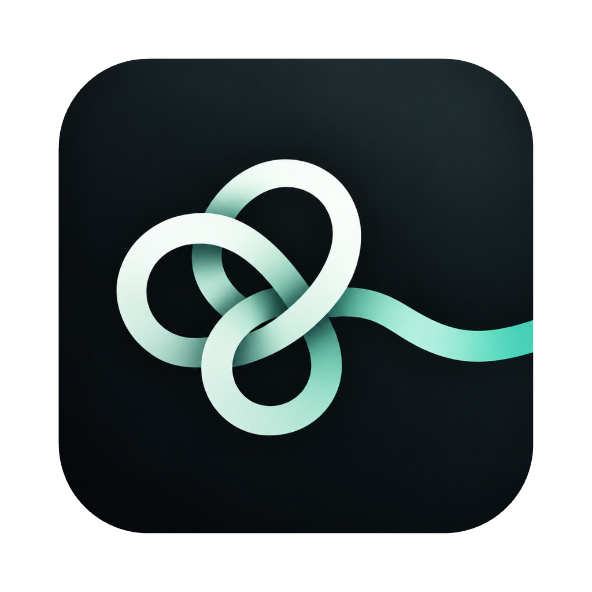
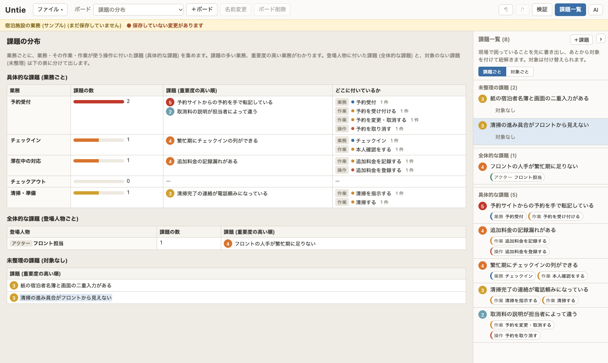
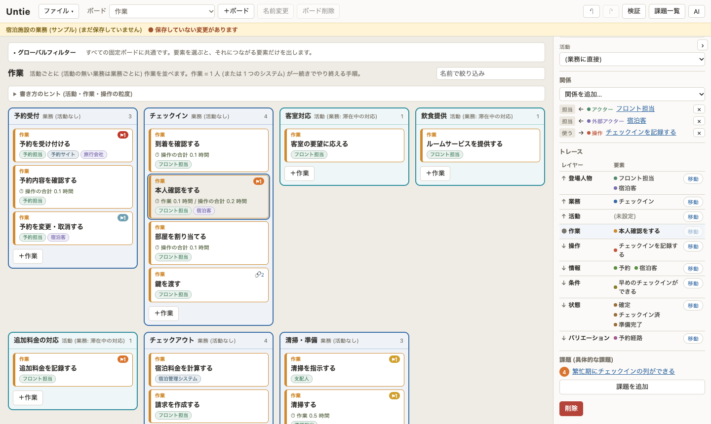
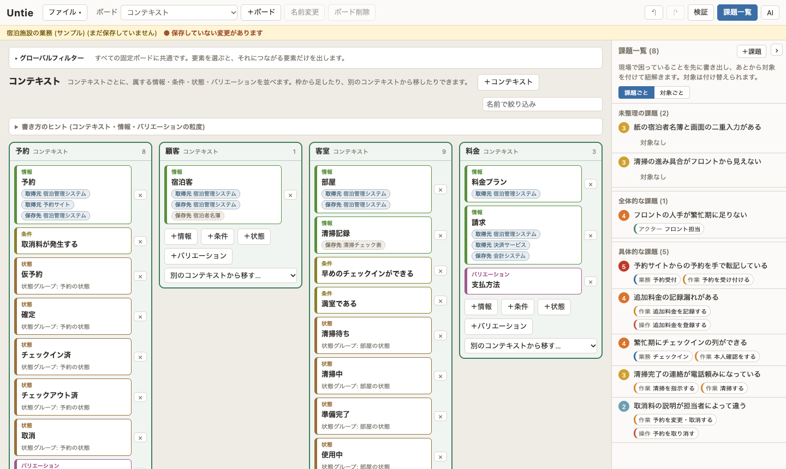
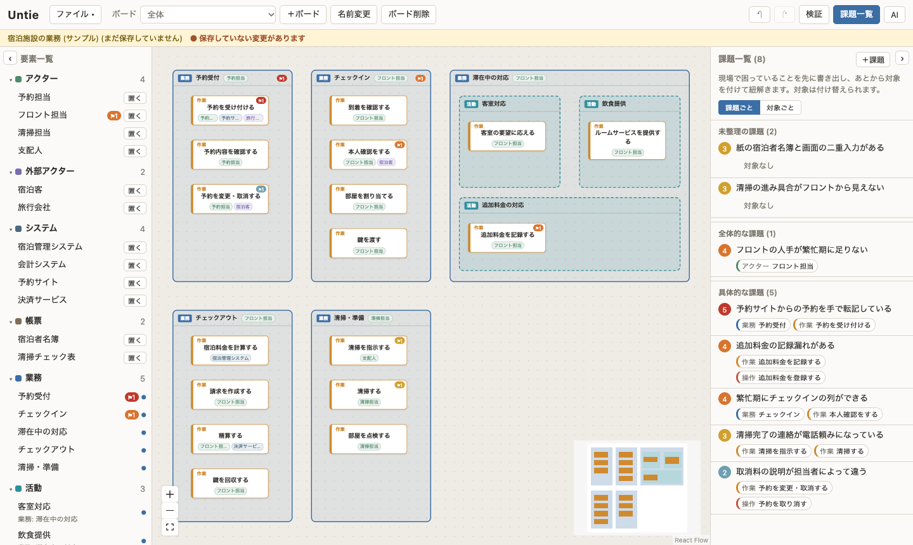
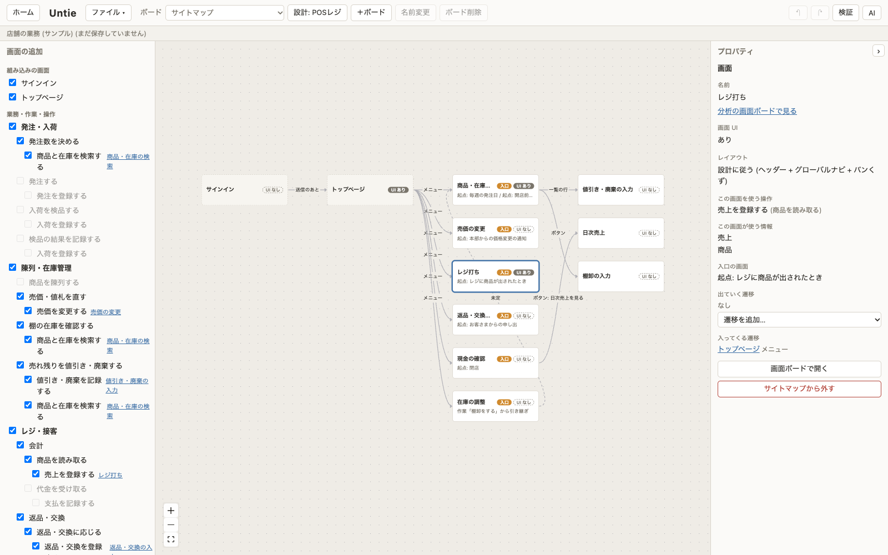
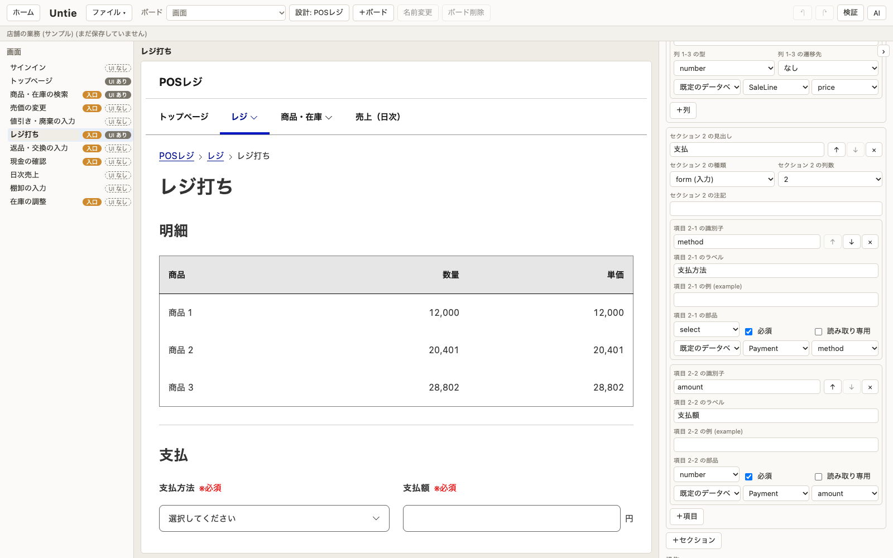
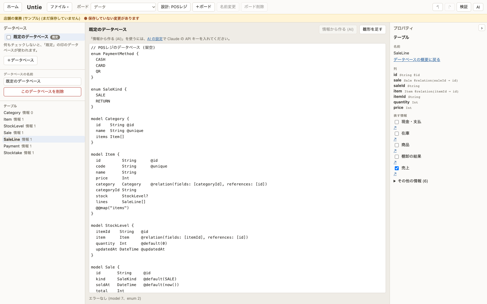
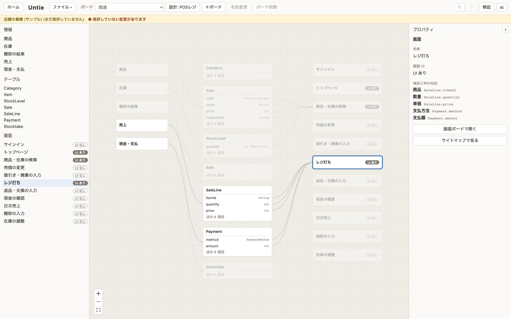

<p align="center">
  
</p>

# Untie

Untie は、業務整理を行いながら、現場が感じている困りごとが業務のどこに潜んでいるかを突き止めるためのツールです。

## 考え方

課題は、新しく見つけ出すものではありません。現場の担当者はすでに「ここが困る」という課題感を持っています。足りないのは、その困りごとが業務のどの活動・作業・つながりから生まれているのかという具体的な所在と、なぜそこで困りごとが発生しているのかという理由です。

Untie は次の流れを想定しています。

| | 段階 | すること | Untie |
| --- | --- | --- | --- |
| 1 | 課題感を持ち寄る | 担当者が感じている困りごとを、そのまま書き出す | 補助する |
| 2 | 所在と理由を突き止める | 業務を整理しながら、どの活動・作業・つながりに問題が潜んでいるか、なぜそこで起きているかを突き止める | 補助する |
| 3 | 認識を揃える | 突き止めた所在を図と表で見せ、関係者のあいだで認識を揃える | 補助する |
| 4 | 手段を決める | 突き止めた所在・理由・影響をもとに、システム化するか、担当や帳票の見直しで済むかを決め、要件定義・開発へ進める | 課題の分析 (現象・所在・理由・影響)・重要度・作業の時間を判断の根拠として渡す。システム化を決めたシステムは、設計モードでサイトマップ・ナビゲーション・画面・データを分析のモデルから組み立てる |

Untie が主に補助するのは前半の 1〜3 です。出口は「手段を決める前」で、課題ごとに現象・所在・理由・影響・重要度・対象が揃い、所在をモデルの要素として指差せる状態を目指します。整理した結果は RDRA に沿ったモデルとして残します。後半の手段の検討から要件定義・開発へは、課題の分析と重要度を優先順位の根拠に、作業の時間を現状の数字に使い、このモデルを手がかりにつなげます。システム化を決めたシステムについては、設計モード (「4. システムの設計へつなぐ」) で、分析の作業・操作・画面・情報からサイトマップ・画面 UI・データベースの設計を導き、分析とのつながりを検証できます (RDRA モデルとして展開し、要件定義に直接使えるようにするのは今後の目標です)。

大事なのは「感じている困りごとの所在を具体化する」ことです。業務を整理すること自体が目的ではなく、最初からシステム化を前提にするものでもありません。業務の整理は、困りごとの所在を突き止めるための手段です。

このリポジトリは PoC (概念実証) です。モデルは JSON ファイルに保存・読み込みできます (「開く」「保存」、Cmd/Ctrl+O・Cmd/Ctrl+S)。クラウドにファイルを置いて、共有し、同時に編集することもできます (「クラウドファイル」)。起動するとホームが開きます。ホームのサンプルの一覧から「宿泊施設の業務」を選ぶと、架空の宿泊施設のサンプルが、分析ボード「課題の分布」と右の課題一覧を開いた状態で表示されます。

## できること

### 1. 課題感を持ち寄る

- 課題一覧の「＋課題」で、対象を決めずに課題を書き出せる。「次の課題を登録する」で続けて書ける
- 重要度 (1〜5) を付けられる。対象のない課題は「未整理」として残り、検証パネルにも件数が出る



### 2. 所在と理由を突き止める

- **固定ボード** (レイヤーごとに 10 枚): 登場人物 → 業務 → 活動 → 作業 → 操作 → 情報・条件・状態・バリエーションと、上から順に業務を詳細化する。上位の要素を枠にして下位の要素を自動で並べ、名前で絞り込める。要素の作成・削除、所属と関係の変更はここで行う
- **課題の対象を付ける・付け替える**: 業務・作業・操作・画面に付けると「具体的な課題」、登場人物 (アクター・外部アクター・システム・帳票) に付けると「全体的な課題」として分かれる。所在の見当が外れていたら、あとから付け替えられる
- **AI と深掘りする**: 課題のプロパティ欄から始めると、下のペインで AI が現象 → 所在 → 理由 → 影響の順に質問を重ねる。質問には AI の見立て (➡️ 推奨) が付き、「はい」で採れる。業務モデルにある事実は AI がモデルから読むので、答えるのは現場の人しか知らないことだけ。最後にまとめを確認すると、課題の分析 (現象・所在・理由・影響)・重要度・対象が更新される。担当者が書いた課題の説明はそのまま残る
- **AI とドメインモデルを決める**: 設計モードのドメインボードで「AI で下書き」を押すと、分析から導いた候補と気づきから、そのシステムの境界づけられたコンテキスト・集約と不変条件・コマンドとイベントの意図の名前と英語名をまとめて作る (そのシステムだけのコンテキストを置き換える。分析は変えない)。「AI と決める」は、下のペインで AI が問いを出し (推奨つき。「はい」で採る)、答えながら 1 つずつ決めて保存する。分析の誤りに気づいたら、課題として残す。
- **ドメインモデルを書き出す (distill-ddd)**: 「ファイル」メニュー (かコンテキストマップ) の「ドメインモデルを書き出す (distill-ddd)…」で、決めたドメインモデルを [distill-ddd](https://github.com/tango238/distill-ddd) (`/ddd` スキル) の成果物の形式 (`event-storming.md`・`bounded-contexts.md`・`context-map.md`・`aggregates.md`・`domain-events.md`・`glossary.md` と `.ddd-session.json`) で書き出す。リポジトリの `docs/domain` フォルダを選ぶと、そのまま `/ddd --resume` で続きのフェーズ (discovery から) に進める。フォルダを選べないブラウザでは zip になる。英語名の無いコマンド・イベントは distill-ddd の図に出ないので、設計モードの検証で確かめておく。
- **ペルソナと困りごとのヒアリング**: アクター・外部アクターには、呼び名・属性・背景・目標・IT の習熟・備考からなる「ペルソナ」を持たせられる (プロパティ欄。登場人物のボードのカードにも呼び名と属性が出る)。そのプロパティ欄の「困りごとをヒアリングする」から、下のペインでヒアリングを始める。答え方は 2 つ。「人間が聞いて、AI が答える」(既定) は、AI がその人になりきって答え、あなたが質問して困りごとを探る (答えはすべて仮説で、ペルソナが無ければ仮のペルソナを作って保存を提案する)。「AI が聞いて、人間が答える」は、AI が現場の人に業務・作業の流れに沿って質問する。どちらも「まとめる」で困りごとを課題の案にして確認し、了承すると課題 (現象・所在・理由・影響・重要度・対象つき) を登録する。既存の課題に近ければ追記を提案する
- **イベントの発生タイミング**: イベントには、いつ起きるかを持たせられる (プロパティ欄。カードにも 1 行で出る)。「定期」は毎月・毎日・毎時に繰り返すバッチ処理で、日・時・分を決める。「不定期 (随時)」は Webhook などから API が呼ばれたときのような処理で、いつ起きるかを書く
- **トレース**: 選んだ要素から上 (担い手) と下 (詳細) へ辿り、レイヤーごとに表で出す。まだつながりの無いレイヤーも「(未設定)」で出し、そこへ移って埋めていける
- **検証**: すべての要素が担い手まで辿れるかを調べ、途切れている箇所を知らせる。エラーとして、1 つの画面を複数の操作が使っているものも知らせる。エラーではなく警告として、1 つの業務に複数のアクターが付いているものも知らせる
- **作業の起点**: 作業ボードで作業を選ぶと、プロパティ欄の「起点」で、起点の作業・イベントを足す・外し、その他 (電話など) を書ける。カードには起点の要約が出る
- **操作とイベントの流れ**: 操作の固定ボードで、作業ごとに「きっかけのイベント → 操作 → 発生するイベント」の順に並べ、イベントは色を分けて出す (操作どうしは「次に」でつなぐ)。人が担当しない自動の処理は、イベントをきっかけに動く操作として「作業なし (イベントから)」にまとめる
- **システムの画面と非機能要件**: システムごとに画面 (操作が使う) と非機能要件 (分類・検証方法・求める人) を持てる。システムは作業の担当ではなく、操作の対象として結ぶ (1 つの操作の対象は、システム・帳票・画面のどれか 1 つ)。情報の置き場所 (取得元・保存先) と画面が扱う情報は、操作が扱う情報 (取得・保存の区別) と対象から導くので、別に入力しない
- 関係は RDRA に沿った型付き。両端の種類から関係が自動で決まり、あり得ない組み合わせは結べない





### 3. 認識を揃える

- **分析ボード** (3 枚。開発モードでは「イベントストーミング」を足した 4 枚): 課題の分布 (業務ごとの具体的な課題・登場人物ごとの全体的な課題・未整理の課題)、担当別の作業一覧 (マニュアルのリンク・時間付き)、情報の所在、イベントストーミング (分析からドメインモデル (DDD) の候補 (コマンド・集約・ドメインイベント・ポリシー・読み取りモデル) を導き、境界やあるべき姿の判断を「問い」として出す。保存はしない)
- **自由ボード** (いくつでも): レイヤーに関係なく要素を置き、説明しやすい図を作る。線の付け根も変えられる。所属や関係は変えない (表示だけ)



### 4. システムの設計へつなぐ

- **モード** (分析（簡易）・分析（詳細）・設計): 「ファイル」メニューの「モード」で切り替える。既定は分析（簡易）で、アプリを開いたとき・サンプルやファイルを開いたときは、簡易のワークフローから始まる (分析（簡易）・分析（詳細）のどちらにいても、ファイルを開き直してもそのモードを保つ)。分析（詳細）は、上の固定ボード・分析ボード・自由ボードを使う。分析（簡易）は、3 枚のボードで書くモードです。「ワークフロー」は登場人物・業務・活動・作業を 1 枚で書き、登場人物から業務を、業務から活動と作業を生やして書く (業務と活動は枠、作業は枠の中に縦に並ぶ)。「システム操作」は作業・操作・画面・情報・条件を 1 枚で書き、活動 (無ければ業務) の枠の中に作業を並べ、作業ごとに使う操作、操作ごとに使う画面・扱う情報・判断する条件を足していく。「情報と状態」はコンテキスト・情報・バリエーション・状態を 1 枚で書き、コンテキストの枠の中に情報を並べ (種別のバリエーションを枝で生やす)、状態は状態グループごとに並べる。選ぶと右のプロパティで関連の追加・削除と削除ができ、子 (活動・作業など) のあるものを消すときは確認が出る。簡易と詳細はボードの数と見せ方が違うだけで同じモデルを扱うので、どちらで作ったものもそのまま行き来して見られる・直せる。設計に切り替えると設計するシステムを選び、ボードの選択肢がそのシステムの設計ボード 6 枚 (サイトマップ・ナビゲーション・データ・画面・関連・シーケンス図。先にデータを作り、そこから画面を作る) と自由ボードになる。シーケンス図は、業務ごとに、誰が・どのシステムに・何をして・何が起きるかを分析から導いて見せ、条件で流れが変わるところ (分岐) で「そのときどうなるか」を決める (開発を始める前に、ふだんと違う流れを出し切るため)。開発モード (下の「開発」の「開発モード」の節) では、内部のドメインモデルを直に扱う「ドメイン」「コンテキストマップ」も出る。ドメインは、分析から導いたドメインモデル (DDD) の候補 (コンテキスト・集約・コマンド・イベント・用語) をそのシステムにしぼって見せ、境界づけられたコンテキスト・集約と不変条件・意図の名前と英語名・分析に無いあるべき姿のコマンドとイベントを決めて保存する (「候補から作る」で、候補をまとめて保存してから直せる)。コンテキストマップは、コンテキストのあいだのつながり (分析から導く) に、関係の種類と統合の方式を決める。設計データはモデル (JSON) の `designs`・`databases` に、ドメインモデルの判断 (境界づけられたコンテキスト・集約・不変条件・コンテキスト間の関係・用語) は `domain` に入る。モードは保存しない (設計モードでファイルを開き直すと、既定の分析（簡易）に戻る)。設計まで進んだシステムを分析で消すときは確認が出て、設計データも一緒に消える
- **サイトマップ**: 左の木で組み込みの画面 (トップページ・サインイン・ホーム) や、業務・作業・操作にチェックを入れると、その画面が遷移と一緒にサイトマップへ加わる (遷移は、操作の「次に」の連鎖や作業の起点から自動で導く。担当やシステムが違って遷移にできなかったものは、入口の画面の注記に出る)。中央の図は画面ごとに入口と画面 UI の有無 (UI あり / UI なし) を示し、画面を選ぶと右で遷移のきっかけ (ボタン・一覧の行・メニュー・送信のあと) や文言を直せる。外すとその画面と遷移が消える (画面設計に進んでいる画面は確認する)
- **ナビゲーション**: 左でナビゲーションメニューのグループと項目を並べ、右で共通の枠 (ヘッダー + グローバルナビ + パンくず / 枠なし) とヘッダーの項目を決めると、中央に [mokkun](https://www.npmjs.com/package/mokkun) で描いた画面のプレビューが出る (メニューやボタンを押して画面を移れる)。メニューは「サイトマップから作る」(画面を業務ごとにグループ化) か、「AI で考える」(AI の設定が必要) で作れる
- **画面**: 左のサイトマップの画面を選ぶと、中央に mokkun で描いたプレビューが出る。右の上で画面の目的と、その画面だけのレイアウト (設計に従う / 枠を上書き。サインインだけ枠なしにする、など) を決め、画面 UI を組み立てる: セクション (入力・一覧・表示・要約)・項目 (ラベル・例・部品・必須など)・一覧の列・ボタンをフォームで足し、項目や列をデータベースのテーブルの列に結べる。YAML で直接書くこともでき、「AI で作る」(AI の設定が必要) は、画面の材料とテーブルの列から画面 UI と列の対応を作る
- **データ**: 左でデータベースを選び (設計ごとに使うものをチェック。何もチェックしないと既定のデータベース。1 つのシステムで複数のデータベースを使え、データベースは設計をまたいで共有する)、中央でテーブルと列を、図 (ER 図) かテキストの DSL (Prisma のスキーマの一部。`model` / `enum`) で編集すると、左にテーブルの一覧が出る。図ではテーブル・列の追加・名前変更・削除、列の型や主キー・一意・NULL 可の切り替えができ、列の右の点から参照する列へ線を引くと関連 (外部キー) になる。図の操作も DSL を書き換えるので、「図」と「テキスト」はいつでも行き来できる。右で、テーブルが表す情報 (分析の情報) を結ぶ (1 つの情報に複数のテーブルを結べる)。「雛形を足す」は、システムが使う情報のうちまだテーブルに対応していないものの `model` を足し、「情報から作る (AI)」は、その情報から DSL と対応を AI に作らせる (AI の設定が必要)。既存の DDL などは AI エージェントに貼れば、DSL に組み立ててもらえる
- **関連**: 分析の情報 → テーブル (画面が使う列を行で出す) → 設計の画面 を 3 列の図で見る読み取り専用のボード。線は情報とテーブルの対応と、テーブルの列と画面の項目の対応。テーブルに未対応の情報と、列の対応が無い項目のある画面には印が付く。選ぶとつながる範囲だけが残り、右から各ボードへ移れる
- **設計の検証**: 設計モードの「検証」は、使う情報がテーブルに対応しているか・DSL が読めるか・遷移のきっかけが決まっているか・メニューからも遷移からも辿れない画面が無いか・画面 UI の項目に列の対応があるかなどを調べる









### 進めるのを助ける機能

- **AI エージェント**: 下のペインで AI と会話して、編集中のモデルを自然言語で直す。「ファイル > プロンプトから作成」で、初期要望の文章からモデルを作り、そのまま会話を続けられる。AI は Claude (Anthropic)・Codex (OpenAI)・Gemini (Google) から選び、API キーは「AI の設定」で入れる (OS のキーチェーンに保存)
- 扱う要素は 17 種: アクター / 外部アクター / システム / 帳票 / 業務 / 活動 (BUC) / 作業 (アクティビティ) / 操作 (ユースケース) / イベント / 画面 / 非機能要件 / コンテキスト / 情報 / 状態 / バリエーション / 条件 / 課題
- Undo / Redo (Cmd/Ctrl+Z、Shift+Cmd/Ctrl+Z)
- **キーボードショートカット**: Cmd/Ctrl+B で一覧を開きます (行を押すとその場所へ移れます)。開いている間に次のキーを押すと、ボードやモードへ移れます (例: Cmd/Ctrl+B → 5 で操作ボード、Cmd/Ctrl+B → F で分析（簡易）のワークフロー、Cmd/Ctrl+B → P でシステム操作、Cmd/Ctrl+B → H で情報と状態、Cmd/Ctrl+B → S で設計モードのサイトマップ)


### クラウドファイル (ログイン・共有・同時編集)

クラウド版 (ブラウザ) と、サーバーにつないだデスクトップ版で、ファイルをクラウドに置いて、他の人と共有し、同時に編集できます (Web 版はローカルのファイルだけです)。ローカルのファイルはこれまでどおり、ログインなしで開いて保存できます。

- **ログイン**: Google のアカウントでログインします (パスワードは持ちません)。ホームの「クラウド」から入ります。デスクトップ版はブラウザでログインして、アプリに戻ります
- **ホーム**: 「自分のファイル」「共有されたファイル」「ゴミ箱」を並べます。ファイルを作る・名前を変える・複製する・JSON に書き出す・ゴミ箱に入れる、ができます。ゴミ箱に入れたファイルは 30 日たつと完全に消え、それまでは所有者が戻せます。いま開いているローカルのモデルは、ファイルメニューの「クラウドへ保存」でクラウドに複製できます
- **入力できる長さ**: 名前は 200 文字、説明は 4000 文字までです (状態グループ・バリエーションの値・リンクの表示名は 200 文字、分析の各項目は 4000 文字、リンクの URL は 2000 文字)。超える入力は断られます。また、クラウドに置けるモデルは **1 MB まで**です (取り込む JSON が 1 MB を超えると断られます)。
- **同時編集**: 複数人が同じファイルを同時に開けます。ほかの人が選んでいる要素には、その人の色の縁と名前が出ます。同じ項目を同時に変えたときは後から届いた方が残ります。**クラウドのファイルでは Undo / Redo は使えません** (共有中は、ほかの人の変更と絡んで結果が読めないため)。戻したいときは、書き出しておいた JSON から開き直します。誤って消したときは、所有者が共有ダイアログの「過去の状態」(1 時間ごとの、その時間の最初の編集の直前の状態を 24 件まで) から JSON に書き出せます
- **共有**: 所有者がファイルの「共有」から、メールアドレスで招待します。役割は **owner (所有者)**・**editor (編集者)**・**viewer (閲覧者)** です。まだログインしたことのない人宛の招待は、画面に出る招待リンクを写して送ってください (メールは送りません)。招待された人はそのリンクを開き、ログインして「受ける」を押すとメンバーになります
- **リンクを知っている人の閲覧**: 所有者が有効にすると、リンクを知っている人は、ログインなしで閲覧だけできます。無効にするか作り直すと、前のリンクは使えなくなり、閲覧中の人は切断されます。編集できるリンクはありません
- **閲覧専用**: viewer とリンクで開いた人は、要素を選べますが、編集と AI エージェントは使えません。ログインすれば、リンクのファイルを「複製して自分のファイルにする」ことはできます

| | owner | editor | viewer | リンク閲覧 |
| --- | --- | --- | --- | --- |
| 開く・書き出す | ○ | ○ | ○ | ○ |
| 編集する・名前を変える | ○ | ○ | – | – |
| 共有する (メンバー・招待・リンク)・所有者を譲る・ゴミ箱 | ○ | – | – | – |
| 複製する | ○ | ○ | ○ | ログインすれば ○ |

- サーバーが保存できなくなったときは、画面の上に「サーバーに保存できていません。JSON に書き出して保存してください」と出ます。そのときは、書き出して手元に残してください。
- ログアウトすると、そのセッションで開いていたファイルの接続も閉じます (「すべての端末からログアウト」はすべての接続を閉じます)。
- AI の API キーは自分の端末にだけ置き、サーバーには送りません。クラウドに置くのはモデルの中身だけです

設計の詳細は [docs/design.md](docs/design.md)、クラウド版 (ユーザー・権限・ログイン・同時編集・サーバー) の設計は [docs/collab-design.md](docs/collab-design.md)、データモデルは [schema/untie.schema.json](schema/untie.schema.json) を参照してください。

## インストールと開き方

[Releases](https://github.com/tango238/untie/releases) から、お使いの OS 向けのファイルをダウンロードしてください。アプリは署名していないため、初回起動時に OS の警告が出ます。

### Mac (Apple Silicon)

1. `.dmg` を開き、Untie.app をアプリケーションフォルダにコピーします。
2. Finder で Untie.app を **右クリック (または control キーを押しながらクリック) → 「開く」** を選びます。
3. 「開発元を確認できません」の警告が出たら、もう一度「開く」を押します。2 回目以降は普通にダブルクリックで起動できます。

それでも開けない場合は、ターミナルで次を実行してから開いてください。

```sh
xattr -dr com.apple.quarantine /Applications/Untie.app
```

Intel Mac は対象外です。

### Windows (x64)

1. `.msi` または `-setup.exe` をダウンロードして実行します。
2. SmartScreen の「Windows によって PC が保護されました」が出たら、**「詳細情報」→「実行」** を押します。


### ブラウザ (Web 版とクラウド版)

ブラウザで使う版は 2 つあり、配信先も別です。利用者はどちらもインストールが要りません。

| | Web 版 | クラウド版 |
| --- | --- | --- |
| できること | このパソコンのファイル (JSON) を開いて編集する。ログインは無い | Web 版に加えて、ログインしてファイルをクラウドに置き、共有・同時編集する |
| 入り口 | `apps/web` | `apps/cloud` (画面) + `apps/server` (API・ログイン・ルーム) |
| 配信 | Cloudflare Pages (静的なサイト。サーバーを持たない)。手順は「Web 版の配信 (Cloudflare Pages)」 | Cloudflare Workers + D1 + Durable Objects。手順は「クラウド版の配信 (Cloudflare Workers)」 |

画面は同じ `packages/ui` です。Web 版はホームにクラウドの欄を出さず、配信元のサーバーには何も送りません。アプリとの違いは次のとおりです (両方に共通)。

- **保存 (ローカルファイル)**: Chrome・Edge では、開いた (または一度保存した) ファイルにそのまま上書きします。それ以外のブラウザでは、保存のたびにダウンロードになります。クラウド版のクラウドファイルに保存の操作は要りません (つながっている間は常に反映されます)。
- **API キー**: ふだんはタブを閉じるまでだけ覚えます。「AI の設定」で「このブラウザに保存する」を選ぶと、次に開いたときも使えます (ブラウザの localStorage に置くので、共用のパソコンでは選ばないでください)。キーはブラウザから各社の API に直接送り、配信元のサーバーには送りません。
- **閉じる前の確認**: 保存していない変更があると、タブを閉じる前にブラウザが確かめます。クラウドファイルでは、つながっていない間の変更がまだ送れていないときだけ確かめます。

### デスクトップ版でクラウドを使う

ローカルのファイルを編集するだけなら設定は要りません。クラウドのファイル (保存・共有・同時編集) を使うときは、クラウド版のサーバー (`apps/server`) につなぎます。次の順に進めます。

1. **初回にサーバーの URL を設定します**。ホームの「サーバーの設定」に、使うサーバーの URL (例: `https://untie.example.com`) を入れて「保存」します。サーバーを変えるとログアウトします (別のサーバーにログインのトークンを送らないため)。サーバーの URL は `https://` のものか、開発用の `http://localhost`・`http://127.0.0.1` で、パスやクエリは付けられません。リリース版は `https://` のサーバーだけにつながります。
2. **ログインはブラウザでします**。「Google でログイン (ブラウザが開きます)」を押すと既定のブラウザが開き、ログインが済むと `untie://` でアプリに戻ります。ブラウザが「Untie を開きますか」と聞くので、許可してください。ログインのトークンは OS のキーチェーンに保存します。
3. **アプリに戻らないときは引換コードを貼ります**。ブラウザの「アプリに戻ります」の画面にコードが出ているので、「コピー」して、アプリのログイン欄 (「ブラウザでログインしています…」の下) の「引換コードを貼る」に貼って「ログインする」を押します。コードは 5 分間、1 回だけ使えます。

アプリは、サーバーの URL を設定で変えられるように、通信先に `https:` と `wss:` 全体を許しています (`apps/desktop/src-tauri/tauri.conf.json` の CSP の `connect-src`。JSON なのでコメントを書けず、理由はここに残します)。スクリプトは自分のものしか読めません。通信先を特定のサーバーだけに絞りたいときは、サーバーの URL を固定したビルドにして `connect-src` をそのホストだけにしてください。

#### `pnpm tauri dev` で deep link を試すとき

- 手元のサーバーにつなぐには、別のターミナルで `pnpm --filter @untie/server dev` (8787) を動かし、アプリのサーバー設定に `http://localhost:8787` を入れます。`DEV_LOGIN=true` なら「開発用ログイン (ブラウザが開きます)」で試せます。開発ビルドの CSP だけが `http://localhost:8787` への通信を許します。サーバーの CORS は `tauri dev` の `http://localhost:1420` を `DEV_LOGIN=true` のときだけ許します。
- Linux / Windows の `tauri dev` は、起動時に `untie://` を実行時に登録します (動いているアプリへ渡すため single-instance プラグインを使います)。Linux では `update-desktop-database` が要ります。
- Linux 向けのファイルは配布していませんが、自分でビルドした Linux 版 (AppImage) はリリース版でも起動のたびに `untie://` を登録します (`~/.local/share/applications/` に `.desktop` を置きます)。`update-desktop-database` が無い環境や、デスクトップ環境が `untie://` を既定のアプリに結び付けない環境では、ブラウザの画面の引換コードを貼ってください。
- **macOS の `tauri dev` では `untie://` が届きません**。`untie://` は `.app` の Info.plist で決まるので、`pnpm app:build` で作ったアプリを使うか、`tauri dev` では引換コードを貼ってください。

## 開発

必要なもの: Node.js 22、pnpm 10。デスクトップアプリ (`pnpm tauri ...`) を作るときは Rust (rustup の stable) も要ります。Tauri 2 の前提条件は [Tauri の公式ドキュメント](https://tauri.app/start/prerequisites/) を参照してください。Web 版・クラウド版だけなら Rust は要りません。

### 構成

pnpm ワークスペース (モノレポ) です。ビルドはせず、Vite・Vitest・Worker が各パッケージの TypeScript を直接読みます。

| 場所 | パッケージ | 役割 |
| --- | --- | --- |
| `packages/core` | `@untie/core` | モデル (型・スキーマ・id・関係ルール・コマンド・検証・固定ボード・分析・トレース)、サンプル。React にも DOM にも依存しない |
| `packages/api` | `@untie/api` | サーバーと画面で共有する契約 (DTO と zod スキーマ、役割と権限、fetch クライアント) |
| `packages/collab` | `@untie/collab` | 同時編集 (Y.Doc とモデルの往復、壊れた参照の修復、ルームの Durable Object) |
| `packages/ui` | `@untie/ui` | React の画面とストア。Web 版・クラウド版・デスクトップで共通 |
| `apps/web` | `@untie/web` | Web 版 (ローカル専用) の入り口 (Vite)。ブラウザの `Platform` の実装 (`src/platform.ts`) もここで、クラウド版も使う。Cloudflare Pages で配る |
| `apps/cloud` | `@untie/cloud` | クラウド版の画面の入り口 (Vite)。`apps/web` の `Platform` を `cloud: true` で使う。`apps/server` の Worker が配る |
| `apps/desktop` | `@untie/desktop` | デスクトップの入り口 (Vite + Tauri 2。`src-tauri/` が Rust) |
| `apps/server` | `@untie/server` | クラウド版のサーバー。Cloudflare Worker (API・ログイン・`apps/cloud/dist` の配信・ルーム)。D1 のマイグレーションと `wrangler.jsonc` もここ |

ファイルやキーの置き場所、ログインなどブラウザとデスクトップで違う処理は、`packages/ui/src/platform.ts` の `Platform` を通し、実装を `apps/web/src/platform.ts` と `apps/desktop/src/platform.ts` に置いています。クラウドの機能 (ホームのクラウドの欄・ログイン・`#/f`・`#/invite`・`#/link`) を出すかは `Platform.cloud` で決まり、Web 版だけが `false` です。設計は [docs/collab-design.md](docs/collab-design.md) の 2 章を参照してください。

### コマンド

```sh
pnpm install
pnpm dev            # Web 版 (ローカル専用) を動かす (http://localhost:5174)
pnpm dev:cloud      # クラウド版の画面とサーバーを同時に動かす (画面: http://localhost:5173、サーバー: 8787。API は 8787 に proxy)
UNTIE_DEV_MODE=1 pnpm dev   # 開発モードで動かす (開発用の画面を出す。下の「開発モード」)
pnpm test           # テスト (Vitest。全パッケージ。サーバーのテストは workerd の中で動く)
pnpm typecheck      # 型検査 (tsc -b。全パッケージ)
pnpm check:types    # スキーマから生成した型・検証関数が最新か確認する
pnpm build          # Web 版を apps/web/dist/ に、クラウド版の画面を apps/cloud/dist/ に、デスクトップ用のフロントを apps/desktop/dist/ に作り、サーバーの wrangler deploy --dry-run も通す
pnpm tauri dev      # デスクトップアプリを起動して開発する
pnpm tauri build    # Mac 用の .app / .dmg を作る
pnpm app:build      # 同上。手元の証明書「Untie Local Code Signing」で署名する
pnpm icon           # assets/icon.png から各サイズのアイコンを作り直す
pnpm gen:types      # スキーマ (schema/untie.schema.json) を変えたあとに、型と検証関数を再生成する
pnpm web:deploy     # Web 版を作って Cloudflare Pages (プロジェクト untie) に上げる
pnpm cloud:deploy   # クラウド版の画面を作って Cloudflare Worker (untie-cloud) に上げる
```

手元でアプリを作り直して使うときは `pnpm app:build` を使ってください。`pnpm tauri build` は簡易署名 (ad-hoc) になり、作り直すたびにアプリの識別が変わるので、キーチェーンに保存した AI の API キーが読み出せなくなります。`pnpm app:build` はログインキーチェーンにあるコード署名用の自己署名証明書 `Untie Local Code Signing` で署名するので、作り直してもキーを読めます。証明書が無い Mac では、キーチェーンアクセスの「証明書アシスタント」で同じ名前のコード署名用の自己署名証明書を作ってください。

スキーマ (`schema/untie.schema.json`) を変えたら `pnpm gen:types` で `packages/core/src/model/schema.d.ts` と検証関数 (`schemaValidator.gen.js`) を再生成してください。CI の `pnpm check:types` は、生成物が最新かを確かめます。保存する JSON の形が変わるときは、モデルの形式のバージョン (`version`。現行は `0.5.3`) を必ず上げ、古い版から変換するマイグレーションを足してください (手順は [AGENTS.md](AGENTS.md))。古い版のファイルは、開くときに自動で変換されます。

アイコンを変えるときは `assets/icon.png` (1024px 四方、中央 824px に角丸の絵、外側は透明) を差し替え、`pnpm icon` で各サイズを再生成します。

### 開発モード

内部のドメインモデルを直に見る・直す画面 (分析ボード「イベントストーミング」、設計ボード「ドメイン」「コンテキストマップ」「業務ルール (Souther)」、ドメインモデルの検証、distill-ddd の形式での書き出し、関連ボードの集約の枠) は、ふだんは出しません。利用者が覚えることを増やさないためで、ドメインモデルは裏で持つ内部の表現として扱います。開発者が中身を確かめるときは、開発モードで起動します。

- **切り替えは、開発サーバーを起動するときの設定** `UNTIE_DEV_MODE` です (`1`・`true`・`on` で on)。既定は off で、画面からは切り替えられません。
  - 起動のときに渡す: `UNTIE_DEV_MODE=1 pnpm dev` (Web 版)、`UNTIE_DEV_MODE=1 pnpm dev:cloud` (クラウド版)。
  - ファイルに書く: リポジトリの直下か、アプリのフォルダ (`apps/web` など) の `.env.local` に `UNTIE_DEV_MODE=1` と書いて、`pnpm dev` を起動し直す (`.env.local` はコミットされません)。Windows でも同じに使えます。
- **build したものは、設定が何であっても off** です (`pnpm build`・`pnpm web:deploy`・`pnpm cloud:deploy`・デスクトップのリリースビルド)。`.env.local` に書いたままデプロイしても、開発用の画面は出ません。
- 仕組み: 各アプリの `vite.config.ts` が、起動のしかたと設定から決めた値を埋め込みます (`scripts/dev-mode.mjs`)。画面側は `packages/ui/src/devMode.ts` の `isDevMode()` で見ます。
- **業務ルール (Souther)**: 設計ボード「業務ルール (Souther)」は、対象のシステムの操作と、シーケンス図で決めた代替パターンを、[Souther](https://github.com/souther-lang/souther) のソース (`.sou`) にして見せます。「書き出す…」で保存したファイルに `souther examples ファイル名` を流すと、例の行が成り立つかと、行の無い組み合わせが分かります (Souther は JDK 25 で動きます。アプリの中では実行しません)。サンプルの書き出しは、CI が `scripts/souther-check.sh` で同じように確かめています。
- **設計書**: 同じボードの「設計書を書き出す…」で、実装する側 (AI のエージェント) が読む設計書を、システムごとの Markdown (`<システム>.design.md`) で書き出します。操作・状態・情報・条件・業務の流れ・画面とデータに加えて、このシステムの外で作られる前提 (ほかのシステムの操作など) と、まだ決まっていないことを載せます。
- **受け入れテスト**: 同じボードの「受け入れテストを書き出す…」で、設計から導いたケース (`<システム>.cases.json`) と、それを流すテストの本体 (`run.test.ts`) を書き出します。出来上がったアプリケーションが設計のとおりに動くかを、作る側が書いたテストとは別に確かめるためのものです。実装する側は、同じフォルダに、アプリケーションにつなぐ `driver.ts` だけを書きます (書き方は、書き出される `README.md`)。

### クラウド版を手元で動かす

```sh
pnpm install
pnpm dev:cloud     # http://localhost:5173 を開く
```

`pnpm dev:cloud` はクラウド版の画面の Vite (5173) と `wrangler dev` (8787) を同時に起動します。Web 版 (`pnpm dev`、5174) と同時に動かせます。Vite が `/api`・`/auth`・`/parties` を 8787 に proxy するので、ブラウザは 5173 だけ見れば足ります。D1 と Durable Object はローカルのファイル (`apps/server/.wrangler/`) に作られ、`pnpm dev:cloud` のたびにマイグレーションが当たります。wrangler のテレメトリを送りたくないときは `WRANGLER_SEND_METRICS=false` を付けてください。

ログインは、開発中は `dev` プロバイダーを使います。`/auth/dev` の画面でメールアドレスを打つだけでログインできます (`apps/server/.dev.vars` の `DEV_LOGIN=true` のときだけ。本番の `wrangler.jsonc` は `"false"`)。複数の人の同時編集を試すには、別のブラウザ (またはシークレットウィンドウ) で別のメールアドレスでログインします。Google でログインするには、`.dev.vars` に `GOOGLE_CLIENT_ID` と `GOOGLE_CLIENT_SECRET` を書き (空だと Google は出ません)、Google Cloud の OAuth クライアントのリダイレクト URI に `http://localhost:5173/auth/callback` を登録します (`wrangler dev` はリクエストのオリジンを常に `http://localhost:8787` と見るため、`.dev.vars` の `APP_ORIGIN=http://localhost:5173` で Vite 側に固定しています。5173 のリクエストは Vite が 8787 に proxy します)。

`.dev.vars` はコミットしません (`.gitignore` 済み)。`pnpm dev:cloud` が、無ければ見本の `apps/server/.dev.vars.example` から写します。開発専用の値だけを書き、本番の秘密の値は書かないでください。開発用ログインは `DEV_LOGIN=true` でも、リクエストのホストが `localhost` / `127.0.0.1` のときだけ効きます。`pnpm test` は `.dev.vars` を使わず、テスト用の値を `apps/server/vitest.config.ts` に持っています。

## Web 版の配信 (Cloudflare Pages)

Web 版 (`apps/web`) はサーバーを持たない静的なサイトなので、Cloudflare Pages で配ります。`pnpm --filter @untie/web build` で `apps/web/dist/` に静的なファイルができます。`apps/web/public/_headers` が `dist/_headers` に入り、Pages が配るときに CSP などのヘッダーを付けます (読み込むスクリプトは自分のサイトだけ、通信先は自分のサイトと Anthropic・OpenAI・Google の API だけ)。AI のプロバイダーを足したときは `connect-src` も足してください。

### GitHub と連携して push のたびに配る

Cloudflare のダッシュボードで **Workers & Pages → Create → Pages → Connect to Git** からこのリポジトリを選び、次のように設定します。

| 項目 | 値 |
| --- | --- |
| Project name | `untie` (`*.pages.dev` のホスト名になる) |
| Production branch | `main` |
| Framework preset | None |
| Root directory | (空のまま。リポジトリのルート) |
| Build command | `pnpm --filter @untie/web build` |
| Build output directory | `apps/web/dist` |
| 環境変数 | `NODE_VERSION` = `22`、`PNPM_VERSION` = `10` (CI と揃える。`pnpm-workspace.yaml` の `allowBuilds` に pnpm 10 が要る) |

ルートの `pnpm build` はクラウド版やデスクトップも作るので、Pages では `--filter @untie/web` で Web 版だけを作ります。Pages のビルドは `pnpm-lock.yaml` を見て pnpm で依存を入れます。main 以外のブランチは、push するたびにプレビューの URL (`<ブランチ>.untie.pages.dev`) に配られます。

### 手元から上げる

初回に Cloudflare にログインしてから、ルートで実行します (プロジェクト `untie` が無ければ作るか聞かれます)。

```sh
pnpm dlx wrangler@4 login
pnpm web:deploy
```

`pnpm web:deploy` は `apps/web` を build して `wrangler pages deploy dist --project-name untie --branch main` を実行します。

### 独自ドメイン・利用者の制限

- **独自ドメイン**: Pages のプロジェクトの **Custom domains → Set up a custom domain** でホスト (例: `untie.example.com`) を足します。ゾーンが同じ Cloudflare アカウントにあれば DNS レコードは自動で作られます。
- **利用者を絞る**: Cloudflare Zero Trust の Access でアプリケーションを作り、Pages のドメインにメールアドレスなどの条件を付けます。

## クラウド版の配信 (Cloudflare Workers)

1 つの Cloudflare Worker (`untie-cloud`) が、クラウド版の画面の静的ファイル (`apps/cloud/dist`)・API (`/api`)・ログイン (`/auth`)・ファイルの中身を持つ Durable Object (`UntieRoom`、`/parties`) を受け持ち、一覧と権限は D1 (SQLite) に置きます。デスクトップ版もこの Worker につなぎます。Web 版 (Pages) とは別のホストになります。

### 初回の手順

次の順に進めます。`wrangler` は `apps/server` に入っているので、コマンドは `apps/server` で `pnpm wrangler ...` として実行します。

1. **ログイン**: Cloudflare にログインします。

   ```sh
   cd apps/server
   pnpm wrangler login
   ```

2. **D1 を作る**: 日本に寄せて作ります。出力の `database_id` を `apps/server/wrangler.jsonc` の `d1_databases[0].database_id` (いまは `<本番で置き換える>`) に書きます。`wrangler` が設定への追記を申し出たら断り、手で書いてください。

   ```sh
   pnpm wrangler d1 create untie --location apac
   ```

3. **マイグレーションを当てる**: 本番の D1 に `apps/server/migrations/*.sql` を番号順に当てます。

   ```sh
   pnpm --filter @untie/server d1:migrate
   ```

4. **Google の OAuth クライアントを作る**: Google Cloud Console の「API とサービス」→「認証情報」→「OAuth クライアント ID」(種類: ウェブアプリケーション) を作り、承認済みのリダイレクト URI に `https://<ホスト>/auth/callback` を登録します (`<ホスト>` は Worker の公開ホスト。`untie-cloud.<アカウント>.workers.dev` か自分のドメイン)。スコープは `openid`・`profile`・`email` です。

5. **秘密の値を入れる**: `wrangler secret put` で 4 つ入れます (`apps/server` で実行)。

   ```sh
   pnpm wrangler secret put SESSION_SECRET      # ログイン途中の Cookie の署名。長い乱数 (32 文字以上が必須。例: openssl rand -base64 32。短いと API とログインが 503 になる)
   pnpm wrangler secret put TICKET_SECRET       # ルームへの接続チケットの署名と、デスクトップの引換コードの暗号鍵の元。同上 (32 文字以上が必須。短いとチケットを発行できない)
   pnpm wrangler secret put GOOGLE_CLIENT_ID
   pnpm wrangler secret put GOOGLE_CLIENT_SECRET
   ```

6. **`APP_ORIGIN` を書く**: `apps/server/wrangler.jsonc` の `vars.APP_ORIGIN` に本番の公開 URL (例: `https://untie-cloud.example.com`) を書きます。Google の redirect URI の組み立てと、招待・リンクの URL に使われます (空ならリクエストのオリジン)。Cookie の `Secure` は `APP_ORIGIN` ではなく、リクエストが https かどうかで付きます。`DEV_LOGIN` は `"false"` のままにします。

7. **上げる**: ルートで実行します。

   ```sh
   pnpm cloud:deploy
   ```

`pnpm cloud:deploy` は `apps/cloud` を build し、`apps/server/public/_headers` (CSP などのヘッダー) を `apps/cloud/dist/_headers` に写してから `wrangler deploy` します。読み込めるスクリプトは自分のサイトだけ、通信先は自分のサイト (WebSocket を含む) と Anthropic・OpenAI・Google の API だけです。AI のプロバイダーを足したときは `_headers` の `connect-src` も足してください。

`workers.dev` のホストは初回の deploy で決まります。カスタムドメインを使わないときは、先に deploy してホストを確かめ、Google の redirect URI と `APP_ORIGIN` を直して、もう一度 deploy してください。

#### 独自ドメインで配る

1. ドメインのゾーンを、Worker と同じ Cloudflare アカウントに置きます。
2. `apps/server/wrangler.jsonc` の、コメントになっている `"workers_dev": false` と `"routes": [{ "pattern": "untie.example.com", "custom_domain": true }]` を有効にして、`pattern` を自分のホストに直します。`custom_domain: true` なので、deploy のときに DNS レコードと証明書が自動で作られます。
3. `vars.APP_ORIGIN` を `https://<そのホスト>` にし、Google の OAuth クライアントの承認済みリダイレクト URI を `https://<そのホスト>/auth/callback` にします。
4. `pnpm cloud:deploy` します。

`APP_ORIGIN` を設定すると、他のホスト (workers.dev やプレビュー URL) で開いても `APP_ORIGIN` へ移ります。**プレビューを画面で確かめるときは、一時的に `APP_ORIGIN` を空にしてください** (空なら移しません)。

workers.dev も残す (`"workers_dev": true` のままにする) ときは、`APP_ORIGIN` を独自ドメインにしておいてください。`APP_ORIGIN` 以外のホスト (workers.dev など) で開かれた画面とログインは、`APP_ORIGIN` の同じパスへ自動で移ります (Cookie とログインを 1 つのホストに揃えるため。ルームの WebSocket・リンク閲覧・デスクトップの引換コードの交換は移しません)。

### 運用

- **ゴミ箱の掃除 (cron)**: 毎日 03:00 (UTC) に Worker が自動で動き、ゴミ箱に入れて 30 日を過ぎたファイルを Durable Object ごと消します。期限切れのセッションと、古い招待の行 (受けられないまま期限が切れて 30 日たったもの、受けて 30 日たったもの) も消します。設定は `wrangler.jsonc` の `triggers.crons` にあり、deploy で有効になります。
- **利用者の制限**: ログインを許すメールのドメインは `wrangler.jsonc` の `vars.ALLOWED_EMAIL_DOMAINS` にカンマ区切りで書きます (空なら Google のアカウントを持つ誰でもログインできます。共有されないファイルは他の人には見えません)。さらに絞りたいときは、Cloudflare Zero Trust の Access でアプリケーションを作り、Worker のドメインにメールアドレスなどの条件を付けます (Worker の前に置けます)。
- **過去の状態を取り出す**: ファイルごとに、1 時間ごとの、その時間の最初の編集の直前の状態を 24 件まで Durable Object に残しています。誤って消したときは、所有者が共有ダイアログの「過去の状態」から JSON に書き出して、「開く」(またはクラウドへ保存) で戻せます。API は所有者だけが使えます: `GET /api/files/:id/snapshots` (`{ keys }`)、`GET /api/files/:id/snapshots/:key` (JSON。キーの `:` は URL エンコード)。
- **保存できないとき**: サーバーのログ (`wrangler tail`) に「検証に通らないので保存しませんでした」「保存に失敗しました」が出て、つながっている人の画面に「サーバーに保存できていません。JSON に書き出して保存してください」が出ます。直前に保存した内容は残っています。モデルは 1 MB までです (取り込みの本文を 1 MB で断ります)。
- **設定が足りないとき**: `SESSION_SECRET`・`TICKET_SECRET` が 32 文字未満だと、Worker は最初のリクエストでログ (どの秘密の名前かだけ。値は出しません) を残し、`/api`・`/auth`・`/parties` に 503 `misconfigured` を返します (静的ファイルは配ります)。
- **スキーマを変えたとき (マイグレーション)**: D1 のテーブルを変えるときは、`apps/server/migrations/` に次の番号のファイル (例: `0005_<内容>.sql`。`pnpm wrangler d1 migrations create untie <内容>` でも作れます) を足します。すでに当てたファイルは書き換えません。`pnpm dev:cloud` が手元の D1 に、`pnpm --filter @untie/server d1:migrate` が本番に当てます。コードより先にマイグレーションを当ててから deploy してください (古いコードが動いている間に壊れない変更にします)。テストは `migrations/` を自動で読みます。
- **確認だけしたいとき**: `pnpm --filter @untie/server check` は `wrangler deploy --dry-run` で、バンドルと設定が通るかだけを確かめます (Cloudflare へのログインは要りません。`pnpm build` と CI が実行します)。
- **データの置き場所**: D1 は `--location apac`、Durable Object は `locationHint: "apac"` で日本に寄せますが、Cloudflare の仕組み上、場所の保証ではなく希望です。


## リリース (デスクトップ)

`v*` のタグを push すると GitHub Actions が Mac (Apple Silicon) の `.dmg` と Windows (x64) の `.msi` / `.exe` を作り、GitHub Releases に添付します。Windows 版は CI でしか作れません。

```sh
git tag v0.1.0
git push origin v0.1.0
```


## このリポジトリで扱わないもの

次のものは、いまは作っていません。

- 対話ヒアリング、矛盾検出、rdra.yml エクスポート、コード署名
- クラウド版の「あとで」([docs/collab-design.md](docs/collab-design.md) の 12.2): Microsoft アカウントでのログイン、メールのリンクでのログイン (magic link)、招待メールの送信 (招待リンクを写して送ります)、フォルダ、名前・説明の文字単位の合流 (同じ項目を同時に変えると後勝ち)、オフライン時の手元キャッシュ (つながっていない間の変更はタブを閉じると失われます)、監査ログ、viewer が AI に質問だけすること

## ライセンス

MIT
