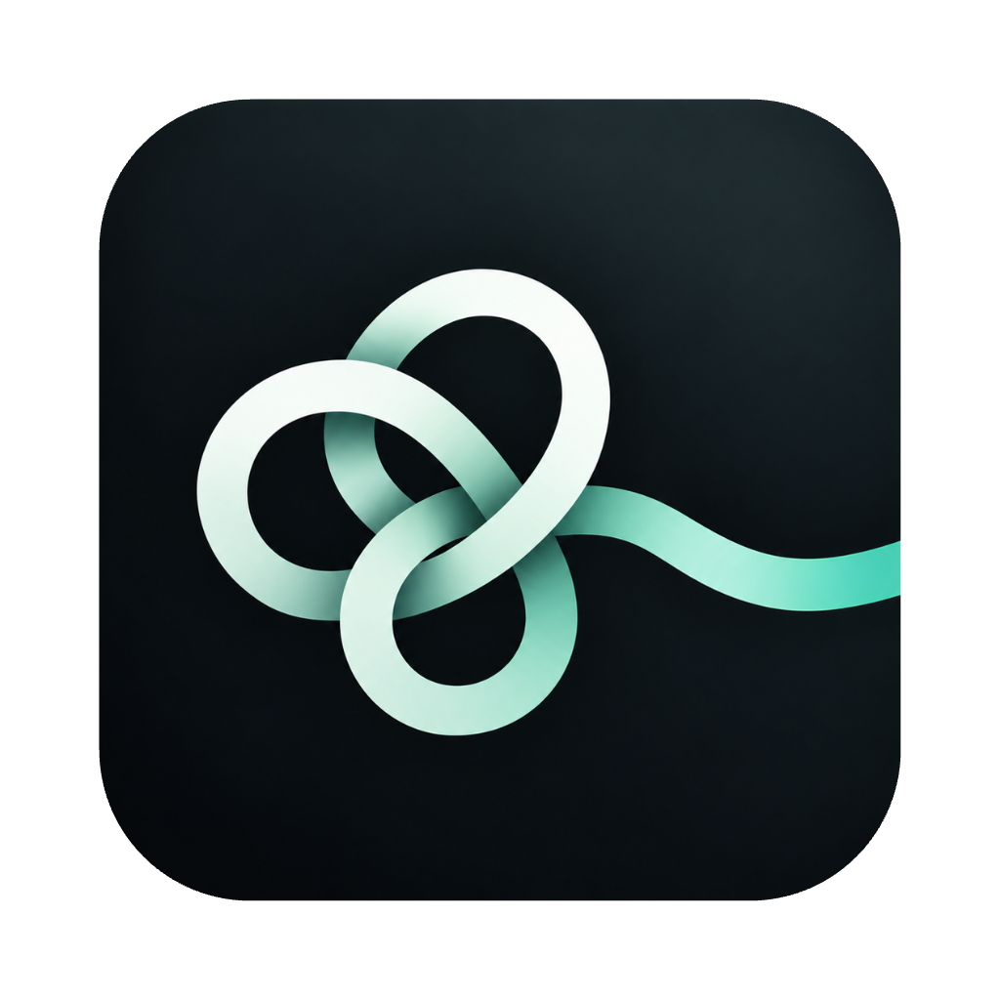
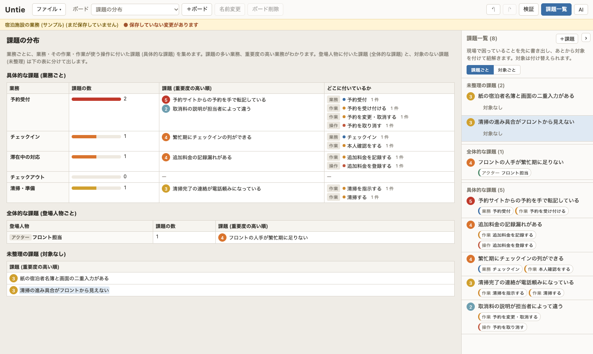
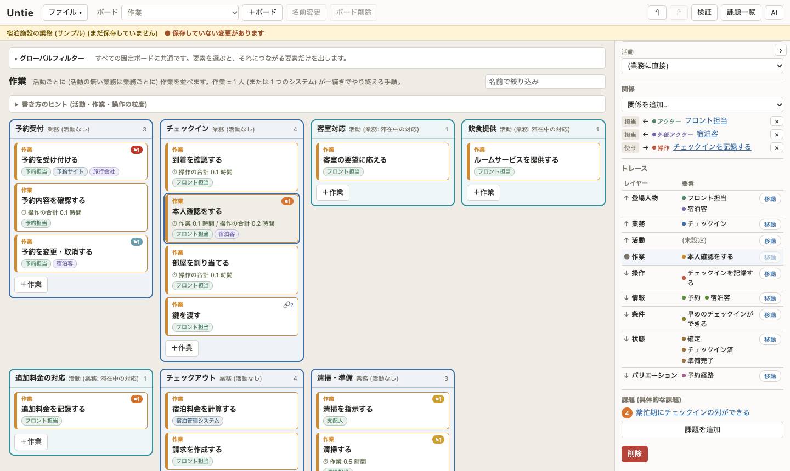
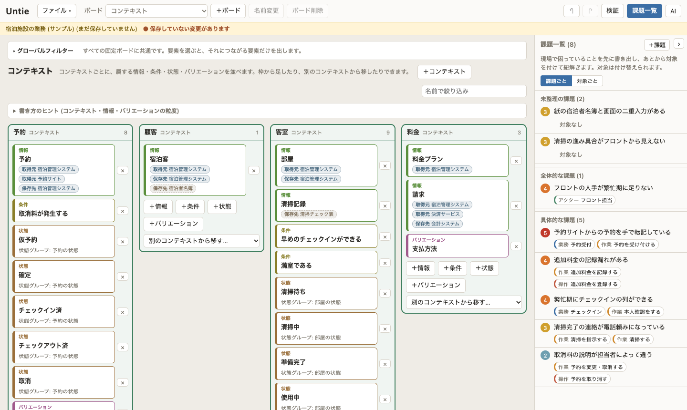
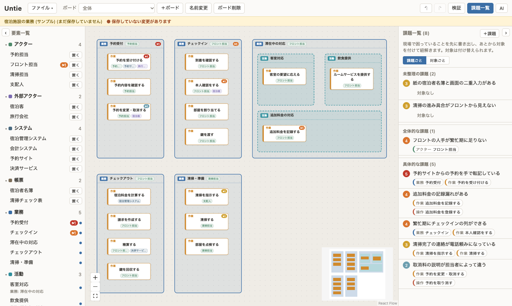

<p align="center">
  
</p>

# Untie

Untie は、業務整理を行いながら、現場が感じている困りごとが業務のどこに潜んでいるかを突き止めるためのツールです。

## 考え方

課題は、新しく見つけ出すものではありません。現場の担当者はすでに「ここが困る」という課題感を持っています。足りないのは、その困りごとが業務のどの活動・作業・つながりから生まれているのかという具体的な所在と、なぜそこで困りごとが発生しているのかという理由です。

Untie は次の流れを想定しています。

| | 段階 | すること | Untie |
| --- | --- | --- | --- |
| 1 | 課題感を持ち寄る | 担当者が感じている困りごとを、そのまま書き出す | 補助する |
| 2 | 所在と理由を突き止める | 業務を整理しながら、どの活動・作業・つながりに問題が潜んでいるか、なぜそこで起きているかを突き止める | 補助する |
| 3 | 認識を揃える | 突き止めた所在を図と表で見せ、関係者のあいだで認識を揃える | 補助する |
| 4 | 解決策を検討する | その部分のシステム化などの解決策を検討し、要件定義・開発へ進める | モデルを手がかりにつなげる |

Untie が補助するのは前半の 1〜3 です。整理した結果は RDRA に沿ったモデルとして残します。後半の解決策の検討から要件定義・開発へは、このモデルを手がかりにつなげます (RDRA モデルとして展開し、要件定義に直接使えるようにするのは今後の目標です)。

大事なのは「感じている困りごとの所在を具体化する」ことです。業務を整理すること自体が目的ではなく、最初からシステム化を前提にするものでもありません。業務の整理は、困りごとの所在を突き止めるための手段です。

このリポジトリは PoC (概念実証) です。モデルは JSON ファイルに保存・読み込みできます (「開く」「保存」、Cmd/Ctrl+O・Cmd/Ctrl+S)。起動すると架空の宿泊施設のサンプルが、分析ボード「課題の分布」と右の課題一覧を開いた状態で表示されます。

## できること

### 1. 課題感を持ち寄る

- 課題一覧の「＋課題」で、対象を決めずに課題を書き出せる。「次の課題を登録する」で続けて書ける
- 重要度 (1〜5) を付けられる。対象のない課題は「未整理」として残り、検証パネルにも件数が出る



### 2. 所在と理由を突き止める

- **固定ボード** (レイヤーごとに 10 枚): 登場人物 → 業務 → 活動 → 作業 → 操作 → 情報・条件・状態・バリエーションと、上から順に業務を詳細化する。上位の要素を枠にして下位の要素を自動で並べ、名前で絞り込める。要素の作成・削除、所属と関係の変更はここで行う
- **課題の対象を付ける・付け替える**: 業務・作業・操作に付けると「具体的な課題」、登場人物 (アクター・外部アクター・システム・帳票) に付けると「全体的な課題」として分かれる。所在の見当が外れていたら、あとから付け替えられる
- **AI と深掘りする**: 課題のプロパティ欄から始めると、下のペインで AI が現象 → 所在 → 理由 → 影響の順に質問を重ねる。質問には AI の見立て (➡️ 推奨) が付き、「はい」で採れる。業務モデルにある事実は AI がモデルから読むので、答えるのは現場の人しか知らないことだけ。最後にまとめを確認すると、課題の分析 (現象・所在・理由・影響)・重要度・対象が更新される。担当者が書いた課題の説明はそのまま残る
- **トレース**: 選んだ要素から上 (担い手) と下 (詳細) へ辿り、レイヤーごとに表で出す。まだつながりの無いレイヤーも「(未設定)」で出し、そこへ移って埋めていける
- **検証**: すべての要素が担い手まで辿れるかを調べ、途切れている箇所を知らせる
- 関係は RDRA に沿った型付き。両端の種類から関係が自動で決まり、あり得ない組み合わせは結べない





### 3. 認識を揃える

- **分析ボード** (3 枚): 課題の分布 (業務ごとの具体的な課題・登場人物ごとの全体的な課題・未整理の課題)、担当別の作業一覧 (マニュアルのリンク・時間付き)、情報の所在
- **自由ボード** (いくつでも): レイヤーに関係なく要素を置き、説明しやすい図を作る。線の付け根も変えられる。所属や関係は変えない (表示だけ)



### 進めるのを助ける機能

- **AI エージェント**: 下のペインで AI と会話して、編集中のモデルを自然言語で直す。「ファイル > プロンプトから作成」で、初期要望の文章からモデルを作り、そのまま会話を続けられる。AI は Claude (Anthropic)・Codex (OpenAI)・Gemini (Google) から選び、API キーは「AI の設定」で入れる (OS のキーチェーンに保存)
- 扱う要素は 14 種: アクター / 外部アクター / システム / 帳票 / 業務 / 活動 (BUC) / 作業 (アクティビティ) / 操作 (ユースケース) / コンテキスト / 情報 / 状態 / バリエーション / 条件 / 課題
- Undo / Redo (Cmd/Ctrl+Z、Shift+Cmd/Ctrl+Z)

設計の詳細は [docs/design.md](docs/design.md)、データモデルは [schema/untie.schema.json](schema/untie.schema.json) を参照してください。

## インストールと開き方

[Releases](https://github.com/tango238/untie/releases) から、お使いの OS 向けのファイルをダウンロードしてください。アプリは署名していないため、初回起動時に OS の警告が出ます。

### Mac (Apple Silicon)

1. `.dmg` を開き、Untie.app をアプリケーションフォルダにコピーします。
2. Finder で Untie.app を **右クリック (または control キーを押しながらクリック) → 「開く」** を選びます。
3. 「開発元を確認できません」の警告が出たら、もう一度「開く」を押します。2 回目以降は普通にダブルクリックで起動できます。

それでも開けない場合は、ターミナルで次を実行してから開いてください。

```sh
xattr -dr com.apple.quarantine /Applications/Untie.app
```

Intel Mac は対象外です。

### Windows (x64)

1. `.msi` または `-setup.exe` をダウンロードして実行します。
2. SmartScreen の「Windows によって PC が保護されました」が出たら、**「詳細情報」→「実行」** を押します。

### ブラウザ (Web 版)

同じソースを Cloudflare の Worker から配信できます (手順は「開発」の「サーバー (Cloudflare Worker)」)。インストールは要りません。アプリとの違いは次のとおりです。

- **保存**: Chrome・Edge では、開いた (または一度保存した) ファイルにそのまま上書きします。それ以外のブラウザでは、保存のたびにダウンロードになります。
- **API キー**: ふだんはタブを閉じるまでだけ覚えます。「AI の設定」で「このブラウザに保存する」を選ぶと、次に開いたときも使えます (ブラウザの localStorage に置くので、共用のパソコンでは選ばないでください)。キーはブラウザから各社の API に直接送り、配信元のサーバーには送りません。
- **閉じる前の確認**: 保存していない変更があると、タブを閉じる前にブラウザが確かめます。

## 開発

必要なもの: Node.js 22、pnpm 10、Rust (rustup の stable)。Tauri 2 の前提条件は [Tauri の公式ドキュメント](https://tauri.app/start/prerequisites/) を参照してください。

```sh
pnpm install
pnpm tauri dev      # アプリを起動して開発する
pnpm dev            # Web とサーバーを同時に動かして開発する (http://localhost:5173。API は 8787 に proxy)
pnpm typecheck      # 型検査
pnpm test           # テスト (Vitest)
pnpm check:types    # スキーマから生成した型が最新か確認する
pnpm tauri build    # Mac 用の .app / .dmg を作る
pnpm app:build      # 同上。手元の証明書「Untie Local Code Signing」で署名する
pnpm build          # Web 版を apps/web/dist/ に、デスクトップ用のフロントを apps/desktop/dist/ に作り、サーバーの wrangler deploy --dry-run も通す
pnpm run deploy     # Web 版を作って Cloudflare Worker (untie) に上げる (`pnpm deploy` は pnpm の別のコマンドなので `run` を付ける)
```

手元でアプリを作り直して使うときは `pnpm app:build` を使ってください。`pnpm tauri build` は簡易署名 (ad-hoc) になり、作り直すたびにアプリの識別が変わるので、キーチェーンに保存した AI の API キーが読み出せなくなります。`pnpm app:build` はログインキーチェーンにあるコード署名用の自己署名証明書 `Untie Local Code Signing` で署名するので、作り直してもキーを読めます。証明書が無い Mac では、キーチェーンアクセスの「証明書アシスタント」で同じ名前のコード署名用の自己署名証明書を作ってください。

スキーマ (`schema/untie.schema.json`) を変えたら `pnpm gen:types` で `packages/core/src/model/schema.d.ts` を再生成してください。

pnpm ワークスペースで、共通のモデルは `packages/core` (`@untie/core`)、画面は `packages/ui` (`@untie/ui`)、Web とデスクトップの入り口は `apps/web`・`apps/desktop`、API の契約は `packages/api`、同時編集のルームは `packages/collab`、Cloudflare Worker (API・ログイン・静的ファイルの配信) は `apps/server` に分かれています。設計は [docs/collab-design.md](docs/collab-design.md) を参照してください。ファイルやキーの置き場所など Web とデスクトップで違う処理は、`packages/ui/src/platform.ts` の `Platform` を通し、実装を各 app の `src/platform.ts` に置いています。

アイコンを変えるときは `assets/icon.png` (1024px 四方、中央 824px に角丸の絵、外側は透明) を差し替え、`pnpm icon` で各サイズを再生成します。

### サーバー (Cloudflare Worker)

クラウドファイルのためのサーバーは `apps/server` にあります。1 つの Worker が、Web の静的ファイル (`apps/web/dist`)・API (`/api`)・ログイン (`/auth`)・ファイルの中身を持つ Durable Object (`UntieRoom`、`/parties`) を受け持ち、一覧と権限は D1 (SQLite) に置きます。

#### 手元で動かす

```sh
pnpm install
pnpm dev     # http://localhost:5173 を開く
```

`pnpm dev` は Vite (5173) と `wrangler dev` (8787) を同時に起動します。Vite が `/api`・`/auth`・`/parties` を 8787 に proxy するので、ブラウザは 5173 だけ見れば足ります。D1 と Durable Object はローカルのファイル (`apps/server/.wrangler/`) に作られ、`pnpm dev` のたびにマイグレーションが当たります。wrangler のテレメトリを送りたくないときは `WRANGLER_SEND_METRICS=false` を付けてください。

ログインは、開発中は `dev` プロバイダーを使います。`/auth/dev` の画面でメールアドレスを打つだけでログインできます (`apps/server/.dev.vars` の `DEV_LOGIN=true` のときだけ。本番の `wrangler.jsonc` は `"false"`)。Google でログインするには、`.dev.vars` に `GOOGLE_CLIENT_ID` と `GOOGLE_CLIENT_SECRET` を書き (空だと Google は出ません)、Google Cloud の OAuth クライアントのリダイレクト URI に `http://localhost:5173/auth/callback` を登録します (`wrangler dev` はリクエストのオリジンを常に `http://localhost:8787` と見るため、`.dev.vars` の `APP_ORIGIN=http://localhost:5173` で Vite 側に固定しています。5173 のリクエストは Vite が 8787 に proxy します)。

`.dev.vars` はコミットしません (`.gitignore` 済み)。`pnpm dev` が、無ければ見本の `apps/server/.dev.vars.example` から写します。開発専用の値だけを書き、本番の秘密の値は書かないでください。開発用ログインは `DEV_LOGIN=true` でも、リクエストのホストが `localhost` / `127.0.0.1` のときだけ効きます。

#### 本番に上げる

1. D1 を日本に寄せて作ります。出力の `database_id` を `apps/server/wrangler.jsonc` の `d1_databases[0].database_id` に書きます。

   ```sh
   pnpm dlx wrangler@4 login
   pnpm dlx wrangler@4 d1 create untie --location apac
   ```

2. 秘密の値を入れます (`apps/server` で実行)。Google の OAuth クライアントは Google Cloud Console で作り、リダイレクト URI に `https://<ホスト>/auth/callback` を登録します。

   ```sh
   cd apps/server
   pnpm wrangler secret put SESSION_SECRET      # Cookie の署名。長い乱数 (例: openssl rand -base64 32)
   pnpm wrangler secret put TICKET_SECRET       # ルームへの接続チケットの署名。同上 (32 文字以上が必須)
   pnpm wrangler secret put GOOGLE_CLIENT_ID
   pnpm wrangler secret put GOOGLE_CLIENT_SECRET
   ```

3. `wrangler.jsonc` の `vars.APP_ORIGIN` に公開の URL (例: `https://untie.example.com`) を書きます。Google の redirect URI の組み立てに使われます (空ならリクエストのオリジン)。Cookie の `Secure` は APP_ORIGIN ではなく、リクエストが https かどうかで付きます。ログインを許すドメインを絞るときは `ALLOWED_EMAIL_DOMAINS` にカンマ区切りで書きます (空なら誰でも)。`DEV_LOGIN` は `"false"` のままにします。

4. マイグレーションを当てて、上げます。

   ```sh
   pnpm --filter @untie/server d1:migrate    # D1 に apps/server/migrations/*.sql を当てる
   pnpm run deploy                           # Web を build して wrangler deploy
   ```

`pnpm run deploy` は `apps/web` を build し、`apps/server/public/_headers` (CSP などのヘッダー) を `apps/web/dist/_headers` に写してから `wrangler deploy` します。読み込めるスクリプトは自分のサイトだけ、通信先は自分のサイトと Anthropic・OpenAI・Google の API だけです。AI のプロバイダーを足したときは `_headers` の `connect-src` も足してください。同じオリジンの WebSocket は `'self'` で許されます。

`pnpm --filter @untie/server check` は `wrangler deploy --dry-run` で、バンドルと設定が通るかだけを確かめます (`pnpm build` と CI が実行します)。ゴミ箱に入れて 30 日を過ぎたファイルは、毎日 03:00 (UTC) の cron が Durable Object ごと消します。

利用者をさらに絞りたいときは、Cloudflare Zero Trust の Access でアプリケーションを作り、Worker のドメインにメールアドレスなどの条件を付けます。

### リリース

`v*` のタグを push すると GitHub Actions が Mac (Apple Silicon) の `.dmg` と Windows (x64) の `.msi` / `.exe` を作り、GitHub Releases に添付します。Windows 版は CI でしか作れません。

```sh
git tag v0.1.0
git push origin v0.1.0
```

## このリポジトリで扱わないもの

対話ヒアリング、矛盾検出、rdra.yml エクスポート、コード署名は別の TODO で扱います。

## ライセンス

MIT
