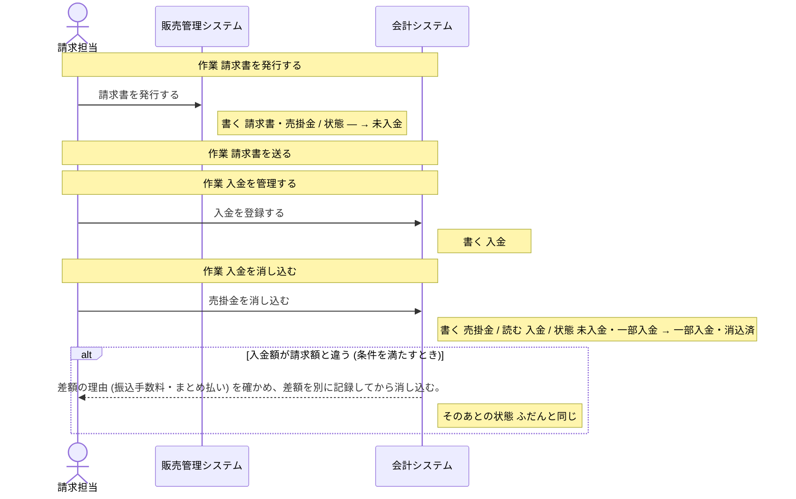
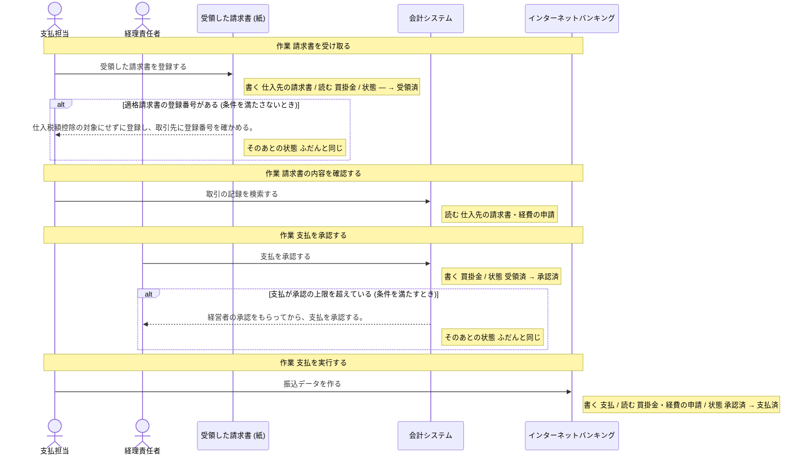
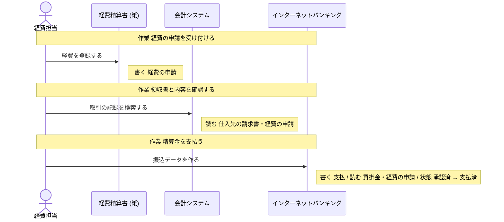
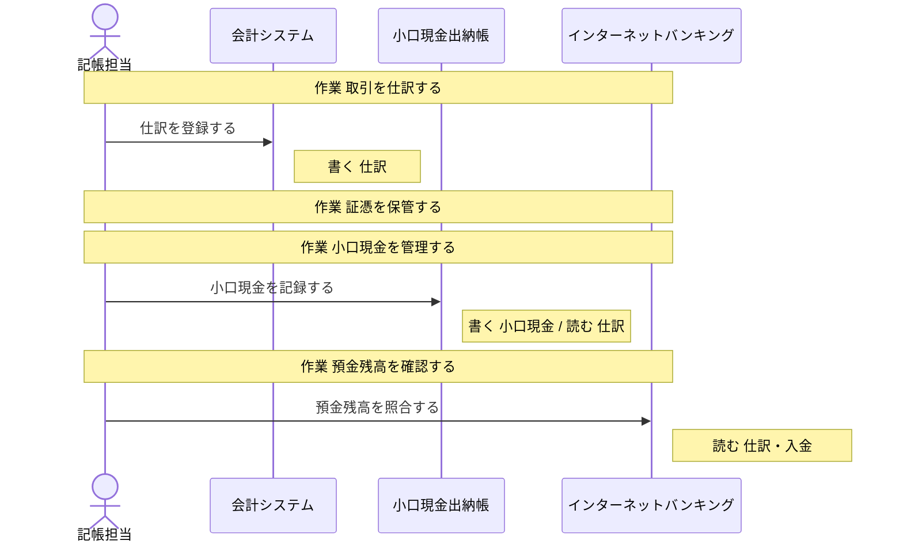
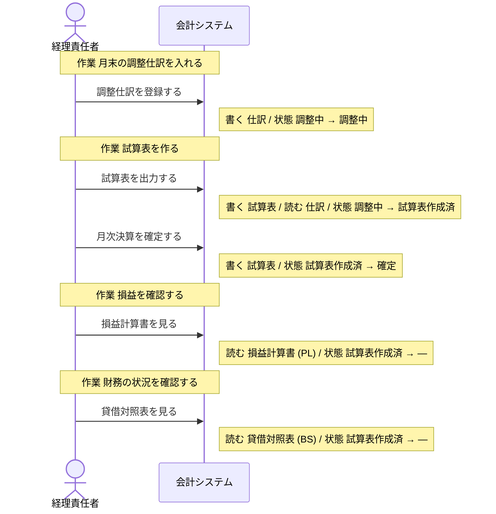
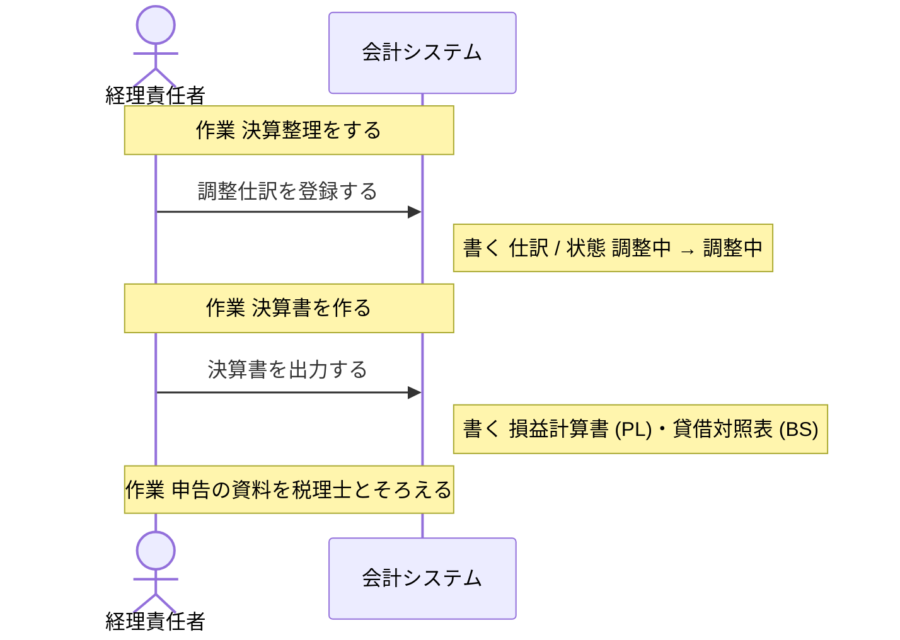

# 会計システム の設計

untie が、分析と設計から書き出したもの (自動生成。手で直しても、書き出し直すと消える)。

## 読み方

- **操作** が、このシステムで作る機能の単位。ここに無い操作は、作らない。
- 「ほかのシステム」「帳票」と書いてある操作は、このシステムでは作らない。このシステムの操作の前提 (状態・情報・出来事) を、外で作っているもの。
- **決まっていない** と書いてあることは、勝手に決めない。「まだ決まっていないこと」に挙がっているあいだは、実装を始めない。

## 操作

### 入金を登録する

- 作業: 入金を管理する (担当: 請求担当・銀行)
- 情報: 入金 (取得・保存)

### 売掛金を消し込む

- 作業: 入金を消し込む (担当: 請求担当)
- 情報: 売掛金 (取得・保存)
- 情報: 入金 (取得)
- 前提の状態: 売掛金の状態 = 未入金、売掛金の状態 = 一部入金 (これ以外のときは、行えない)
- 次の状態: 売掛金の状態 = 一部入金、売掛金の状態 = 消込済
- 条件「入金額が請求額と違う」: 条件を満たすとき、差額の理由 (振込手数料・まとめ払い) を確かめ、差額を別に記録してから消し込む。 (そのあとの状態: ふだんと同じ)

### 取引の記録を検索する

- 作業: 請求書の内容を確認する (担当: 支払担当)
- 作業: 領収書と内容を確認する (担当: 経費担当)
- 情報: 仕入先の請求書 (取得)
- 情報: 経費の申請 (取得)

### 支払を承認する

- 作業: 支払を承認する (担当: 経理責任者・経営者)
- 情報: 買掛金 (取得・保存)
- 前提の状態: 支払の状態 = 受領済 (これ以外のときは、行えない)
- 次の状態: 支払の状態 = 承認済
- 条件「支払が承認の上限を超えている」: 条件を満たすとき、経営者の承認をもらってから、支払を承認する。 (そのあとの状態: ふだんと同じ)

### 仕訳を登録する

- 作業: 取引を仕訳する (担当: 記帳担当)
- 情報: 仕訳 (取得・保存)

### 調整仕訳を登録する

- 作業: 月末の調整仕訳を入れる (担当: 経理責任者)
- 作業: 決算整理をする (担当: 経理責任者)
- 情報: 仕訳 (取得・保存)
- 前提の状態: 月次決算の状態 = 調整中 (これ以外のときは、行えない)
- 次の状態: 月次決算の状態 = 調整中

### 試算表を出力する

- 作業: 試算表を作る (担当: 経理責任者)
- 情報: 試算表 (取得・保存)
- 情報: 仕訳 (取得)
- 前提の状態: 月次決算の状態 = 調整中 (これ以外のときは、行えない)
- 次の状態: 月次決算の状態 = 試算表作成済

### 月次決算を確定する

- 作業: 試算表を作る (担当: 経理責任者)
- 情報: 試算表 (取得・保存)
- 前提の状態: 月次決算の状態 = 試算表作成済 (これ以外のときは、行えない)
- 次の状態: 月次決算の状態 = 確定

### 損益計算書を見る

- 作業: 損益を確認する (担当: 経理責任者・経営者)
- 情報: 損益計算書 (PL) (取得)
- 前提の状態: 月次決算の状態 = 試算表作成済 (これ以外のときは、行えない)

### 貸借対照表を見る

- 作業: 財務の状況を確認する (担当: 経理責任者・経営者)
- 情報: 貸借対照表 (BS) (取得)
- 前提の状態: 月次決算の状態 = 試算表作成済 (これ以外のときは、行えない)

### 決算書を出力する

- 作業: 決算書を作る (担当: 経理責任者)
- 情報: 損益計算書 (PL) (取得・保存)
- 情報: 貸借対照表 (BS) (取得・保存)

## 状態

### 売掛金の状態

情報「売掛金」の状態。どれか 1 つの値を取る。

| 状態 | この状態にする操作 | この状態が前提の操作 |
| --- | --- | --- |
| 未入金 | 「請求書を発行する」(ほかのシステム「販売管理システム」) | 「売掛金を消し込む」 |
| 一部入金 | 「売掛金を消し込む」 | 「売掛金を消し込む」 |
| 消込済 | 「売掛金を消し込む」 | 無い |

作られたときの状態: 未入金

### 支払の状態

情報「支払」の状態。どれか 1 つの値を取る。

| 状態 | この状態にする操作 | この状態が前提の操作 |
| --- | --- | --- |
| 受領済 | 「受領した請求書を登録する」(帳票「受領した請求書 (紙)」) | 「支払を承認する」 |
| 承認済 | 「支払を承認する」 | 「振込データを作る」(ほかのシステム「インターネットバンキング」) |
| 支払済 | 「振込データを作る」(ほかのシステム「インターネットバンキング」) | 無い |

作られたときの状態: 受領済

### 月次決算の状態

情報「試算表」の状態。どれか 1 つの値を取る。

| 状態 | この状態にする操作 | この状態が前提の操作 |
| --- | --- | --- |
| 調整中 | 「調整仕訳を登録する」 | 「調整仕訳を登録する」、「試算表を出力する」 |
| 試算表作成済 | 「試算表を出力する」 | 「月次決算を確定する」、「損益計算書を見る」、「貸借対照表を見る」 |
| 確定 | 「月次決算を確定する」 | 無い |

作られたときの状態: 設計に無い (前提の状態なしに、このグループの状態にする操作が無い)。作る手段を足すなら、どの状態で作るかを、呼び出す側が渡す形にする。

## 情報

### 売掛金

- 状態: 売掛金の状態
- 結びつく情報: 請求書・入金・貸借対照表 (BS)
- 保存する操作: 「請求書を発行する」(ほかのシステム「販売管理システム」)、「売掛金を消し込む」
- 取得する操作: 「請求書を発行する」(ほかのシステム「販売管理システム」)、「売掛金を消し込む」
- テーブル: 決まっていない

### 入金

- 結びつく情報: 売掛金
- 区分: 入金の方法
- 保存する操作: 「入金を登録する」
- 取得する操作: 「入金を登録する」、「売掛金を消し込む」、「預金残高を照合する」(ほかのシステム「インターネットバンキング」)
- テーブル: 決まっていない

### 仕入先の請求書

- 結びつく情報: 買掛金
- 区分: 税区分
- 保存する操作: 「受領した請求書を登録する」(帳票「受領した請求書 (紙)」)
- 取得する操作: 「受領した請求書を登録する」(帳票「受領した請求書 (紙)」)、「取引の記録を検索する」
- テーブル: 決まっていない

### 買掛金

- 結びつく情報: 仕入先の請求書・支払・貸借対照表 (BS)
- 保存する操作: 「支払を承認する」
- 取得する操作: 「受領した請求書を登録する」(帳票「受領した請求書 (紙)」)、「支払を承認する」、「振込データを作る」(ほかのシステム「インターネットバンキング」)
- テーブル: 決まっていない

### 経費の申請

- 結びつく情報: 仕訳
- 区分: 経費の区分
- 保存する操作: 「経費を登録する」(帳票「経費精算書 (紙)」)
- 取得する操作: 「取引の記録を検索する」、「振込データを作る」(ほかのシステム「インターネットバンキング」)、「経費を登録する」(帳票「経費精算書 (紙)」)
- テーブル: 決まっていない

### 仕訳

- 結びつく情報: 経費の申請・試算表
- 保存する操作: 「仕訳を登録する」、「調整仕訳を登録する」
- 取得する操作: 「仕訳を登録する」、「小口現金を記録する」(帳票「小口現金出納帳」)、「預金残高を照合する」(ほかのシステム「インターネットバンキング」)、「調整仕訳を登録する」、「試算表を出力する」
- テーブル: 決まっていない

### 試算表

- 状態: 月次決算の状態
- 結びつく情報: 仕訳・損益計算書 (PL)・貸借対照表 (BS)
- 保存する操作: 「試算表を出力する」、「月次決算を確定する」
- 取得する操作: 「試算表を出力する」、「月次決算を確定する」
- テーブル: 決まっていない

### 損益計算書 (PL)

- 結びつく情報: 請求書・試算表・貸借対照表 (BS)
- 保存する操作: 「決算書を出力する」
- 取得する操作: 「損益計算書を見る」、「決算書を出力する」
- テーブル: 決まっていない

### 貸借対照表 (BS)

- 結びつく情報: 売掛金・買掛金・試算表・損益計算書 (PL)
- 保存する操作: 「決算書を出力する」
- 取得する操作: 「貸借対照表を見る」、「決算書を出力する」
- テーブル: 決まっていない

## 条件

条件を満たすかどうかは、下の「何で判断するか」から決める。式までは決まっていないので、判断に要る値が足りなければ、呼び出す側が渡す形にする。

### 入金額が請求額と違う

- 何で判断するか: 振込手数料の差し引きや、複数の請求書のまとめ払いで差が出る。状態 (売掛金の状態 = 未入金) を見る
- 判断する操作: 「売掛金を消し込む」

### 支払が承認の上限を超えている

- 何で判断するか: 10 万円を超える支払は、経営者の承認が要る。状態 (支払の状態 = 受領済) を見る
- 判断する操作: 「支払を承認する」

## 区分

- 入金の方法: 銀行振込・口座振替・クレジットカード
- 経費の区分: 交通費・交際費・消耗品費
- 税区分: 課税 10%・軽減税率 8%・非課税

## 業務の流れ

業務ごとの、作業と操作の順 (シーケンス図)。条件で流れが変わるところは、alt の枠。

### 請求・売掛金管理

### 支払・買掛金管理

### 経費精算

### 仕訳・記帳

### 月次決算

### 年次決算・税務

## まだ決まっていないこと

### データの置き場所が決まっている

- このシステムの設計がまだありません

### 画面がそろっている

- このシステムの設計がまだありません
