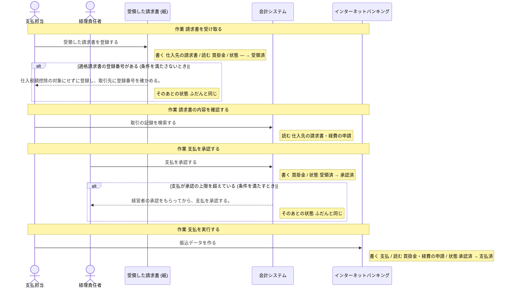
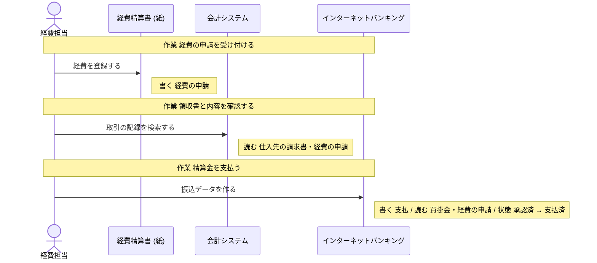
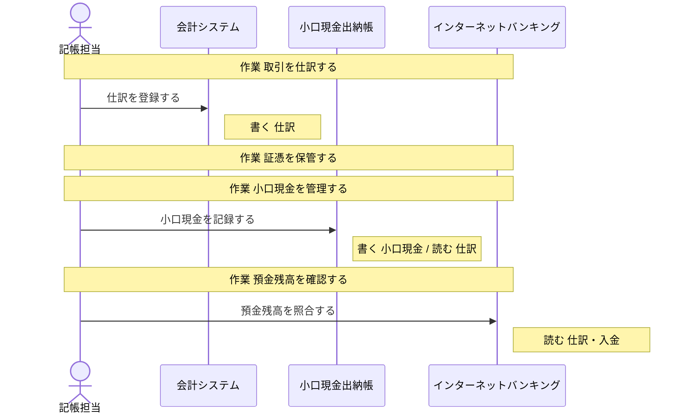

# インターネットバンキング の設計

untie が、分析と設計から書き出したもの (自動生成。手で直しても、書き出し直すと消える)。

## 読み方

- **操作** が、このシステムで作る機能の単位。ここに無い操作は、作らない。
- 「ほかのシステム」「帳票」と書いてある操作は、このシステムでは作らない。このシステムの操作の前提 (状態・情報・出来事) を、外で作っているもの。
- **決まっていない** と書いてあることは、勝手に決めない。「まだ決まっていないこと」に挙がっているあいだは、実装を始めない。

## 操作

### 振込データを作る

- 作業: 支払を実行する (担当: 支払担当・銀行)
- 作業: 精算金を支払う (担当: 経費担当)
- 情報: 支払 (取得・保存)
- 情報: 買掛金 (取得)
- 情報: 経費の申請 (取得)
- 前提の状態: 支払の状態 = 承認済 (これ以外のときは、行えない)
- 次の状態: 支払の状態 = 支払済

### 預金残高を照合する

- 作業: 預金残高を確認する (担当: 記帳担当・銀行)
- 情報: 仕訳 (取得)
- 情報: 入金 (取得)

## 状態

### 支払の状態

情報「支払」の状態。どれか 1 つの値を取る。

| 状態 | この状態にする操作 | この状態が前提の操作 |
| --- | --- | --- |
| 受領済 | 「受領した請求書を登録する」(帳票「受領した請求書 (紙)」) | 「支払を承認する」(ほかのシステム「会計システム」) |
| 承認済 | 「支払を承認する」(ほかのシステム「会計システム」) | 「振込データを作る」 |
| 支払済 | 「振込データを作る」 | 無い |

作られたときの状態: 受領済

## 情報

### 入金

- 結びつく情報: 売掛金
- 区分: 入金の方法
- 保存する操作: 「入金を登録する」(ほかのシステム「会計システム」)
- 取得する操作: 「入金を登録する」(ほかのシステム「会計システム」)、「売掛金を消し込む」(ほかのシステム「会計システム」)、「預金残高を照合する」
- テーブル: 決まっていない

### 買掛金

- 結びつく情報: 仕入先の請求書・支払・貸借対照表 (BS)
- 保存する操作: 「支払を承認する」(ほかのシステム「会計システム」)
- 取得する操作: 「受領した請求書を登録する」(帳票「受領した請求書 (紙)」)、「支払を承認する」(ほかのシステム「会計システム」)、「振込データを作る」
- テーブル: 決まっていない

### 支払

- 状態: 支払の状態
- 結びつく情報: 買掛金
- 保存する操作: 「振込データを作る」
- 取得する操作: 「振込データを作る」
- テーブル: 決まっていない

### 経費の申請

- 結びつく情報: 仕訳
- 区分: 経費の区分
- 保存する操作: 「経費を登録する」(帳票「経費精算書 (紙)」)
- 取得する操作: 「取引の記録を検索する」(ほかのシステム「会計システム」)、「振込データを作る」、「経費を登録する」(帳票「経費精算書 (紙)」)
- テーブル: 決まっていない

### 仕訳

- 結びつく情報: 経費の申請・試算表
- 保存する操作: 「仕訳を登録する」(ほかのシステム「会計システム」)、「調整仕訳を登録する」(ほかのシステム「会計システム」)
- 取得する操作: 「仕訳を登録する」(ほかのシステム「会計システム」)、「小口現金を記録する」(帳票「小口現金出納帳」)、「預金残高を照合する」、「調整仕訳を登録する」(ほかのシステム「会計システム」)、「試算表を出力する」(ほかのシステム「会計システム」)
- テーブル: 決まっていない

## 区分

- 入金の方法: 銀行振込・口座振替・クレジットカード
- 経費の区分: 交通費・交際費・消耗品費

## 業務の流れ

業務ごとの、作業と操作の順 (シーケンス図)。条件で流れが変わるところは、alt の枠。

### 支払・買掛金管理

### 経費精算

### 仕訳・記帳

## まだ決まっていないこと

### データの置き場所が決まっている

- このシステムの設計がまだありません

### 画面がそろっている

- このシステムの設計がまだありません
