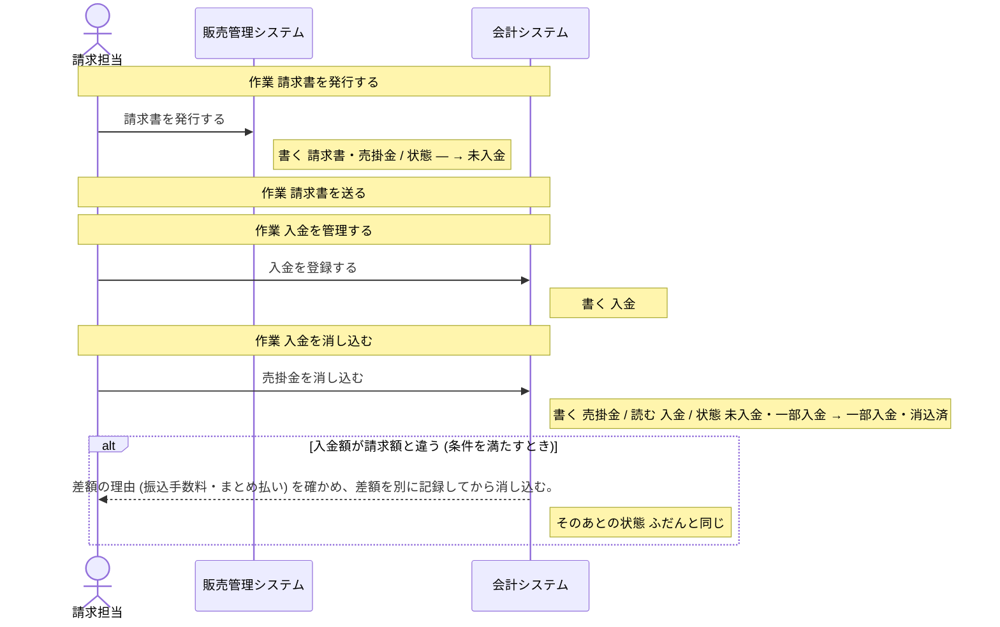

# 販売管理システム の設計

untie が、分析と設計から書き出したもの (自動生成。手で直しても、書き出し直すと消える)。

## 読み方

- **操作** が、このシステムで作る機能の単位。ここに無い操作は、作らない。
- 「ほかのシステム」「帳票」と書いてある操作は、このシステムでは作らない。このシステムの操作の前提 (状態・情報・出来事) を、外で作っているもの。
- **決まっていない** と書いてあることは、勝手に決めない。「まだ決まっていないこと」に挙がっているあいだは、実装を始めない。

## 操作

### 請求書を発行する

- 作業: 請求書を発行する (担当: 請求担当)
- 情報: 請求書 (取得・保存)
- 情報: 売掛金 (取得・保存)
- 次の状態: 売掛金の状態 = 未入金

## 状態

### 売掛金の状態

情報「売掛金」の状態。どれか 1 つの値を取る。

| 状態 | この状態にする操作 | この状態が前提の操作 |
| --- | --- | --- |
| 未入金 | 「請求書を発行する」 | 「売掛金を消し込む」(ほかのシステム「会計システム」) |
| 一部入金 | 「売掛金を消し込む」(ほかのシステム「会計システム」) | 「売掛金を消し込む」(ほかのシステム「会計システム」) |
| 消込済 | 「売掛金を消し込む」(ほかのシステム「会計システム」) | 無い |

作られたときの状態: 未入金

## 情報

### 請求書

- 結びつく情報: 売掛金・損益計算書 (PL)
- 保存する操作: 「請求書を発行する」
- 取得する操作: 「請求書を発行する」
- テーブル: 決まっていない

### 売掛金

- 状態: 売掛金の状態
- 結びつく情報: 請求書・入金・貸借対照表 (BS)
- 保存する操作: 「請求書を発行する」、「売掛金を消し込む」(ほかのシステム「会計システム」)
- 取得する操作: 「請求書を発行する」、「売掛金を消し込む」(ほかのシステム「会計システム」)
- テーブル: 決まっていない

## 業務の流れ

業務ごとの、作業と操作の順 (シーケンス図)。条件で流れが変わるところは、alt の枠。

### 請求・売掛金管理

## まだ決まっていないこと

### データの置き場所が決まっている

- このシステムの設計がまだありません

### 画面がそろっている

- このシステムの設計がまだありません
