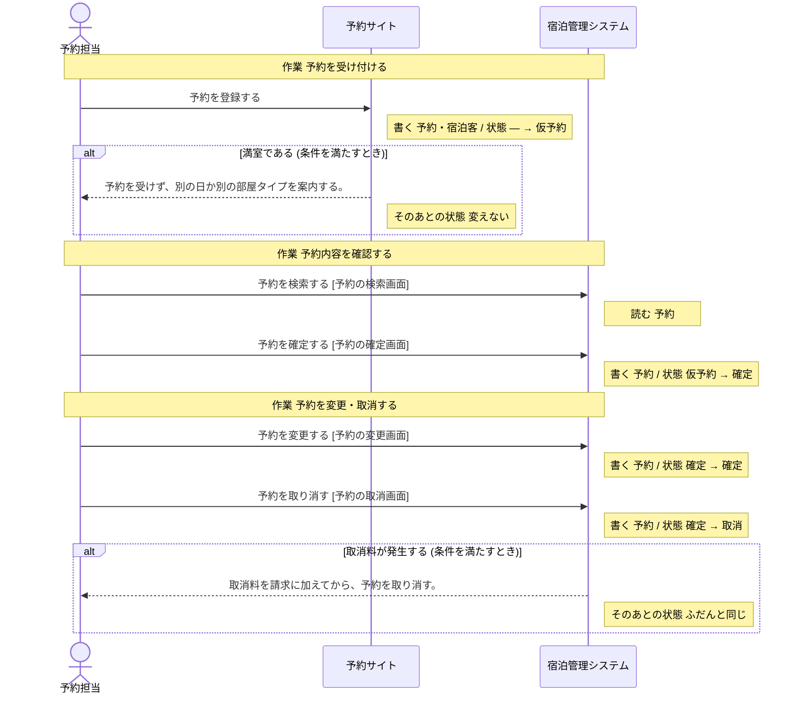

# 予約サイト の設計

untie が、分析と設計から書き出したもの (自動生成。手で直しても、書き出し直すと消える)。

## 読み方

- **操作** が、このシステムで作る機能の単位。ここに無い操作は、作らない。
- 「ほかのシステム」「帳票」と書いてある操作は、このシステムでは作らない。このシステムの操作の前提 (状態・情報・出来事) を、外で作っているもの。
- **決まっていない** と書いてあることは、勝手に決めない。「まだ決まっていないこと」に挙がっているあいだは、実装を始めない。

## 操作

### 予約を登録する

- 作業: 予約を受け付ける (担当: 予約担当・旅行会社)
- 情報: 予約 (取得・保存)
- 情報: 宿泊客 (取得・保存)
- 次の状態: 予約の状態 = 仮予約
- 条件「満室である」: 条件を満たすとき、予約を受けず、別の日か別の部屋タイプを案内する。 (そのあとの状態: 変えない)

## 状態

### 予約の状態

情報「予約」の状態。どれか 1 つの値を取る。

| 状態 | この状態にする操作 | この状態が前提の操作 |
| --- | --- | --- |
| 仮予約 | 「予約を登録する」 | 「予約を確定する」(ほかのシステム「宿泊管理システム」) |
| 確定 | 「予約を確定する」(ほかのシステム「宿泊管理システム」)、「予約を変更する」(ほかのシステム「宿泊管理システム」) | 「予約を変更する」(ほかのシステム「宿泊管理システム」)、「予約を取り消す」(ほかのシステム「宿泊管理システム」)、「チェックインを記録する」(ほかのシステム「宿泊管理システム」) |
| チェックイン済 | 「チェックインを記録する」(ほかのシステム「宿泊管理システム」) | 「追加料金を登録する」(ほかのシステム「宿泊管理システム」)、「チェックアウトを記録する」(ほかのシステム「宿泊管理システム」) |
| チェックアウト済 | 「チェックアウトを記録する」(ほかのシステム「宿泊管理システム」) | 無い |
| 取消 | 「予約を取り消す」(ほかのシステム「宿泊管理システム」) | 無い |

作られたときの状態: 仮予約

## 情報

### 予約

- 状態: 予約の状態
- 結びつく情報: 宿泊客・部屋・料金プラン・請求
- 区分: 予約経路
- 保存する操作: 「予約を登録する」、「予約を確定する」(ほかのシステム「宿泊管理システム」)、「予約を変更する」(ほかのシステム「宿泊管理システム」)、「予約を取り消す」(ほかのシステム「宿泊管理システム」)、「チェックインを記録する」(ほかのシステム「宿泊管理システム」)、「チェックアウトを記録する」(ほかのシステム「宿泊管理システム」)
- 取得する操作: 「予約を登録する」、「予約を確定する」(ほかのシステム「宿泊管理システム」)、「予約を検索する」(ほかのシステム「宿泊管理システム」)、「予約を変更する」(ほかのシステム「宿泊管理システム」)、「予約を取り消す」(ほかのシステム「宿泊管理システム」)、「チェックインを記録する」(ほかのシステム「宿泊管理システム」)、「部屋の割り当てを記録する」(ほかのシステム「宿泊管理システム」)、「チェックアウトを記録する」(ほかのシステム「宿泊管理システム」)
- テーブル: 決まっていない

### 宿泊客

- 結びつく情報: 予約
- 保存する操作: 「予約を登録する」、「チェックインを記録する」(ほかのシステム「宿泊管理システム」)、「宿泊者名簿に記入する」(帳票「宿泊者名簿」)
- 取得する操作: 「予約を登録する」、「チェックインを記録する」(ほかのシステム「宿泊管理システム」)
- テーブル: 決まっていない

## 条件

条件を満たすかどうかは、下の「何で判断するか」から決める。式までは決まっていないので、判断に要る値が足りなければ、呼び出す側が渡す形にする。

### 満室である

- 何で判断するか: 状態 (部屋の状態 = 使用中) を見る。区分 (部屋タイプ) を見る
- 判断する操作: 「予約を登録する」、「部屋の割り当てを記録する」(ほかのシステム「宿泊管理システム」)

## 区分

- 部屋タイプ: シングル・ツイン・スイート
- 予約経路: 電話・予約サイト・直接来館

## 業務の流れ

業務ごとの、作業と操作の順 (シーケンス図)。条件で流れが変わるところは、alt の枠。

### 予約受付

## まだ決まっていないこと

### データの置き場所が決まっている

- このシステムの設計がまだありません

### 画面がそろっている

- このシステムの設計がまだありません
