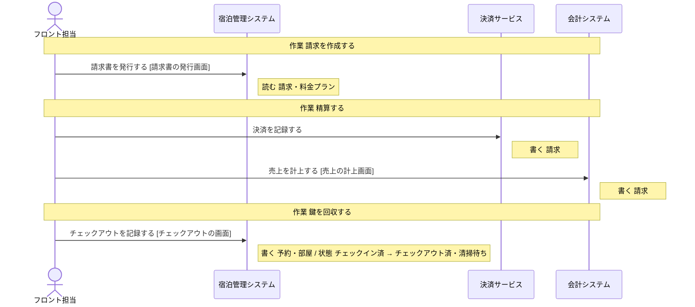

# 決済サービス の設計

untie が、分析と設計から書き出したもの (自動生成。手で直しても、書き出し直すと消える)。

## 読み方

- **操作** が、このシステムで作る機能の単位。ここに無い操作は、作らない。
- 「ほかのシステム」「帳票」と書いてある操作は、このシステムでは作らない。このシステムの操作の前提 (状態・情報・出来事) を、外で作っているもの。
- **決まっていない** と書いてあることは、勝手に決めない。「まだ決まっていないこと」に挙がっているあいだは、実装を始めない。

## 操作

### 決済を記録する

- 作業: 精算する (担当: フロント担当)
- 情報: 請求 (取得・保存)

## 情報

### 請求

- 結びつく情報: 予約
- 区分: 支払方法
- 保存する操作: 「請求金額を計算する」(ほかのシステム「宿泊管理システム」)、「追加料金を登録する」(ほかのシステム「宿泊管理システム」)、「決済を記録する」、「売上を計上する」(ほかのシステム「会計システム」)
- 取得する操作: 「請求金額を計算する」(ほかのシステム「宿泊管理システム」)、「追加料金を登録する」(ほかのシステム「宿泊管理システム」)、「請求書を発行する」(ほかのシステム「宿泊管理システム」)、「決済を記録する」
- テーブル: 決まっていない

## 区分

- 支払方法: 現金・クレジットカード・事前決済

## 業務の流れ

業務ごとの、作業と操作の順 (シーケンス図)。条件で流れが変わるところは、alt の枠。

### チェックアウト

## まだ決まっていないこと

### データの置き場所が決まっている

- このシステムの設計がまだありません

### 画面がそろっている

- このシステムの設計がまだありません
