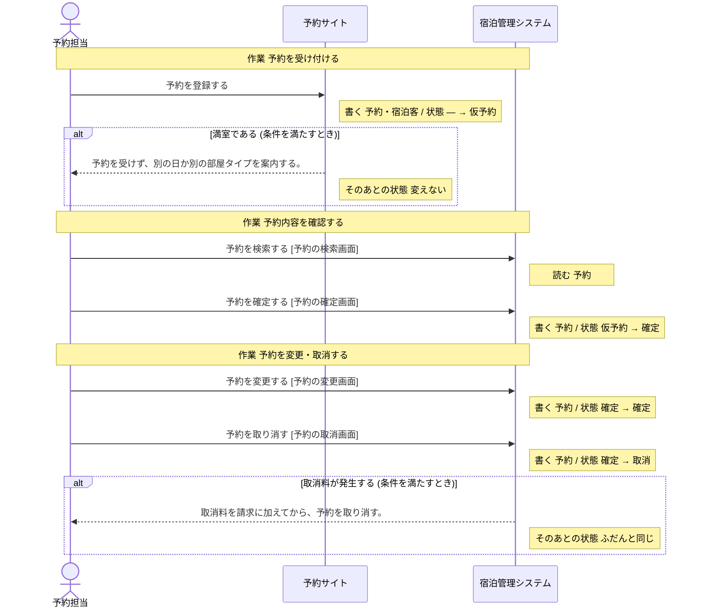
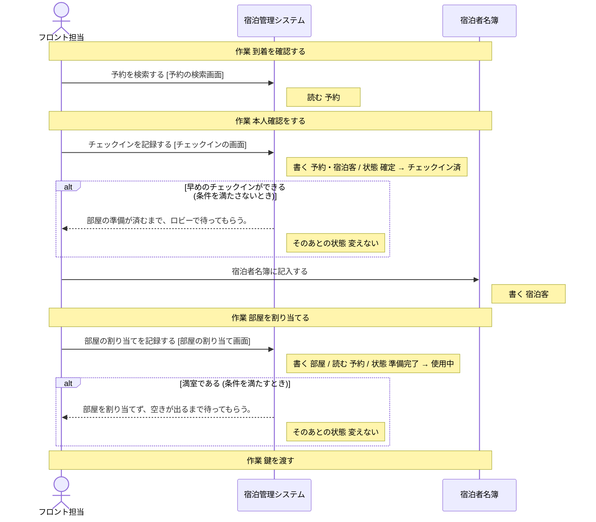
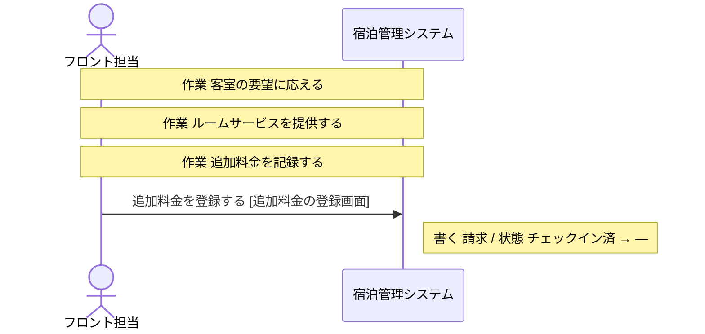
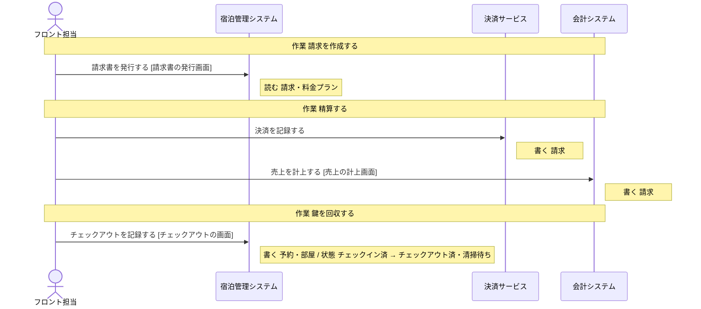
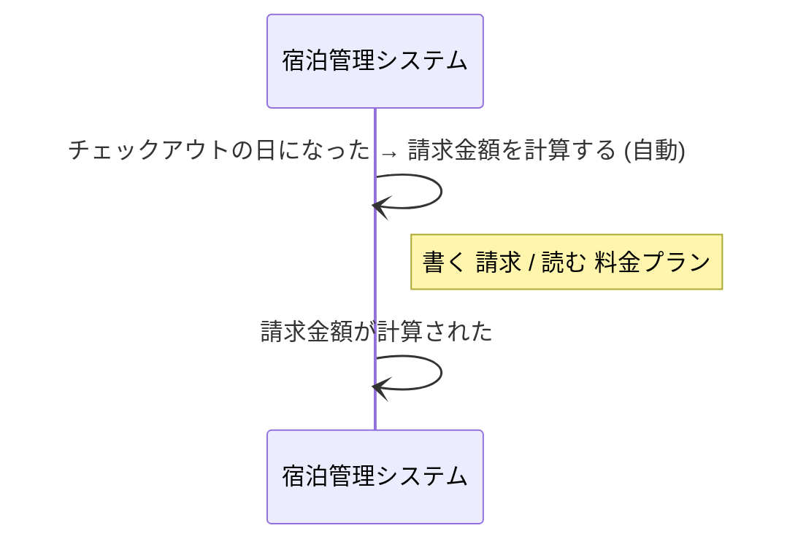

# 宿泊管理システム の設計

untie が、分析と設計から書き出したもの (自動生成。手で直しても、書き出し直すと消える)。

## 読み方

- **操作** が、このシステムで作る機能の単位。ここに無い操作は、作らない。
- 「ほかのシステム」「帳票」と書いてある操作は、このシステムでは作らない。このシステムの操作の前提 (状態・情報・出来事) を、外で作っているもの。
- **決まっていない** と書いてあることは、勝手に決めない。「まだ決まっていないこと」に挙がっているあいだは、実装を始めない。

## 操作

### 予約を確定する

- 作業: 予約内容を確認する (担当: 予約担当)
- 画面: 予約の確定画面
- 情報: 予約 (取得・保存)
- 前提の状態: 予約の状態 = 仮予約 (これ以外のときは、行えない)
- 次の状態: 予約の状態 = 確定

### 予約を検索する

- 作業: 予約内容を確認する (担当: 予約担当)
- 作業: 到着を確認する (担当: フロント担当)
- 画面: 予約の検索画面
- 情報: 予約 (取得)

### 予約を変更する

- 作業: 予約を変更・取消する (担当: 予約担当・宿泊客)
- 画面: 予約の変更画面
- 情報: 予約 (取得・保存)
- 前提の状態: 予約の状態 = 確定 (これ以外のときは、行えない)
- 次の状態: 予約の状態 = 確定

### 予約を取り消す

- 作業: 予約を変更・取消する (担当: 予約担当・宿泊客)
- 画面: 予約の取消画面
- 情報: 予約 (取得・保存)
- 前提の状態: 予約の状態 = 確定 (これ以外のときは、行えない)
- 次の状態: 予約の状態 = 取消
- 条件「取消料が発生する」: 条件を満たすとき、取消料を請求に加えてから、予約を取り消す。 (そのあとの状態: ふだんと同じ)

### チェックインを記録する

- 作業: 本人確認をする (担当: フロント担当・宿泊客)
- 画面: チェックインの画面
- 情報: 予約 (取得・保存)
- 情報: 宿泊客 (取得・保存)
- 前提の状態: 予約の状態 = 確定 (これ以外のときは、行えない)
- 次の状態: 予約の状態 = チェックイン済
- 条件「早めのチェックインができる」: 条件を満たさないとき、部屋の準備が済むまで、ロビーで待ってもらう。 (そのあとの状態: 変えない)

### 部屋の割り当てを記録する

- 作業: 部屋を割り当てる (担当: フロント担当)
- 画面: 部屋の割り当て画面
- 情報: 部屋 (取得・保存)
- 情報: 予約 (取得)
- 前提の状態: 部屋の状態 = 準備完了 (これ以外のときは、行えない)
- 次の状態: 部屋の状態 = 使用中
- 条件「満室である」: 条件を満たすとき、部屋を割り当てず、空きが出るまで待ってもらう。 (そのあとの状態: 変えない)

### 請求金額を計算する

- きっかけの出来事: チェックアウトの日になった (人の操作ではなく、この出来事が起きたら行う)
- 情報: 請求 (取得・保存)
- 情報: 料金プラン (取得)
- 起きる出来事: 請求金額が計算された

### 追加料金を登録する

- 作業: 追加料金を記録する (担当: フロント担当)
- 画面: 追加料金の登録画面
- 情報: 請求 (取得・保存)
- 前提の状態: 予約の状態 = チェックイン済 (これ以外のときは、行えない)

### 請求書を発行する

- 作業: 請求を作成する (担当: フロント担当)
- きっかけの出来事: 請求金額が計算された (人の操作ではなく、この出来事が起きたら行う)
- 画面: 請求書の発行画面
- 情報: 請求 (取得)
- 情報: 料金プラン (取得)

### チェックアウトを記録する

- 作業: 鍵を回収する (担当: フロント担当)
- 画面: チェックアウトの画面
- 情報: 予約 (取得・保存)
- 情報: 部屋 (取得・保存)
- 前提の状態: 予約の状態 = チェックイン済 (これ以外のときは、行えない)
- 次の状態: 予約の状態 = チェックアウト済、部屋の状態 = 清掃待ち

## 状態

### 予約の状態

情報「予約」の状態。どれか 1 つの値を取る。

| 状態 | この状態にする操作 | この状態が前提の操作 |
| --- | --- | --- |
| 仮予約 | 「予約を登録する」(ほかのシステム「予約サイト」) | 「予約を確定する」 |
| 確定 | 「予約を確定する」、「予約を変更する」 | 「予約を変更する」、「予約を取り消す」、「チェックインを記録する」 |
| チェックイン済 | 「チェックインを記録する」 | 「追加料金を登録する」、「チェックアウトを記録する」 |
| チェックアウト済 | 「チェックアウトを記録する」 | 無い |
| 取消 | 「予約を取り消す」 | 無い |

作られたときの状態: 仮予約

### 部屋の状態

情報「部屋」の状態。どれか 1 つの値を取る。

| 状態 | この状態にする操作 | この状態が前提の操作 |
| --- | --- | --- |
| 清掃待ち | 「チェックアウトを記録する」 | 「清掃状況を更新する」(帳票「清掃チェック表」) |
| 清掃中 | 「清掃状況を更新する」(帳票「清掃チェック表」) | 「清掃状況を更新する」(帳票「清掃チェック表」) |
| 準備完了 | 「清掃状況を更新する」(帳票「清掃チェック表」) | 「部屋の割り当てを記録する」 |
| 使用中 | 「部屋の割り当てを記録する」 | 無い |

作られたときの状態: 設計に無い (前提の状態なしに、このグループの状態にする操作が無い)。作る手段を足すなら、どの状態で作るかを、呼び出す側が渡す形にする。

## 情報

### 予約

- 状態: 予約の状態
- 結びつく情報: 宿泊客・部屋・料金プラン・請求
- 区分: 予約経路
- 保存する操作: 「予約を登録する」(ほかのシステム「予約サイト」)、「予約を確定する」、「予約を変更する」、「予約を取り消す」、「チェックインを記録する」、「チェックアウトを記録する」
- 取得する操作: 「予約を登録する」(ほかのシステム「予約サイト」)、「予約を確定する」、「予約を検索する」、「予約を変更する」、「予約を取り消す」、「チェックインを記録する」、「部屋の割り当てを記録する」、「チェックアウトを記録する」
- テーブル: 決まっていない

### 宿泊客

- 結びつく情報: 予約
- 保存する操作: 「予約を登録する」(ほかのシステム「予約サイト」)、「チェックインを記録する」、「宿泊者名簿に記入する」(帳票「宿泊者名簿」)
- 取得する操作: 「予約を登録する」(ほかのシステム「予約サイト」)、「チェックインを記録する」
- テーブル: 決まっていない

### 部屋

- 状態: 部屋の状態
- 結びつく情報: 予約・清掃記録
- 区分: 部屋タイプ
- 保存する操作: 「部屋の割り当てを記録する」、「チェックアウトを記録する」
- 取得する操作: 「部屋の割り当てを記録する」、「チェックアウトを記録する」、「清掃状況を更新する」(帳票「清掃チェック表」)
- テーブル: 決まっていない

### 料金プラン

- 結びつく情報: 予約
- 保存する操作: 無い
- 取得する操作: 「請求金額を計算する」、「請求書を発行する」
- テーブル: 決まっていない

### 請求

- 結びつく情報: 予約
- 区分: 支払方法
- 保存する操作: 「請求金額を計算する」、「追加料金を登録する」、「決済を記録する」(ほかのシステム「決済サービス」)、「売上を計上する」(ほかのシステム「会計システム」)
- 取得する操作: 「請求金額を計算する」、「追加料金を登録する」、「請求書を発行する」、「決済を記録する」(ほかのシステム「決済サービス」)
- テーブル: 決まっていない

## 条件

条件を満たすかどうかは、下の「何で判断するか」から決める。式までは決まっていないので、判断に要る値が足りなければ、呼び出す側が渡す形にする。

### 取消料が発生する

- 何で判断するか: 宿泊日が近い取消は取消料がかかる。状態 (予約の状態 = 確定) を見る
- 判断する操作: 「予約を取り消す」

### 早めのチェックインができる

- 何で判断するか: 状態 (部屋の状態 = 準備完了) を見る
- 判断する操作: 「チェックインを記録する」

### 満室である

- 何で判断するか: 状態 (部屋の状態 = 使用中) を見る。区分 (部屋タイプ) を見る
- 判断する操作: 「予約を登録する」(ほかのシステム「予約サイト」)、「部屋の割り当てを記録する」

## 区分

- 部屋タイプ: シングル・ツイン・スイート
- 予約経路: 電話・予約サイト・直接来館
- 支払方法: 現金・クレジットカード・事前決済

## 出来事

- チェックアウトの日になった: 起こすもの: システム「宿泊管理システム」、定期: 毎日 0:05 (日付が変わったら、その日にチェックアウトする予約をまとめて拾う)。これをきっかけに行う操作: 「請求金額を計算する」
- 請求金額が計算された: 起こすもの: 「請求金額を計算する」。これをきっかけに行う操作: 「請求書を発行する」

## 業務の流れ

業務ごとの、作業と操作の順 (シーケンス図)。条件で流れが変わるところは、alt の枠。

### 予約受付

### チェックイン

### 滞在中の対応

### チェックアウト

### 自動の処理 (業務に属さないもの)

## まだ決まっていないこと

### 情報と出来事の出どころが決まっている

- 情報「料金プラン」を保存する操作がありません (取得するだけで、どこで作られるかが決まっていない)

### データの置き場所が決まっている

- このシステムの設計がまだありません

### 画面がそろっている

- このシステムの設計がまだありません
