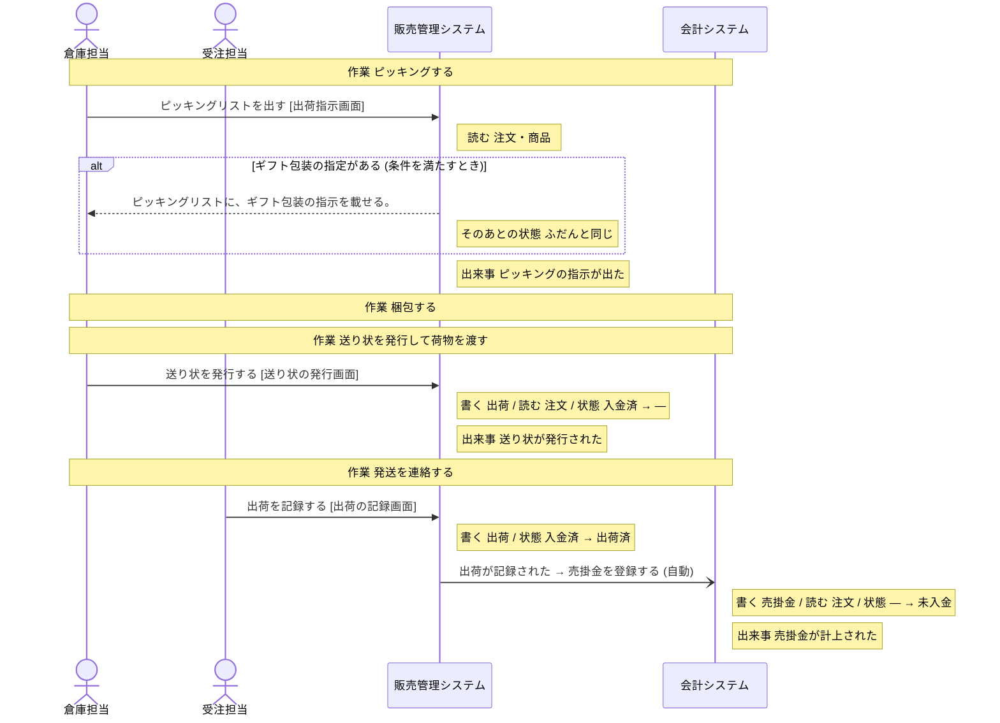
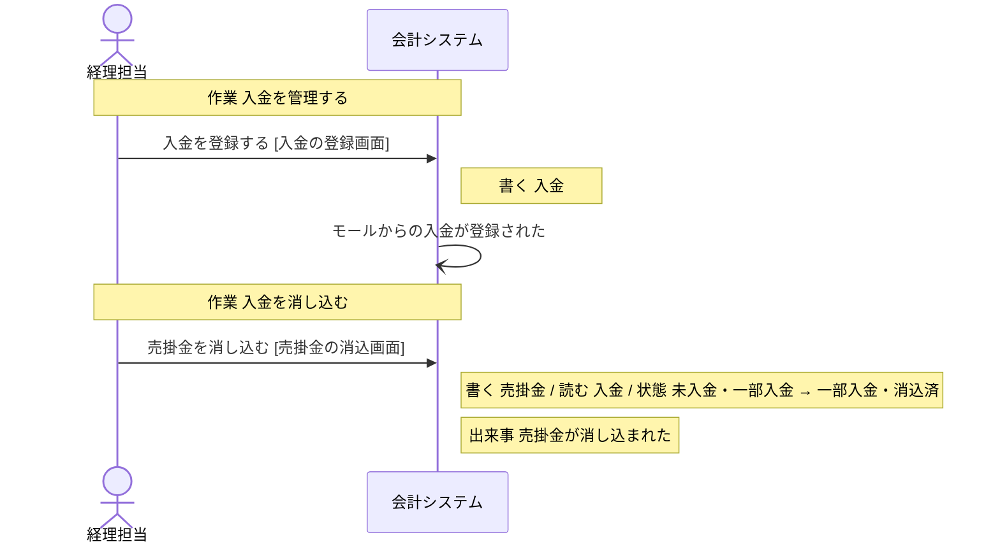
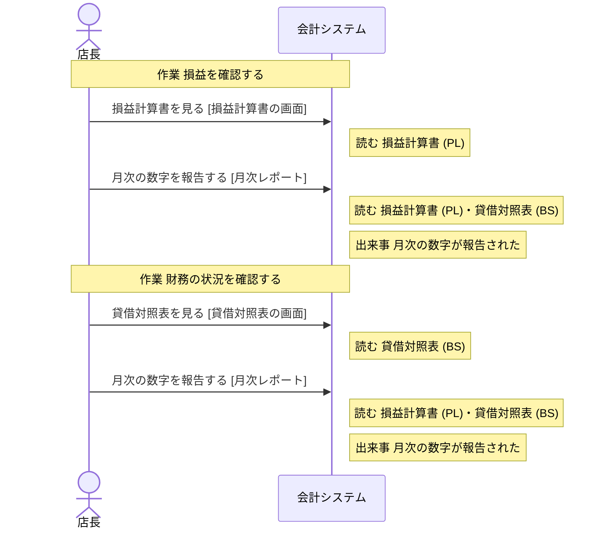

# 会計システム の設計

untie が、分析と設計から書き出したもの (自動生成。手で直しても、書き出し直すと消える)。

## 読み方

- **操作** が、このシステムで作る機能の単位。ここに無い操作は、作らない。
- 「ほかのシステム」「帳票」と書いてある操作は、このシステムでは作らない。このシステムの操作の前提 (状態・情報・出来事) を、外で作っているもの。
- **決まっていない** と書いてあることは、勝手に決めない。「まだ決まっていないこと」に挙がっているあいだは、実装を始めない。

## 操作

### 売掛金を登録する

- きっかけの出来事: 出荷が記録された (人の操作ではなく、この出来事が起きたら行う)
- 情報: 売掛金 (取得・保存)
- 情報: 注文 (取得)
- 次の状態: 売掛金の状態 = 未入金
- 起きる出来事: 売掛金が計上された

### 入金を登録する

- 作業: 入金を管理する (担当: 経理担当)
- 画面: 入金の登録画面
- 情報: 入金 (取得・保存)
- 起きる出来事: モールからの入金が登録された

### 売掛金を消し込む

- 作業: 入金を消し込む (担当: 経理担当)
- きっかけの出来事: モールからの入金が登録された (人の操作ではなく、この出来事が起きたら行う)
- 画面: 売掛金の消込画面
- 情報: 売掛金 (取得・保存)
- 情報: 入金 (取得)
- 前提の状態: 売掛金の状態 = 未入金、売掛金の状態 = 一部入金 (これ以外のときは、行えない)
- 次の状態: 売掛金の状態 = 一部入金、売掛金の状態 = 消込済
- 起きる出来事: 売掛金が消し込まれた

### 損益計算書を見る

- 作業: 損益を確認する (担当: 店長・経理担当)
- きっかけの出来事: 月次の締めが済んだ (人の操作ではなく、この出来事が起きたら行う)
- 画面: 損益計算書の画面
- 情報: 損益計算書 (PL) (取得)
- 続けて行う操作: 「月次の数字を報告する」

### 貸借対照表を見る

- 作業: 財務の状況を確認する (担当: 店長・経理担当)
- 画面: 貸借対照表の画面
- 情報: 貸借対照表 (BS) (取得)
- 続けて行う操作: 「月次の数字を報告する」

### 月次の数字を報告する

- 作業: 損益を確認する (担当: 店長・経理担当)
- 作業: 財務の状況を確認する (担当: 店長・経理担当)
- 画面: 月次レポート
- 情報: 損益計算書 (PL) (取得)
- 情報: 貸借対照表 (BS) (取得)
- 起きる出来事: 月次の数字が報告された

## 状態

### 売掛金の状態

情報「売掛金」の状態。どれか 1 つの値を取る。

| 状態 | この状態にする操作 | この状態が前提の操作 |
| --- | --- | --- |
| 未入金 | 「売掛金を登録する」 | 「売掛金を消し込む」 |
| 一部入金 | 「売掛金を消し込む」 | 「売掛金を消し込む」 |
| 消込済 | 「売掛金を消し込む」 | 無い |

作られたときの状態: 未入金

## 情報

### 注文

- 状態: 注文の状態
- 結びつく情報: 返品・購入者・商品・出荷・売掛金・損益計算書 (PL)
- 区分: 販売チャネル・支払方法
- 保存する操作: 「注文を登録する」(ほかのシステム「販売管理システム」)、「注文を確定する」(ほかのシステム「販売管理システム」)、「注文を取り消す」(ほかのシステム「販売管理システム」)
- 取得する操作: 「モールの注文を確認する」(ほかのシステム「モールの管理画面」)、「注文を登録する」(ほかのシステム「販売管理システム」)、「注文を検索する」(ほかのシステム「販売管理システム」)、「注文を確定する」(ほかのシステム「販売管理システム」)、「注文を取り消す」(ほかのシステム「販売管理システム」)、「在庫を引き当てる」(ほかのシステム「販売管理システム」)、「入金を記録する」(ほかのシステム「決済サービス」)、「ピッキングリストを出す」(ほかのシステム「販売管理システム」)、「送り状を発行する」(ほかのシステム「販売管理システム」)、「返品を登録する」(ほかのシステム「販売管理システム」)、「売掛金を登録する」
- テーブル: 決まっていない

### 売掛金

- 状態: 売掛金の状態
- 結びつく情報: 注文・入金・貸借対照表 (BS)
- 保存する操作: 「売掛金を登録する」、「売掛金を消し込む」
- 取得する操作: 「売掛金を登録する」、「売掛金を消し込む」
- テーブル: 決まっていない

### 入金

- 結びつく情報: 売掛金
- 保存する操作: 「入金を登録する」
- 取得する操作: 「入金を登録する」、「売掛金を消し込む」
- テーブル: 決まっていない

### 損益計算書 (PL)

- 結びつく情報: 注文・貸借対照表 (BS)
- 保存する操作: 無い
- 取得する操作: 「損益計算書を見る」、「月次の数字を報告する」
- テーブル: 決まっていない

### 貸借対照表 (BS)

- 結びつく情報: 売掛金・損益計算書 (PL)
- 保存する操作: 無い
- 取得する操作: 「貸借対照表を見る」、「月次の数字を報告する」
- テーブル: 決まっていない

## 区分

- 販売チャネル: 自社サイト・モールA・モールB
- 支払方法: クレジットカード・代金引換・コンビニ払い

## 出来事

- 出荷が記録された: 起こすもの: 「出荷を記録する」(ほかのシステム「販売管理システム」)。これをきっかけに行う操作: 「売掛金を登録する」
- 売掛金が計上された: 起こすもの: 「売掛金を登録する」。これをきっかけに行う操作: 無い
- モールからの入金が登録された: 起こすもの: 「入金を登録する」。これをきっかけに行う操作: 「売掛金を消し込む」
- 売掛金が消し込まれた: 起こすもの: 「売掛金を消し込む」。これをきっかけに行う操作: 無い
- 月次の締めが済んだ: 起こすもの: システム「会計システム」。これをきっかけに行う操作: 「損益計算書を見る」
- 月次の数字が報告された: 起こすもの: 「月次の数字を報告する」。これをきっかけに行う操作: 無い

## 業務の流れ

業務ごとの、作業と操作の順 (シーケンス図)。条件で流れが変わるところは、alt の枠。

### 出荷

### 売掛金・入金管理

### 月次の数字の確認

## まだ決まっていないこと

### 情報と出来事の出どころが決まっている

- 情報「損益計算書 (PL)」を保存する操作がありません (取得するだけで、どこで作られるかが決まっていない)
- 情報「貸借対照表 (BS)」を保存する操作がありません (取得するだけで、どこで作られるかが決まっていない)

### データの置き場所が決まっている

- このシステムの設計がまだありません

### 画面がそろっている

- このシステムの設計がまだありません
