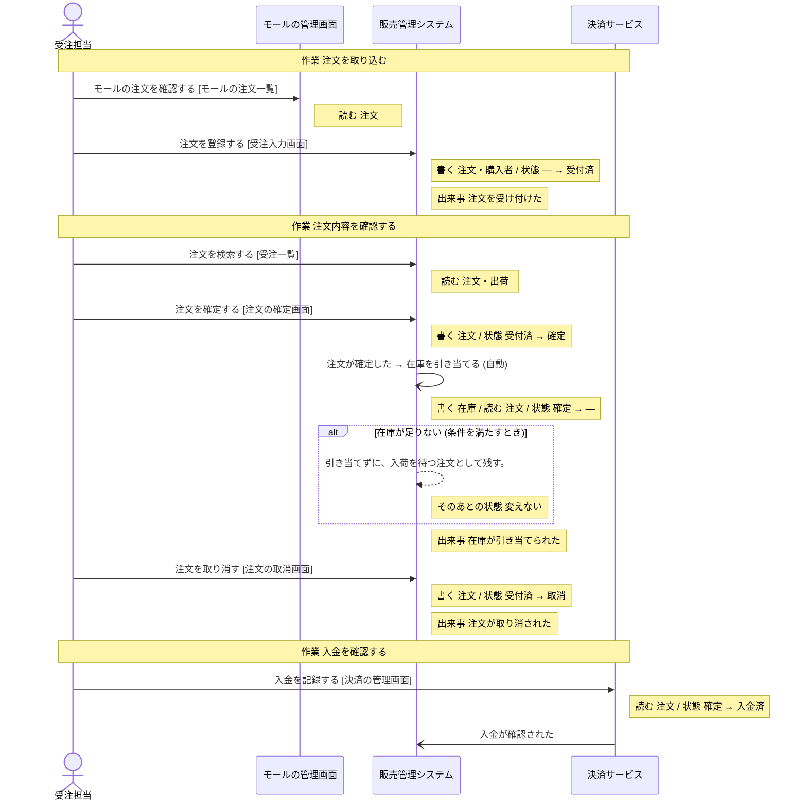

# モールの管理画面 の設計

untie が、分析と設計から書き出したもの (自動生成。手で直しても、書き出し直すと消える)。

## 読み方

- **操作** が、このシステムで作る機能の単位。ここに無い操作は、作らない。
- 「ほかのシステム」「帳票」と書いてある操作は、このシステムでは作らない。このシステムの操作の前提 (状態・情報・出来事) を、外で作っているもの。
- **決まっていない** と書いてあることは、勝手に決めない。「まだ決まっていないこと」に挙がっているあいだは、実装を始めない。

## 操作

### モールの注文を確認する

- 作業: 注文を取り込む (担当: 受注担当・購入者)
- 画面: モールの注文一覧
- 情報: 注文 (取得)
- 続けて行う操作: 「注文を登録する」(ほかのシステム「販売管理システム」)

## 情報

### 注文

- 状態: 注文の状態
- 結びつく情報: 返品・購入者・商品・出荷・売掛金・損益計算書 (PL)
- 区分: 販売チャネル・支払方法
- 保存する操作: 「注文を登録する」(ほかのシステム「販売管理システム」)、「注文を確定する」(ほかのシステム「販売管理システム」)、「注文を取り消す」(ほかのシステム「販売管理システム」)
- 取得する操作: 「モールの注文を確認する」、「注文を登録する」(ほかのシステム「販売管理システム」)、「注文を検索する」(ほかのシステム「販売管理システム」)、「注文を確定する」(ほかのシステム「販売管理システム」)、「注文を取り消す」(ほかのシステム「販売管理システム」)、「在庫を引き当てる」(ほかのシステム「販売管理システム」)、「入金を記録する」(ほかのシステム「決済サービス」)、「ピッキングリストを出す」(ほかのシステム「販売管理システム」)、「送り状を発行する」(ほかのシステム「販売管理システム」)、「返品を登録する」(ほかのシステム「販売管理システム」)、「売掛金を登録する」(ほかのシステム「会計システム」)
- テーブル: 決まっていない

## 区分

- 販売チャネル: 自社サイト・モールA・モールB
- 支払方法: クレジットカード・代金引換・コンビニ払い

## 業務の流れ

業務ごとの、作業と操作の順 (シーケンス図)。条件で流れが変わるところは、alt の枠。

### 受注処理

## まだ決まっていないこと

### データの置き場所が決まっている

- このシステムの設計がまだありません

### 画面がそろっている

- このシステムの設計がまだありません
