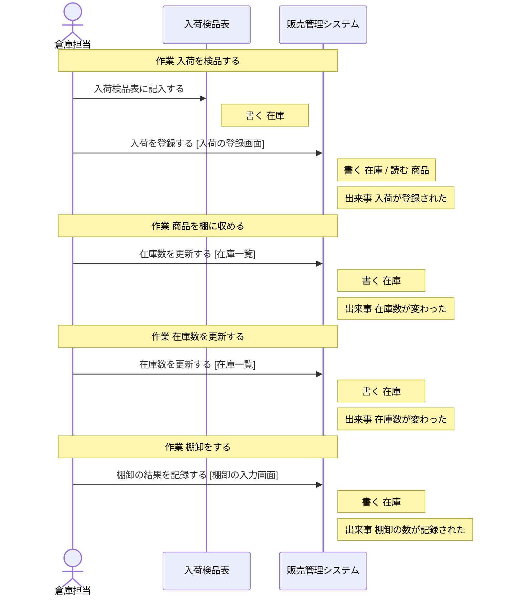
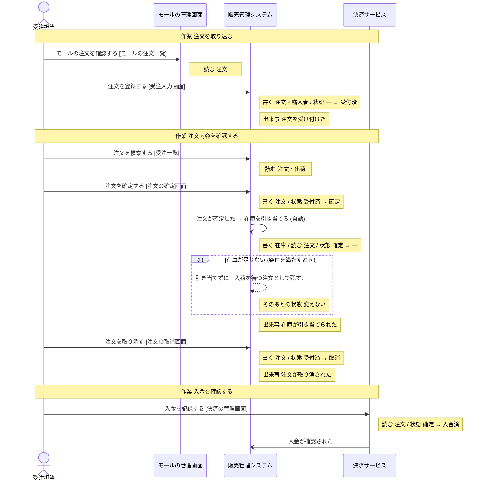
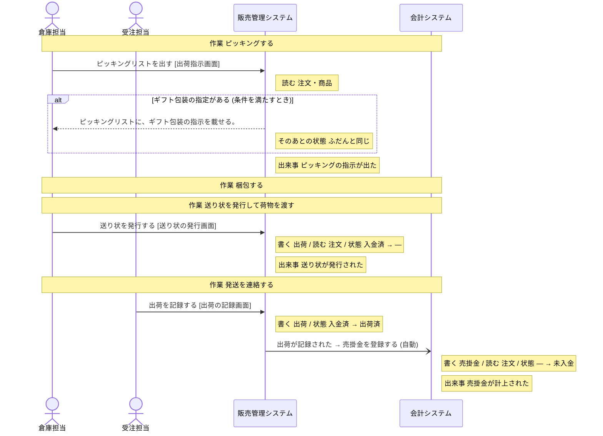
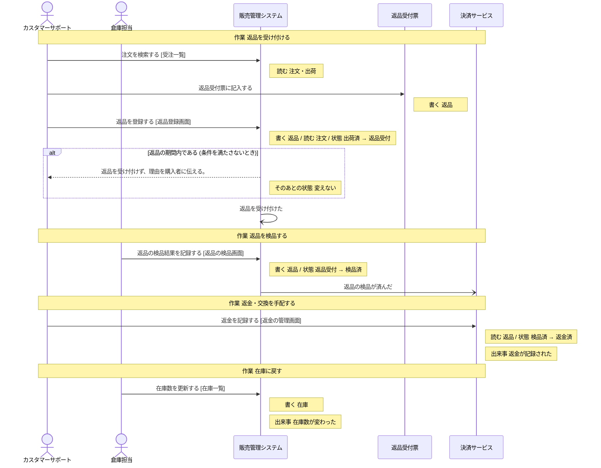
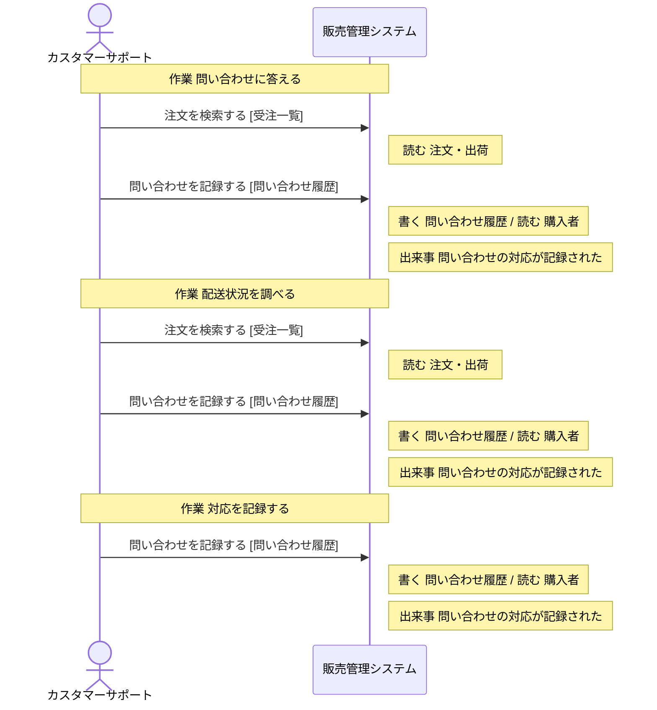

# 販売管理システム の設計

untie が、分析と設計から書き出したもの (自動生成。手で直しても、書き出し直すと消える)。

## 読み方

- **操作** が、このシステムで作る機能の単位。ここに無い操作は、作らない。
- 「ほかのシステム」「帳票」と書いてある操作は、このシステムでは作らない。このシステムの操作の前提 (状態・情報・出来事) を、外で作っているもの。
- **決まっていない** と書いてあることは、勝手に決めない。「まだ決まっていないこと」に挙がっているあいだは、実装を始めない。

## 操作

### 入荷を登録する

- 作業: 入荷を検品する (担当: 倉庫担当・仕入先)
- 画面: 入荷の登録画面
- 情報: 商品 (取得)
- 情報: 在庫 (取得・保存)
- 起きる出来事: 入荷が登録された

### 在庫数を更新する

- 作業: 商品を棚に収める (担当: 倉庫担当)
- 作業: 在庫数を更新する (担当: 倉庫担当)
- 作業: 在庫に戻す (担当: 倉庫担当)
- 画面: 在庫一覧
- 情報: 在庫 (取得・保存)
- 起きる出来事: 在庫数が変わった

### 棚卸の結果を記録する

- 作業: 棚卸をする (担当: 倉庫担当・店長)
- 画面: 棚卸の入力画面
- 情報: 在庫 (取得・保存)
- 起きる出来事: 棚卸の数が記録された

### 注文を登録する

- 作業: 注文を取り込む (担当: 受注担当・購入者)
- 画面: 受注入力画面
- 情報: 注文 (取得・保存)
- 情報: 購入者 (取得・保存)
- 次の状態: 注文の状態 = 受付済
- 起きる出来事: 注文を受け付けた

### 注文を検索する

- 作業: 注文内容を確認する (担当: 受注担当)
- 作業: 返品を受け付ける (担当: カスタマーサポート・購入者)
- 作業: 問い合わせに答える (担当: カスタマーサポート・購入者)
- 作業: 配送状況を調べる (担当: カスタマーサポート・配送業者)
- 画面: 受注一覧
- 情報: 注文 (取得)
- 情報: 出荷 (取得)
- 続けて行う操作: 「注文を確定する」、「注文を取り消す」、「返品を登録する」、「問い合わせを記録する」

### 注文を確定する

- 作業: 注文内容を確認する (担当: 受注担当)
- 画面: 注文の確定画面
- 情報: 注文 (取得・保存)
- 前提の状態: 注文の状態 = 受付済 (これ以外のときは、行えない)
- 次の状態: 注文の状態 = 確定
- 起きる出来事: 注文が確定した

### 注文を取り消す

- 作業: 注文内容を確認する (担当: 受注担当)
- 画面: 注文の取消画面
- 情報: 注文 (取得・保存)
- 前提の状態: 注文の状態 = 受付済 (これ以外のときは、行えない)
- 次の状態: 注文の状態 = 取消
- 起きる出来事: 注文が取り消された

### 在庫を引き当てる

- きっかけの出来事: 注文が確定した (人の操作ではなく、この出来事が起きたら行う)
- 情報: 在庫 (取得・保存)
- 情報: 注文 (取得)
- 前提の状態: 注文の状態 = 確定 (これ以外のときは、行えない)
- 条件「在庫が足りない」: 条件を満たすとき、引き当てずに、入荷を待つ注文として残す。 (そのあとの状態: 変えない)
- 起きる出来事: 在庫が引き当てられた

### ピッキングリストを出す

- 作業: ピッキングする (担当: 倉庫担当)
- きっかけの出来事: 入金が確認された (人の操作ではなく、この出来事が起きたら行う)
- 画面: 出荷指示画面
- 情報: 注文 (取得)
- 情報: 商品 (取得)
- 条件「ギフト包装の指定がある」: 条件を満たすとき、ピッキングリストに、ギフト包装の指示を載せる。 (そのあとの状態: ふだんと同じ)
- 起きる出来事: ピッキングの指示が出た

### 送り状を発行する

- 作業: 送り状を発行して荷物を渡す (担当: 倉庫担当・配送業者)
- 画面: 送り状の発行画面
- 情報: 出荷 (取得・保存)
- 情報: 注文 (取得)
- 前提の状態: 注文の状態 = 入金済 (これ以外のときは、行えない)
- 起きる出来事: 送り状が発行された

### 出荷を記録する

- 作業: 発送を連絡する (担当: 受注担当・購入者)
- 画面: 出荷の記録画面
- 情報: 出荷 (取得・保存)
- 前提の状態: 注文の状態 = 入金済 (これ以外のときは、行えない)
- 次の状態: 注文の状態 = 出荷済
- 起きる出来事: 出荷が記録された

### 返品を登録する

- 作業: 返品を受け付ける (担当: カスタマーサポート・購入者)
- 画面: 返品登録画面
- 情報: 返品 (取得・保存)
- 情報: 注文 (取得)
- 前提の状態: 注文の状態 = 出荷済 (これ以外のときは、行えない)
- 次の状態: 返品の状態 = 返品受付
- 条件「返品の期間内である」: 条件を満たさないとき、返品を受け付けず、理由を購入者に伝える。 (そのあとの状態: 変えない)
- 起きる出来事: 返品を受け付けた

### 返品の検品結果を記録する

- 作業: 返品を検品する (担当: 倉庫担当)
- きっかけの出来事: 返品を受け付けた (人の操作ではなく、この出来事が起きたら行う)
- 画面: 返品の検品画面
- 情報: 返品 (取得・保存)
- 前提の状態: 返品の状態 = 返品受付 (これ以外のときは、行えない)
- 次の状態: 返品の状態 = 検品済
- 起きる出来事: 返品の検品が済んだ

### 問い合わせを記録する

- 作業: 問い合わせに答える (担当: カスタマーサポート・購入者)
- 作業: 配送状況を調べる (担当: カスタマーサポート・配送業者)
- 作業: 対応を記録する (担当: カスタマーサポート)
- 画面: 問い合わせ履歴
- 情報: 問い合わせ履歴 (取得・保存)
- 情報: 購入者 (取得)
- 起きる出来事: 問い合わせの対応が記録された

## 状態

### 注文の状態

情報「注文」の状態。どれか 1 つの値を取る。

| 状態 | この状態にする操作 | この状態が前提の操作 |
| --- | --- | --- |
| 受付済 | 「注文を登録する」 | 「注文を確定する」、「注文を取り消す」 |
| 確定 | 「注文を確定する」 | 「在庫を引き当てる」、「入金を記録する」(ほかのシステム「決済サービス」) |
| 入金済 | 「入金を記録する」(ほかのシステム「決済サービス」) | 「送り状を発行する」、「出荷を記録する」 |
| 出荷済 | 「出荷を記録する」 | 「返品を登録する」 |
| 取消 | 「注文を取り消す」 | 無い |

作られたときの状態: 受付済

### 返品の状態

情報「返品」の状態。どれか 1 つの値を取る。

| 状態 | この状態にする操作 | この状態が前提の操作 |
| --- | --- | --- |
| 返品受付 | 「返品を登録する」 | 「返品の検品結果を記録する」 |
| 検品済 | 「返品の検品結果を記録する」 | 「返金を記録する」(ほかのシステム「決済サービス」) |
| 返金済 | 「返金を記録する」(ほかのシステム「決済サービス」) | 無い |

作られたときの状態: 設計に無い (前提の状態なしに、このグループの状態にする操作が無い)。作る手段を足すなら、どの状態で作るかを、呼び出す側が渡す形にする。

## 情報

### 注文

- 状態: 注文の状態
- 結びつく情報: 返品・購入者・商品・出荷・売掛金・損益計算書 (PL)
- 区分: 販売チャネル・支払方法
- 保存する操作: 「注文を登録する」、「注文を確定する」、「注文を取り消す」
- 取得する操作: 「モールの注文を確認する」(ほかのシステム「モールの管理画面」)、「注文を登録する」、「注文を検索する」、「注文を確定する」、「注文を取り消す」、「在庫を引き当てる」、「入金を記録する」(ほかのシステム「決済サービス」)、「ピッキングリストを出す」、「送り状を発行する」、「返品を登録する」、「売掛金を登録する」(ほかのシステム「会計システム」)
- テーブル: 決まっていない

### 返品

- 状態: 返品の状態
- 結びつく情報: 注文
- 保存する操作: 「返品受付票に記入する」(帳票「返品受付票」)、「返品を登録する」、「返品の検品結果を記録する」
- 取得する操作: 「返品を登録する」、「返品の検品結果を記録する」、「返金を記録する」(ほかのシステム「決済サービス」)
- テーブル: 決まっていない

### 購入者

- 結びつく情報: 注文・問い合わせ履歴
- 保存する操作: 「注文を登録する」
- 取得する操作: 「注文を登録する」、「問い合わせを記録する」
- テーブル: 決まっていない

### 問い合わせ履歴

- 結びつく情報: 購入者
- 保存する操作: 「問い合わせを記録する」
- 取得する操作: 「問い合わせを記録する」
- テーブル: 決まっていない

### 商品

- 結びつく情報: 注文・在庫
- 保存する操作: 無い
- 取得する操作: 「入荷を登録する」、「ピッキングリストを出す」
- テーブル: 決まっていない

### 在庫

- 結びつく情報: 商品
- 保存する操作: 「入荷検品表に記入する」(帳票「入荷検品表」)、「入荷を登録する」、「在庫数を更新する」、「棚卸の結果を記録する」、「在庫を引き当てる」
- 取得する操作: 「入荷を登録する」、「在庫数を更新する」、「棚卸の結果を記録する」、「在庫を引き当てる」
- テーブル: 決まっていない

### 出荷

- 結びつく情報: 注文
- 区分: 配送方法
- 保存する操作: 「送り状を発行する」、「出荷を記録する」
- 取得する操作: 「注文を検索する」、「送り状を発行する」、「出荷を記録する」
- テーブル: 決まっていない

## 条件

条件を満たすかどうかは、下の「何で判断するか」から決める。式までは決まっていないので、判断に要る値が足りなければ、呼び出す側が渡す形にする。

### 在庫が足りない

- 何で判断するか: 引き当てる数が、棚にある数を超えている。状態 (注文の状態 = 確定) を見る。区分 (販売チャネル) を見る
- 判断する操作: 「在庫を引き当てる」

### 返品の期間内である

- 何で判断するか: 商品が届いてから 8 日以内の申し出だけ受ける。状態 (注文の状態 = 出荷済) を見る
- 判断する操作: 「返品を登録する」

### ギフト包装の指定がある

- 何で判断するか: 状態 (注文の状態 = 入金済) を見る
- 判断する操作: 「ピッキングリストを出す」

## 区分

- 販売チャネル: 自社サイト・モールA・モールB
- 支払方法: クレジットカード・代金引換・コンビニ払い
- 配送方法: 宅配便・メール便・店頭受取

## 出来事

- 入荷が登録された: 起こすもの: 「入荷を登録する」。これをきっかけに行う操作: 無い
- 在庫数が変わった: 起こすもの: 「在庫数を更新する」。これをきっかけに行う操作: 無い
- 棚卸の数が記録された: 起こすもの: 「棚卸の結果を記録する」。これをきっかけに行う操作: 無い
- 注文を受け付けた: 起こすもの: 「注文を登録する」、システム「自社サイトのカート」。これをきっかけに行う操作: 無い
- 注文が確定した: 起こすもの: 「注文を確定する」。これをきっかけに行う操作: 「在庫を引き当てる」
- 注文が取り消された: 起こすもの: 「注文を取り消す」。これをきっかけに行う操作: 無い
- 在庫が引き当てられた: 起こすもの: 「在庫を引き当てる」。これをきっかけに行う操作: 無い
- 入金が確認された: 起こすもの: 「入金を記録する」(ほかのシステム「決済サービス」)、不定期: 決済サービスから入金の通知 (Webhook) を受けたとき。これをきっかけに行う操作: 「ピッキングリストを出す」
- ピッキングの指示が出た: 起こすもの: 「ピッキングリストを出す」。これをきっかけに行う操作: 無い
- 送り状が発行された: 起こすもの: 「送り状を発行する」。これをきっかけに行う操作: 無い
- 出荷が記録された: 起こすもの: 「出荷を記録する」。これをきっかけに行う操作: 「売掛金を登録する」(ほかのシステム「会計システム」)
- 返品を受け付けた: 起こすもの: 「返品を登録する」。これをきっかけに行う操作: 「返品の検品結果を記録する」
- 返品の検品が済んだ: 起こすもの: 「返品の検品結果を記録する」。これをきっかけに行う操作: 「返金を記録する」(ほかのシステム「決済サービス」)
- 問い合わせの対応が記録された: 起こすもの: 「問い合わせを記録する」。これをきっかけに行う操作: 無い

## 業務の流れ

業務ごとの、作業と操作の順 (シーケンス図)。条件で流れが変わるところは、alt の枠。

### 入荷・在庫管理

### 受注処理

### 出荷

### 返品・交換

### 問い合わせ対応

## まだ決まっていないこと

### 情報と出来事の出どころが決まっている

- 情報「商品」を保存する操作がありません (取得するだけで、どこで作られるかが決まっていない)

### データの置き場所が決まっている

- このシステムの設計がまだありません

### 画面がそろっている

- このシステムの設計がまだありません
