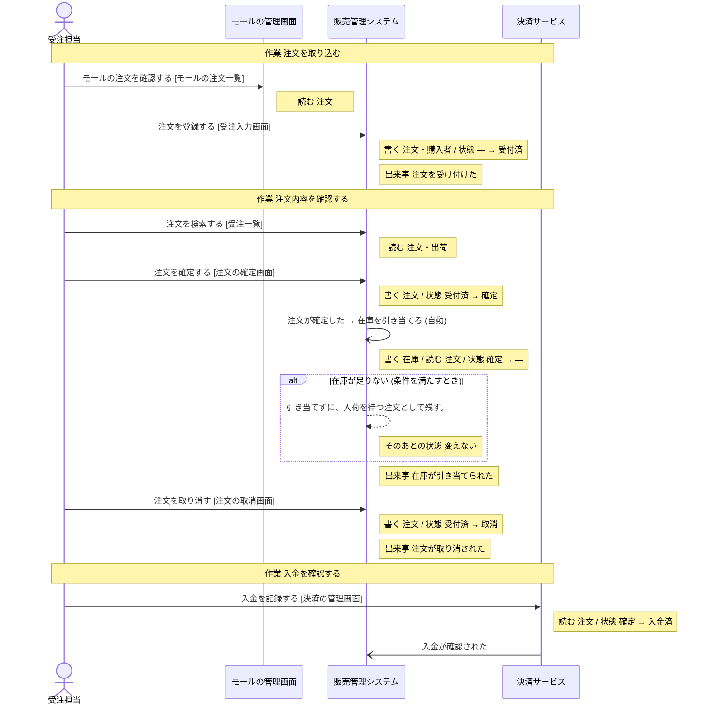
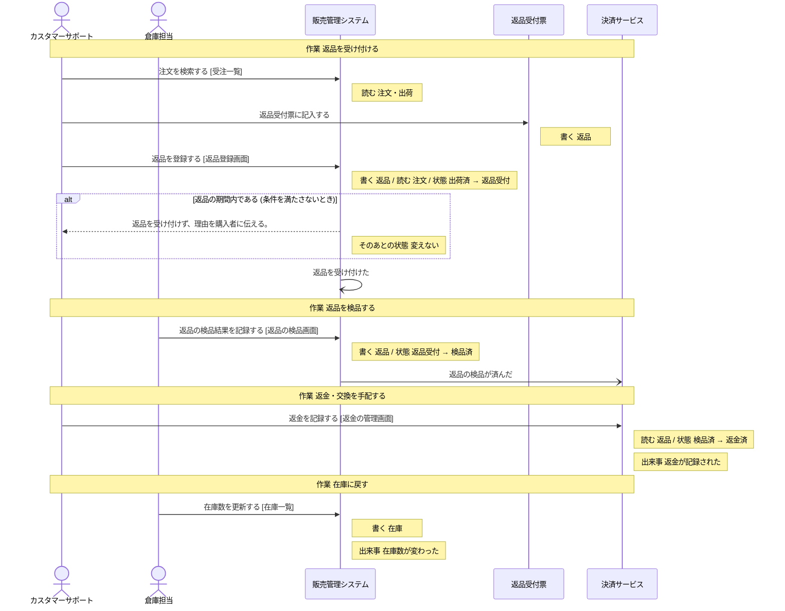

# 決済サービス の設計

untie が、分析と設計から書き出したもの (自動生成。手で直しても、書き出し直すと消える)。

## 読み方

- **操作** が、このシステムで作る機能の単位。ここに無い操作は、作らない。
- 「ほかのシステム」「帳票」と書いてある操作は、このシステムでは作らない。このシステムの操作の前提 (状態・情報・出来事) を、外で作っているもの。
- **決まっていない** と書いてあることは、勝手に決めない。「まだ決まっていないこと」に挙がっているあいだは、実装を始めない。

## 操作

### 入金を記録する

- 作業: 入金を確認する (担当: 受注担当)
- 画面: 決済の管理画面
- 情報: 注文 (取得)
- 前提の状態: 注文の状態 = 確定 (これ以外のときは、行えない)
- 次の状態: 注文の状態 = 入金済
- 起きる出来事: 入金が確認された

### 返金を記録する

- 作業: 返金・交換を手配する (担当: カスタマーサポート・店長)
- きっかけの出来事: 返品の検品が済んだ (人の操作ではなく、この出来事が起きたら行う)
- 画面: 返金の管理画面
- 情報: 返品 (取得)
- 前提の状態: 返品の状態 = 検品済 (これ以外のときは、行えない)
- 次の状態: 返品の状態 = 返金済
- 起きる出来事: 返金が記録された

## 状態

### 注文の状態

情報「注文」の状態。どれか 1 つの値を取る。

| 状態 | この状態にする操作 | この状態が前提の操作 |
| --- | --- | --- |
| 受付済 | 「注文を登録する」(ほかのシステム「販売管理システム」) | 「注文を確定する」(ほかのシステム「販売管理システム」)、「注文を取り消す」(ほかのシステム「販売管理システム」) |
| 確定 | 「注文を確定する」(ほかのシステム「販売管理システム」) | 「在庫を引き当てる」(ほかのシステム「販売管理システム」)、「入金を記録する」 |
| 入金済 | 「入金を記録する」 | 「送り状を発行する」(ほかのシステム「販売管理システム」)、「出荷を記録する」(ほかのシステム「販売管理システム」) |
| 出荷済 | 「出荷を記録する」(ほかのシステム「販売管理システム」) | 「返品を登録する」(ほかのシステム「販売管理システム」) |
| 取消 | 「注文を取り消す」(ほかのシステム「販売管理システム」) | 無い |

作られたときの状態: 受付済

### 返品の状態

情報「返品」の状態。どれか 1 つの値を取る。

| 状態 | この状態にする操作 | この状態が前提の操作 |
| --- | --- | --- |
| 返品受付 | 「返品を登録する」(ほかのシステム「販売管理システム」) | 「返品の検品結果を記録する」(ほかのシステム「販売管理システム」) |
| 検品済 | 「返品の検品結果を記録する」(ほかのシステム「販売管理システム」) | 「返金を記録する」 |
| 返金済 | 「返金を記録する」 | 無い |

作られたときの状態: 設計に無い (前提の状態なしに、このグループの状態にする操作が無い)。作る手段を足すなら、どの状態で作るかを、呼び出す側が渡す形にする。

## 情報

### 注文

- 状態: 注文の状態
- 結びつく情報: 返品・購入者・商品・出荷・売掛金・損益計算書 (PL)
- 区分: 販売チャネル・支払方法
- 保存する操作: 「注文を登録する」(ほかのシステム「販売管理システム」)、「注文を確定する」(ほかのシステム「販売管理システム」)、「注文を取り消す」(ほかのシステム「販売管理システム」)
- 取得する操作: 「モールの注文を確認する」(ほかのシステム「モールの管理画面」)、「注文を登録する」(ほかのシステム「販売管理システム」)、「注文を検索する」(ほかのシステム「販売管理システム」)、「注文を確定する」(ほかのシステム「販売管理システム」)、「注文を取り消す」(ほかのシステム「販売管理システム」)、「在庫を引き当てる」(ほかのシステム「販売管理システム」)、「入金を記録する」、「ピッキングリストを出す」(ほかのシステム「販売管理システム」)、「送り状を発行する」(ほかのシステム「販売管理システム」)、「返品を登録する」(ほかのシステム「販売管理システム」)、「売掛金を登録する」(ほかのシステム「会計システム」)
- テーブル: 決まっていない

### 返品

- 状態: 返品の状態
- 結びつく情報: 注文
- 保存する操作: 「返品受付票に記入する」(帳票「返品受付票」)、「返品を登録する」(ほかのシステム「販売管理システム」)、「返品の検品結果を記録する」(ほかのシステム「販売管理システム」)
- 取得する操作: 「返品を登録する」(ほかのシステム「販売管理システム」)、「返品の検品結果を記録する」(ほかのシステム「販売管理システム」)、「返金を記録する」
- テーブル: 決まっていない

## 区分

- 販売チャネル: 自社サイト・モールA・モールB
- 支払方法: クレジットカード・代金引換・コンビニ払い

## 出来事

- 入金が確認された: 起こすもの: 「入金を記録する」、不定期: 決済サービスから入金の通知 (Webhook) を受けたとき。これをきっかけに行う操作: 「ピッキングリストを出す」(ほかのシステム「販売管理システム」)
- 返品の検品が済んだ: 起こすもの: 「返品の検品結果を記録する」(ほかのシステム「販売管理システム」)。これをきっかけに行う操作: 「返金を記録する」
- 返金が記録された: 起こすもの: 「返金を記録する」。これをきっかけに行う操作: 無い

## 業務の流れ

業務ごとの、作業と操作の順 (シーケンス図)。条件で流れが変わるところは、alt の枠。

### 受注処理

### 返品・交換

## まだ決まっていないこと

### データの置き場所が決まっている

- このシステムの設計がまだありません

### 画面がそろっている

- このシステムの設計がまだありません
