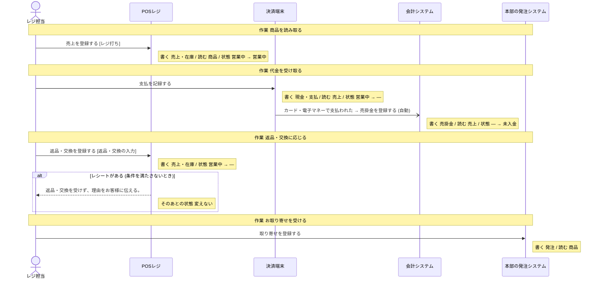
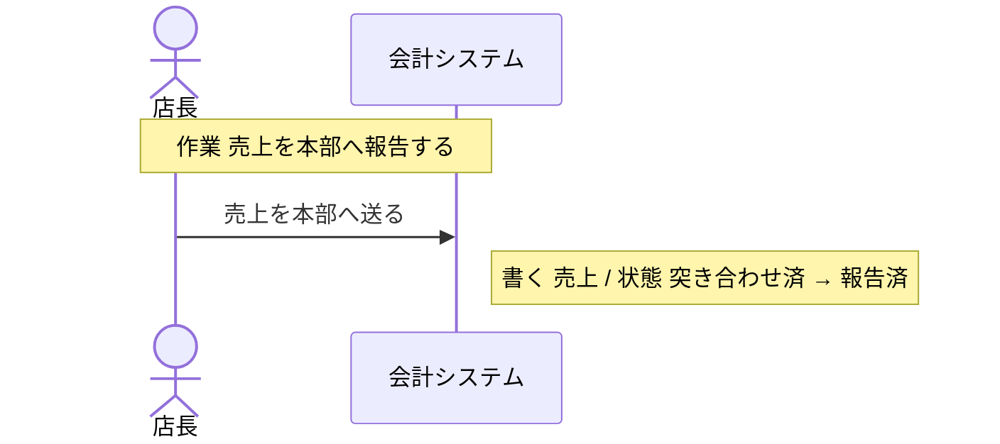
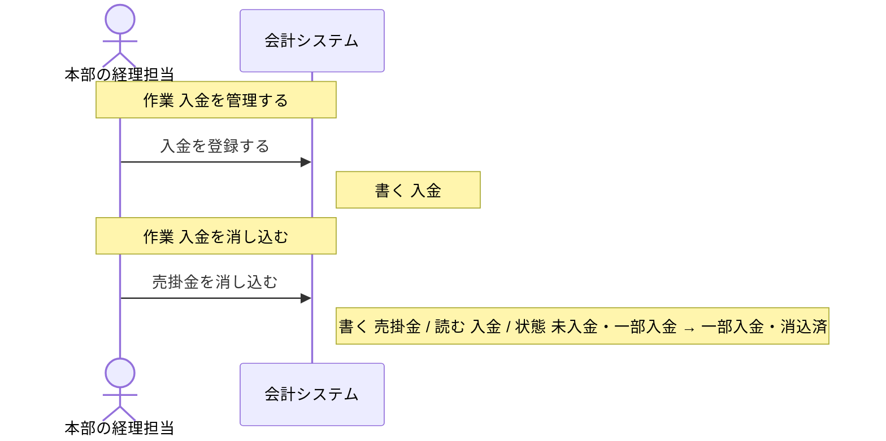
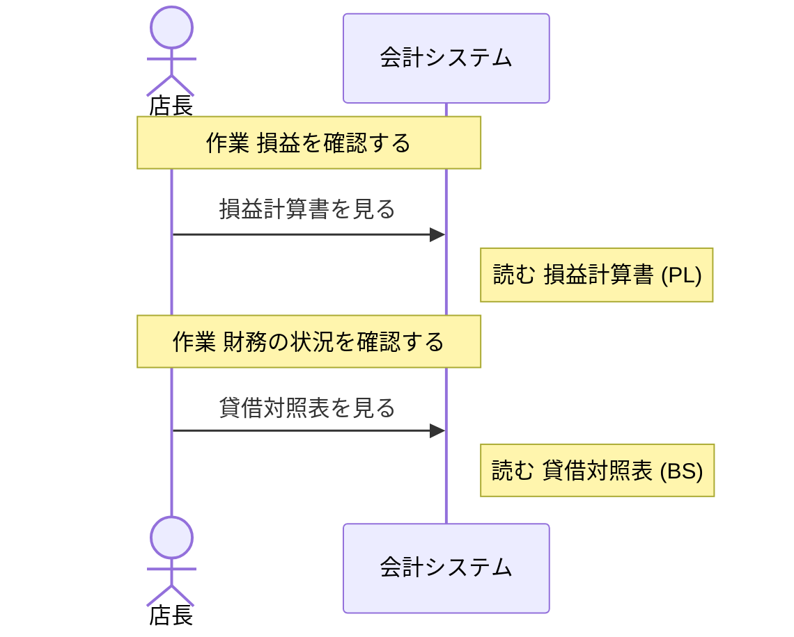

# 会計システム の設計

untie が、分析と設計から書き出したもの (自動生成。手で直しても、書き出し直すと消える)。

## 読み方

- **操作** が、このシステムで作る機能の単位。ここに無い操作は、作らない。
- 「ほかのシステム」「帳票」と書いてある操作は、このシステムでは作らない。このシステムの操作の前提 (状態・情報・出来事) を、外で作っているもの。
- **決まっていない** と書いてあることは、勝手に決めない。「まだ決まっていないこと」に挙がっているあいだは、実装を始めない。

## 操作

### 売上を本部へ送る

- 作業: 売上を本部へ報告する (担当: 店長・本部の仕入担当)
- 情報: 売上 (保存)
- 前提の状態: 1 日の締めの状態 = 突き合わせ済 (これ以外のときは、行えない)
- 次の状態: 1 日の締めの状態 = 報告済

### 売掛金を登録する

- きっかけの出来事: カード・電子マネーで支払われた (人の操作ではなく、この出来事が起きたら行う)
- 情報: 売掛金 (取得・保存)
- 情報: 売上 (取得)
- 次の状態: 売掛金の状態 = 未入金

### 入金を登録する

- 作業: 入金を管理する (担当: 本部の経理担当)
- 情報: 入金 (取得・保存)

### 売掛金を消し込む

- 作業: 入金を消し込む (担当: 本部の経理担当)
- 情報: 売掛金 (取得・保存)
- 情報: 入金 (取得)
- 前提の状態: 売掛金の状態 = 未入金、売掛金の状態 = 一部入金 (これ以外のときは、行えない)
- 次の状態: 売掛金の状態 = 一部入金、売掛金の状態 = 消込済

### 損益計算書を見る

- 作業: 損益を確認する (担当: 店長・本部の経理担当)
- 情報: 損益計算書 (PL) (取得)

### 貸借対照表を見る

- 作業: 財務の状況を確認する (担当: 店長・本部の経理担当)
- 情報: 貸借対照表 (BS) (取得)

## 状態

### 1 日の締めの状態

どの情報の状態かは、**決まっていない**。

| 状態 | この状態にする操作 | この状態が前提の操作 |
| --- | --- | --- |
| 営業中 | 「売上を登録する」(ほかのシステム「POSレジ」) | 「売上を登録する」(ほかのシステム「POSレジ」)、「支払を記録する」(ほかのシステム「決済端末」)、「返品・交換を登録する」(ほかのシステム「POSレジ」)、「現金の実際の額を記録する」(ほかのシステム「POSレジ」) |
| 現金確認済 | 「現金の実際の額を記録する」(ほかのシステム「POSレジ」) | 「日次の売上を出力する」(ほかのシステム「POSレジ」) |
| 突き合わせ済 | 「日次の売上を出力する」(ほかのシステム「POSレジ」) | 「売上を本部へ送る」 |
| 報告済 | 「売上を本部へ送る」 | 「入金を記録する」(帳票「レジ締め表」) |
| 入金済 | 「入金を記録する」(帳票「レジ締め表」) | 無い |

作られたときの状態: 設計に無い (前提の状態なしに、このグループの状態にする操作が無い)。作る手段を足すなら、どの状態で作るかを、呼び出す側が渡す形にする。

### 売掛金の状態

情報「売掛金」の状態。どれか 1 つの値を取る。

| 状態 | この状態にする操作 | この状態が前提の操作 |
| --- | --- | --- |
| 未入金 | 「売掛金を登録する」 | 「売掛金を消し込む」 |
| 一部入金 | 「売掛金を消し込む」 | 「売掛金を消し込む」 |
| 消込済 | 「売掛金を消し込む」 | 無い |

作られたときの状態: 未入金

## 情報

### 売上

- 結びつく情報: 商品・現金・支払・売掛金・損益計算書 (PL)
- 保存する操作: 「売上を登録する」(ほかのシステム「POSレジ」)、「返品・交換を登録する」(ほかのシステム「POSレジ」)、「売上を本部へ送る」
- 取得する操作: 「売上を登録する」(ほかのシステム「POSレジ」)、「支払を記録する」(ほかのシステム「決済端末」)、「返品・交換を登録する」(ほかのシステム「POSレジ」)、「日次の売上を出力する」(ほかのシステム「POSレジ」)、「売掛金を登録する」
- テーブル: 決まっていない

### 売掛金

- 状態: 売掛金の状態
- 結びつく情報: 売上・入金・貸借対照表 (BS)
- 保存する操作: 「売掛金を登録する」、「売掛金を消し込む」
- 取得する操作: 「売掛金を登録する」、「売掛金を消し込む」
- テーブル: 決まっていない

### 入金

- 結びつく情報: 売掛金
- 保存する操作: 「入金を登録する」
- 取得する操作: 「入金を登録する」、「売掛金を消し込む」
- テーブル: 決まっていない

### 損益計算書 (PL)

- 結びつく情報: 売上・貸借対照表 (BS)
- 保存する操作: 無い
- 取得する操作: 「損益計算書を見る」
- テーブル: 決まっていない

### 貸借対照表 (BS)

- 結びつく情報: 売掛金・損益計算書 (PL)
- 保存する操作: 無い
- 取得する操作: 「貸借対照表を見る」
- テーブル: 決まっていない

## 出来事

- カード・電子マネーで支払われた: 起こすもの: 「支払を記録する」(ほかのシステム「決済端末」)、不定期: 決済端末から決済の結果が届いたとき。これをきっかけに行う操作: 「売掛金を登録する」

## 業務の流れ

業務ごとの、作業と操作の順 (シーケンス図)。条件で流れが変わるところは、alt の枠。

### レジ・接客

### 売上報告

### 売掛金・入金管理

### 月次の数字の確認

## まだ決まっていないこと

### 情報と出来事の出どころが決まっている

- 情報「損益計算書 (PL)」を保存する操作がありません (取得するだけで、どこで作られるかが決まっていない)
- 情報「貸借対照表 (BS)」を保存する操作がありません (取得するだけで、どこで作られるかが決まっていない)

### 状態の移り変わりがつながっている

- 「1 日の締めの状態」が、どの情報の状態かが決まりません (この状態へ移す操作が保存する情報が複数あって、決められません: 売上・現金・支払・在庫)

### データの置き場所が決まっている

- このシステムの設計がまだありません

### 画面がそろっている

- このシステムの設計がまだありません
