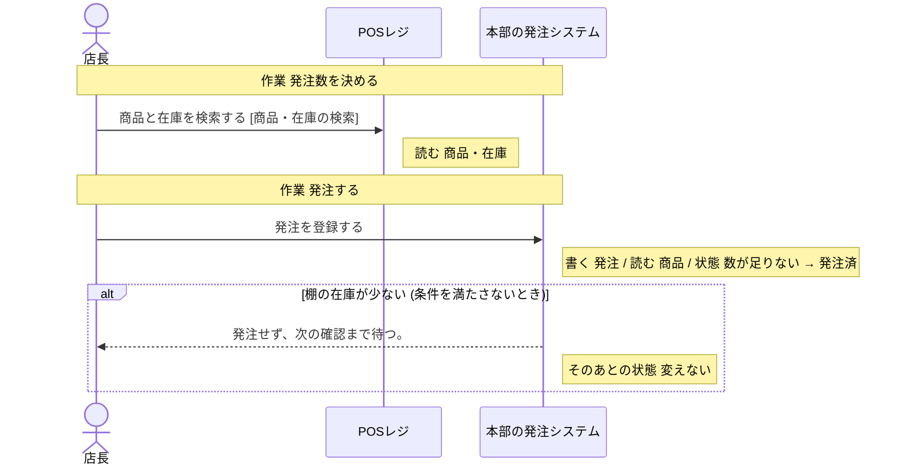
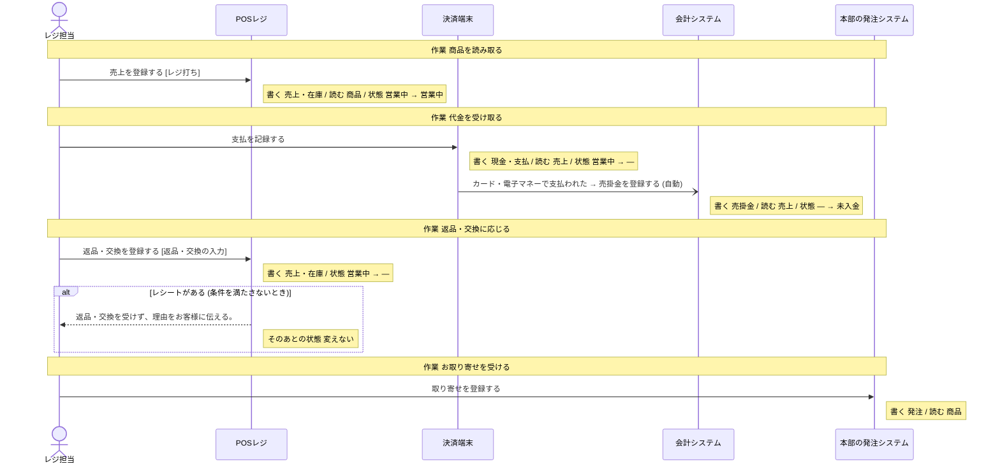

# 本部の発注システム の設計

untie が、分析と設計から書き出したもの (自動生成。手で直しても、書き出し直すと消える)。

## 読み方

- **操作** が、このシステムで作る機能の単位。ここに無い操作は、作らない。
- 「ほかのシステム」「帳票」と書いてある操作は、このシステムでは作らない。このシステムの操作の前提 (状態・情報・出来事) を、外で作っているもの。
- **決まっていない** と書いてあることは、勝手に決めない。「まだ決まっていないこと」に挙がっているあいだは、実装を始めない。

## 操作

### 発注を登録する

- 作業: 発注する (担当: 店長)
- 情報: 発注 (取得・保存)
- 情報: 商品 (取得)
- 前提の状態: 発注の状態 = 数が足りない (これ以外のときは、行えない)
- 次の状態: 発注の状態 = 発注済
- 条件「棚の在庫が少ない」: 条件を満たさないとき、発注せず、次の確認まで待つ。 (そのあとの状態: 変えない)

### 取り寄せを登録する

- 作業: お取り寄せを受ける (担当: レジ担当・本部の仕入担当・来店客)
- 情報: 発注 (取得・保存)
- 情報: 商品 (取得)

## 状態

### 発注の状態

情報「発注」の状態。どれか 1 つの値を取る。

| 状態 | この状態にする操作 | この状態が前提の操作 |
| --- | --- | --- |
| 発注済 | 「発注を登録する」 | 「入荷を登録する」(帳票「納品書・検品票」) |
| 入荷済 | 「入荷を登録する」(帳票「納品書・検品票」) | 「売価を変更する」(ほかのシステム「POSレジ」) |
| 数が足りない | 「入荷を登録する」(帳票「納品書・検品票」) | 「発注を登録する」 |

作られたときの状態: 設計に無い (前提の状態なしに、このグループの状態にする操作が無い)。作る手段を足すなら、どの状態で作るかを、呼び出す側が渡す形にする。

## 情報

### 商品

- 結びつく情報: 在庫・発注・売上
- 区分: 商品区分
- 保存する操作: 「売価を変更する」(ほかのシステム「POSレジ」)
- 取得する操作: 「発注を登録する」、「商品と在庫を検索する」(ほかのシステム「POSレジ」)、「売価を変更する」(ほかのシステム「POSレジ」)、「値引き・廃棄を記録する」(ほかのシステム「POSレジ」)、「売上を登録する」(ほかのシステム「POSレジ」)、「取り寄せを登録する」
- テーブル: 決まっていない

### 発注

- 状態: 発注の状態
- 結びつく情報: 商品・入荷
- 区分: 発注の種類
- 保存する操作: 「発注を登録する」、「取り寄せを登録する」
- 取得する操作: 「発注を登録する」、「入荷を登録する」(帳票「納品書・検品票」)、「取り寄せを登録する」
- テーブル: 決まっていない

## 条件

条件を満たすかどうかは、下の「何で判断するか」から決める。式までは決まっていないので、判断に要る値が足りなければ、呼び出す側が渡す形にする。

### 棚の在庫が少ない

- 何で判断するか: 発注点を下回っている。状態 (発注の状態 = 発注済) を見る。区分 (商品区分) を見る
- 判断する操作: 「発注を登録する」

## 区分

- 商品区分: 日用品・食品・雑貨
- 発注の種類: 定番品・特売品・新商品

## 業務の流れ

業務ごとの、作業と操作の順 (シーケンス図)。条件で流れが変わるところは、alt の枠。

### 発注

### レジ・接客

## まだ決まっていないこと

### データの置き場所が決まっている

- このシステムの設計がまだありません

### 画面がそろっている

- このシステムの設計がまだありません
