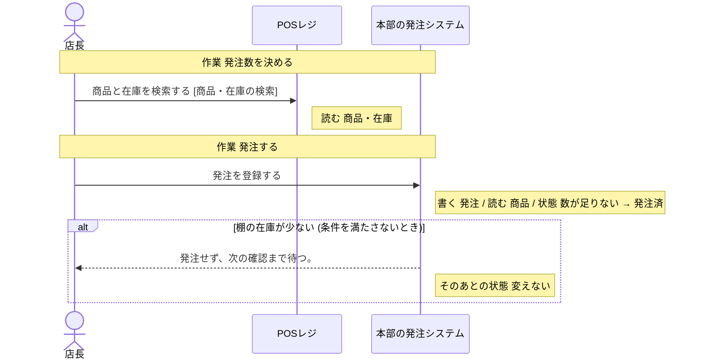
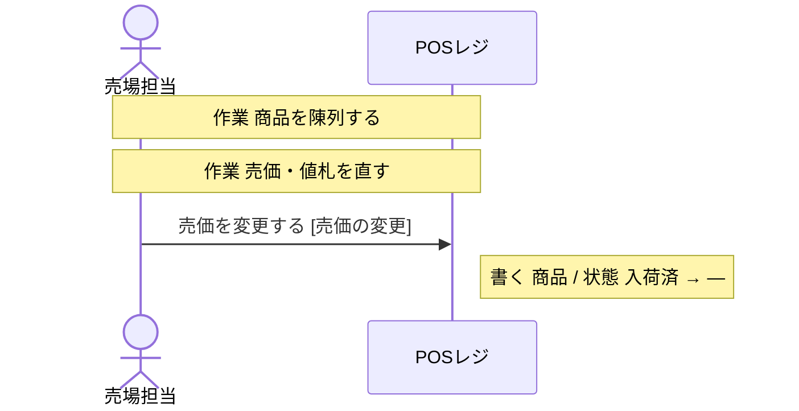
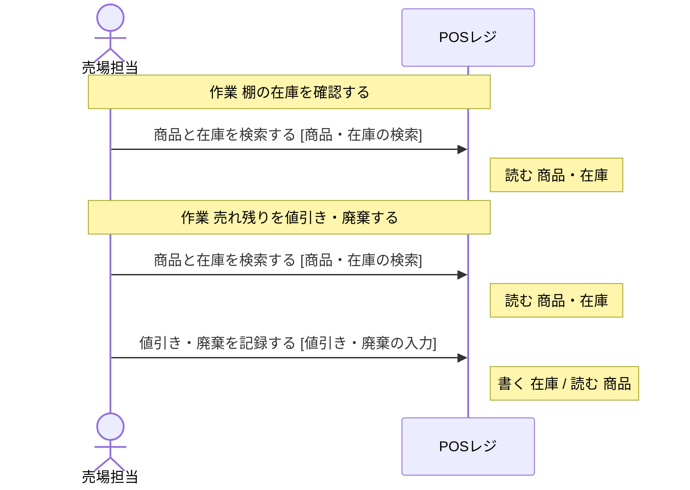
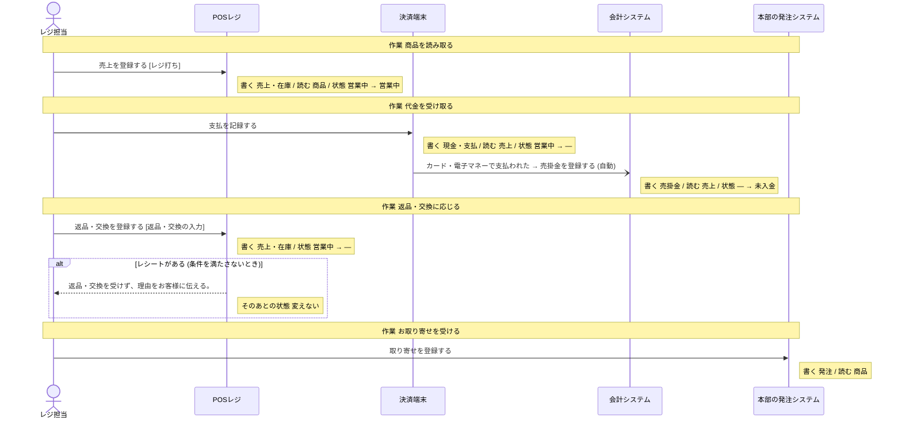
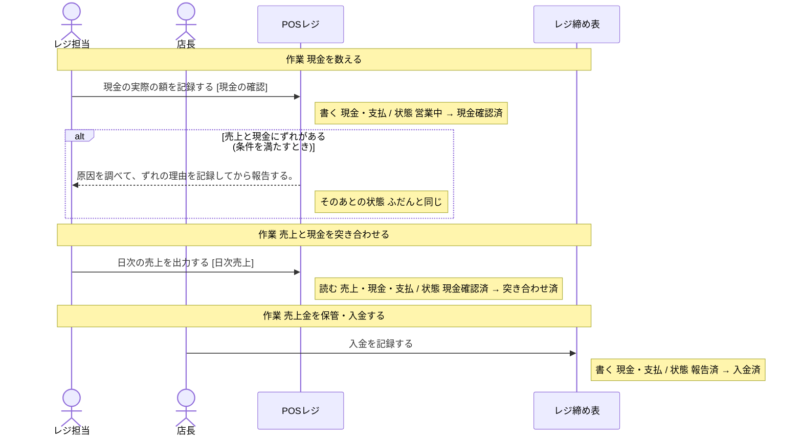
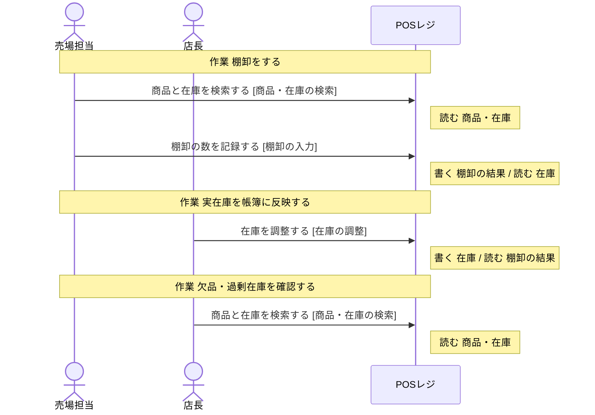

# POSレジ の設計

untie が、分析と設計から書き出したもの (自動生成。手で直しても、書き出し直すと消える)。

## 読み方

- **操作** が、このシステムで作る機能の単位。ここに無い操作は、作らない。
- 「ほかのシステム」「帳票」と書いてある操作は、このシステムでは作らない。このシステムの操作の前提 (状態・情報・出来事) を、外で作っているもの。
- **決まっていない** と書いてあることは、勝手に決めない。「まだ決まっていないこと」に挙がっているあいだは、実装を始めない。

## 操作

### 商品と在庫を検索する

- 作業: 発注数を決める (担当: 店長・本部の仕入担当)
- 作業: 棚の在庫を確認する (担当: 売場担当)
- 作業: 欠品・過剰在庫を確認する (担当: 店長)
- 作業: 売れ残りを値引き・廃棄する (担当: 店長・売場担当)
- 作業: 棚卸をする (担当: 売場担当・バックヤード担当)
- 画面: 商品・在庫の検索
- 情報: 商品 (取得)
- 情報: 在庫 (取得)
- 続けて行う操作: 「値引き・廃棄を記録する」、「棚卸の数を記録する」

### 売価を変更する

- 作業: 売価・値札を直す (担当: 売場担当)
- 画面: 売価の変更
- 情報: 商品 (取得・保存)
- 前提の状態: 発注の状態 = 入荷済 (これ以外のときは、行えない)

### 値引き・廃棄を記録する

- 作業: 売れ残りを値引き・廃棄する (担当: 店長・売場担当)
- 画面: 値引き・廃棄の入力
- 情報: 在庫 (取得・保存)
- 情報: 商品 (取得)

### 売上を登録する

- 作業: 商品を読み取る (担当: レジ担当・来店客)
- 画面: レジ打ち
- 情報: 売上 (取得・保存)
- 情報: 商品 (取得)
- 情報: 在庫 (取得・保存)
- 前提の状態: 1 日の締めの状態 = 営業中 (これ以外のときは、行えない)
- 次の状態: 1 日の締めの状態 = 営業中

### 返品・交換を登録する

- 作業: 返品・交換に応じる (担当: 店長・レジ担当・来店客)
- 画面: 返品・交換の入力
- 情報: 売上 (取得・保存)
- 情報: 在庫 (取得・保存)
- 前提の状態: 1 日の締めの状態 = 営業中 (これ以外のときは、行えない)
- 条件「レシートがある」: 条件を満たさないとき、返品・交換を受けず、理由をお客様に伝える。 (そのあとの状態: 変えない)

### 現金の実際の額を記録する

- 作業: 現金を数える (担当: レジ担当)
- 画面: 現金の確認
- 情報: 現金・支払 (取得・保存)
- 前提の状態: 1 日の締めの状態 = 営業中 (これ以外のときは、行えない)
- 次の状態: 1 日の締めの状態 = 現金確認済
- 条件「売上と現金にずれがある」: 条件を満たすとき、原因を調べて、ずれの理由を記録してから報告する。 (そのあとの状態: ふだんと同じ)

### 日次の売上を出力する

- 作業: 売上と現金を突き合わせる (担当: レジ担当)
- 画面: 日次売上
- 情報: 売上 (取得)
- 情報: 現金・支払 (取得)
- 前提の状態: 1 日の締めの状態 = 現金確認済 (これ以外のときは、行えない)
- 次の状態: 1 日の締めの状態 = 突き合わせ済

### 棚卸の数を記録する

- 作業: 棚卸をする (担当: 売場担当・バックヤード担当)
- 画面: 棚卸の入力
- 情報: 棚卸の結果 (取得・保存)
- 情報: 在庫 (取得)

### 在庫を調整する

- 作業: 実在庫を帳簿に反映する (担当: 店長)
- 画面: 在庫の調整
- 情報: 在庫 (取得・保存)
- 情報: 棚卸の結果 (取得)

## 状態

### 発注の状態

情報「発注」の状態。どれか 1 つの値を取る。

| 状態 | この状態にする操作 | この状態が前提の操作 |
| --- | --- | --- |
| 発注済 | 「発注を登録する」(ほかのシステム「本部の発注システム」) | 「入荷を登録する」(帳票「納品書・検品票」) |
| 入荷済 | 「入荷を登録する」(帳票「納品書・検品票」) | 「売価を変更する」 |
| 数が足りない | 「入荷を登録する」(帳票「納品書・検品票」) | 「発注を登録する」(ほかのシステム「本部の発注システム」) |

作られたときの状態: 設計に無い (前提の状態なしに、このグループの状態にする操作が無い)。作る手段を足すなら、どの状態で作るかを、呼び出す側が渡す形にする。

### 1 日の締めの状態

どの情報の状態かは、**決まっていない**。

| 状態 | この状態にする操作 | この状態が前提の操作 |
| --- | --- | --- |
| 営業中 | 「売上を登録する」 | 「売上を登録する」、「支払を記録する」(ほかのシステム「決済端末」)、「返品・交換を登録する」、「現金の実際の額を記録する」 |
| 現金確認済 | 「現金の実際の額を記録する」 | 「日次の売上を出力する」 |
| 突き合わせ済 | 「日次の売上を出力する」 | 「売上を本部へ送る」(ほかのシステム「会計システム」) |
| 報告済 | 「売上を本部へ送る」(ほかのシステム「会計システム」) | 「入金を記録する」(帳票「レジ締め表」) |
| 入金済 | 「入金を記録する」(帳票「レジ締め表」) | 無い |

作られたときの状態: 設計に無い (前提の状態なしに、このグループの状態にする操作が無い)。作る手段を足すなら、どの状態で作るかを、呼び出す側が渡す形にする。

## 情報

### 商品

- 結びつく情報: 在庫・発注・売上
- 区分: 商品区分
- 保存する操作: 「売価を変更する」
- 取得する操作: 「発注を登録する」(ほかのシステム「本部の発注システム」)、「商品と在庫を検索する」、「売価を変更する」、「値引き・廃棄を記録する」、「売上を登録する」、「取り寄せを登録する」(ほかのシステム「本部の発注システム」)
- テーブル: Item

### 在庫

- 結びつく情報: 商品・棚卸の結果
- 保存する操作: 「値引き・廃棄を記録する」、「売上を登録する」、「返品・交換を登録する」、「在庫を調整する」
- 取得する操作: 「入荷を登録する」(帳票「納品書・検品票」)、「商品と在庫を検索する」、「値引き・廃棄を記録する」、「売上を登録する」、「返品・交換を登録する」、「棚卸の数を記録する」、「在庫を調整する」
- テーブル: StockLevel

### 棚卸の結果

- 結びつく情報: 在庫
- 保存する操作: 「棚卸の数を記録する」
- 取得する操作: 「棚卸の数を記録する」、「在庫を調整する」
- テーブル: Stocktake

### 売上

- 結びつく情報: 商品・現金・支払・売掛金・損益計算書 (PL)
- 保存する操作: 「売上を登録する」、「返品・交換を登録する」、「売上を本部へ送る」(ほかのシステム「会計システム」)
- 取得する操作: 「売上を登録する」、「支払を記録する」(ほかのシステム「決済端末」)、「返品・交換を登録する」、「日次の売上を出力する」、「売掛金を登録する」(ほかのシステム「会計システム」)
- テーブル: Sale・SaleLine

### 現金・支払

- 結びつく情報: 売上
- 区分: 支払方法
- 保存する操作: 「支払を記録する」(ほかのシステム「決済端末」)、「現金の実際の額を記録する」、「入金を記録する」(帳票「レジ締め表」)
- 取得する操作: 「支払を記録する」(ほかのシステム「決済端末」)、「現金の実際の額を記録する」、「日次の売上を出力する」、「入金を記録する」(帳票「レジ締め表」)
- テーブル: Payment

## 条件

条件を満たすかどうかは、下の「何で判断するか」から決める。式までは決まっていないので、判断に要る値が足りなければ、呼び出す側が渡す形にする。

### レシートがある

- 何で判断するか: 返品・交換は、レシートがあるときだけ受ける。状態 (1 日の締めの状態 = 営業中) を見る
- 判断する操作: 「返品・交換を登録する」

### 売上と現金にずれがある

- 何で判断するか: ずれがあれば、原因を調べてから報告する。状態 (1 日の締めの状態 = 現金確認済) を見る
- 判断する操作: 「現金の実際の額を記録する」

## 区分

- 支払方法: 現金・クレジットカード・電子マネー
- 商品区分: 日用品・食品・雑貨

## 業務の流れ

業務ごとの、作業と操作の順 (シーケンス図)。条件で流れが変わるところは、alt の枠。

### 発注



### 陳列



### 在庫管理



### レジ・接客



### レジ締め



### 棚卸



## 画面

- トップページ
- サインイン
- ホーム
- 商品・在庫の検索 (操作: 商品と在庫を検索する)
- 売価の変更 (操作: 売価を変更する)
- 値引き・廃棄の入力 (操作: 値引き・廃棄を記録する)
- レジ打ち (操作: 売上を登録する)
- 返品・交換の入力 (操作: 返品・交換を登録する)
- 現金の確認 (操作: 現金の実際の額を記録する)
- 日次売上 (操作: 日次の売上を出力する)
- 棚卸の入力 (操作: 棚卸の数を記録する)
- 在庫の調整 (操作: 在庫を調整する)

## データ: 既定のデータベース

テーブルの定義 (Prisma の書き方)。

```prisma
// POSレジのデータベース (架空)
enum PaymentMethod {
  CASH
  CARD
  QR
}

enum SaleKind {
  SALE
  RETURN
}

model Category {
  id    String @id
  name  String @unique
  items Item[]
}

model Item {
  id         String      @id
  code       String      @unique
  name       String
  price      Int
  category   Category    @relation(fields: [categoryId], references: [id])
  categoryId String
  stock      StockLevel?
  lines      SaleLine[]
  @@map("items")
}

model StockLevel {
  itemId    String   @id
  item      Item     @relation(fields: [itemId], references: [id])
  quantity  Int      @default(0)
  updatedAt DateTime @updatedAt
}

model Sale {
  id       String     @id
  kind     SaleKind   @default(SALE)
  soldAt   DateTime   @default(now())
  total    Int
  lines    SaleLine[]
  payments Payment[]
}

model SaleLine {
  id       String @id
  sale     Sale   @relation(fields: [saleId], references: [id])
  saleId   String
  item     Item   @relation(fields: [itemId], references: [id])
  itemId   String
  quantity Int
  price    Int
}

model Payment {
  id     String        @id
  sale   Sale          @relation(fields: [saleId], references: [id])
  saleId String
  method PaymentMethod
  amount Int
  paidAt DateTime      @default(now())
}

model Stocktake {
  id         String   @id
  itemId     String
  countedQty Int
  countedAt  DateTime @default(now())
  note       String?
}
```

## まだ決まっていないこと

### 状態の移り変わりがつながっている

- 「1 日の締めの状態」が、どの情報の状態かが決まりません (この状態へ移す操作が保存する情報が複数あって、決められません: 売上・現金・支払・在庫)

### 画面がそろっている

- 画面「サインイン」の画面 UI がまだありません
- 画面「売価の変更」の画面 UI がまだありません
- 画面「値引き・廃棄の入力」の画面 UI がまだありません
- 画面「返品・交換の入力」の画面 UI がまだありません
- 画面「現金の確認」の画面 UI がまだありません
- 画面「日次売上」の画面 UI がまだありません
- 画面「棚卸の入力」の画面 UI がまだありません
- 画面「在庫の調整」の画面 UI がまだありません

### 画面の行き来が決まっている

- 遷移「在庫の調整」→「商品・在庫の検索」のきっかけが未定です
