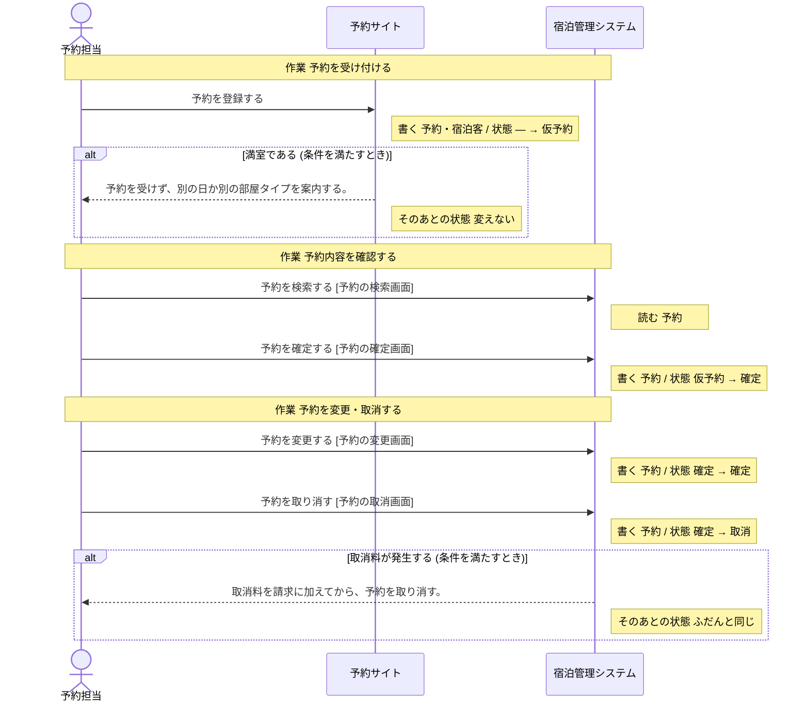
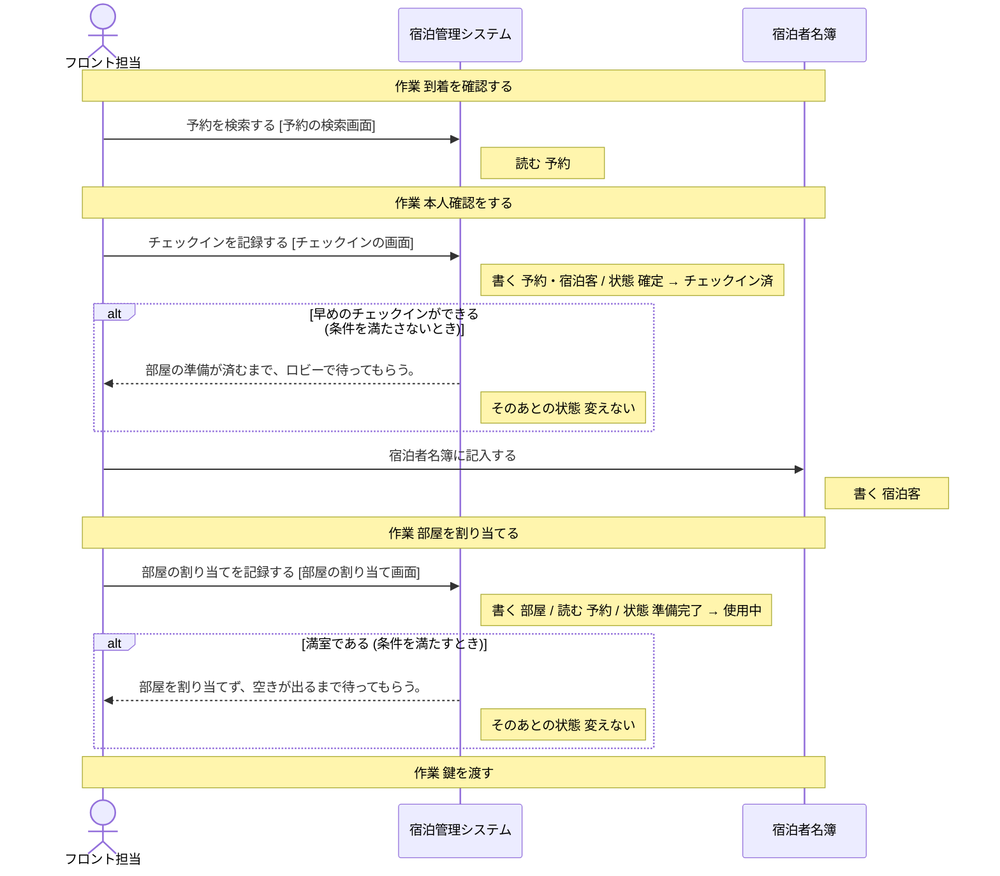
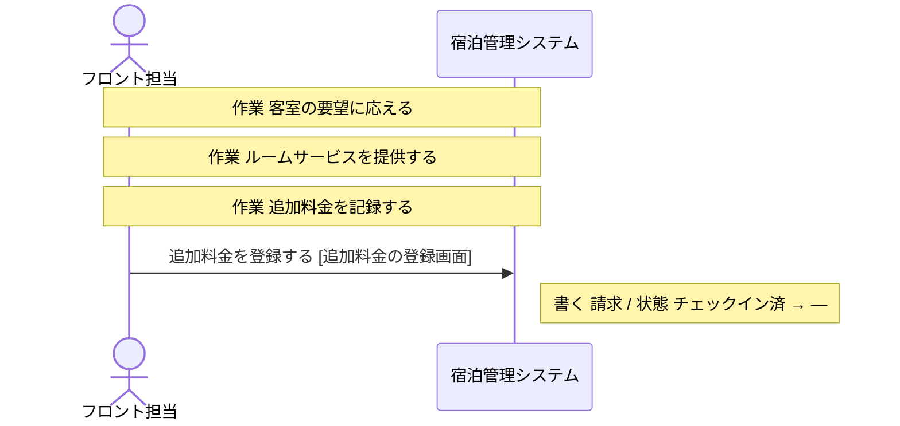
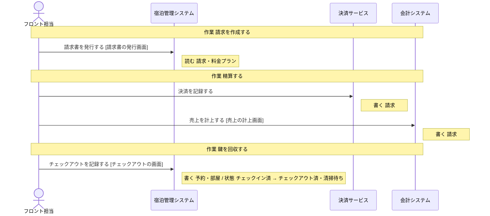
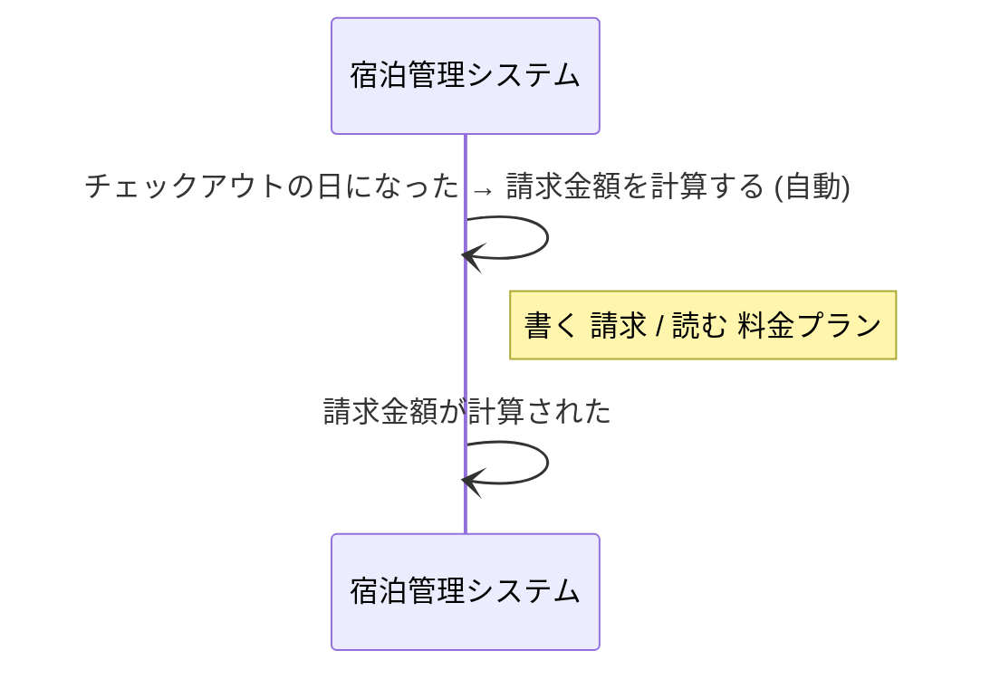

# 宿泊管理システム の設計 (untie から書き出したもの)

## 操作

### 予約を確定する
- 画面: 予約の確定画面
- 情報: 予約 (取得・保存)
- 状態: 仮予約 → 確定

### 予約を検索する
- 画面: 予約の検索画面
- 情報: 予約 (取得)

### 予約を変更する
- 画面: 予約の変更画面
- 情報: 予約 (取得・保存)
- 状態: 確定 → 確定

### 予約を取り消す
- 画面: 予約の取消画面
- 情報: 予約 (取得・保存)
- 状態: 確定 → 取消
- 条件: 取消料が発生する (満たすとき: 取消料を請求に加えてから、予約を取り消す。 そのあとの状態: ふだんと同じ)

### チェックインを記録する
- 画面: チェックインの画面
- 情報: 予約 (取得・保存)
- 情報: 宿泊客 (取得・保存)
- 状態: 確定 → チェックイン済
- 条件: 早めのチェックインができる (満たさないとき: 部屋の準備が済むまで、ロビーで待ってもらう。 そのあとの状態: 変えない)

### 部屋の割り当てを記録する
- 画面: 部屋の割り当て画面
- 情報: 部屋 (取得・保存)
- 情報: 予約 (取得)
- 状態: 準備完了 → 使用中
- 条件: 満室である (満たすとき: 部屋を割り当てず、空きが出るまで待ってもらう。 そのあとの状態: 変えない)

### 請求金額を計算する
- 情報: 請求 (取得・保存)
- 情報: 料金プラン (取得)
- 起きる出来事: 請求金額が計算された

### 追加料金を登録する
- 画面: 追加料金の登録画面
- 情報: 請求 (取得・保存)
- 状態: チェックイン済 → —

### 請求書を発行する
- 画面: 請求書の発行画面
- 情報: 請求 (取得)
- 情報: 料金プラン (取得)

### チェックアウトを記録する
- 画面: チェックアウトの画面
- 情報: 予約 (取得・保存)
- 情報: 部屋 (取得・保存)
- 状態: チェックイン済 → チェックアウト済・清掃待ち

## 業務の流れ (シーケンス図)

### 予約受付

### チェックイン

### 滞在中の対応

### チェックアウト

### 自動の処理 (業務に属さないもの)

## 実装を始める準備

- [x] 分析に抜けが無い
- [x] このシステムで行う操作がある
- [x] 操作が扱う情報が決まっている
- [ ] 情報と出来事の出どころが決まっている: 情報「料金プラン」を保存する操作がありません (取得するだけで、どこで作られるかが決まっていない)
- [x] 条件と区分の中身が決まっている
- [x] 状態の移り変わりがつながっている
- [x] 業務の流れが決まっている
- [ ] データの置き場所が決まっている: このシステムの設計がまだありません
- [ ] 画面がそろっている: このシステムの設計がまだありません
- [x] 画面の行き来が決まっている
